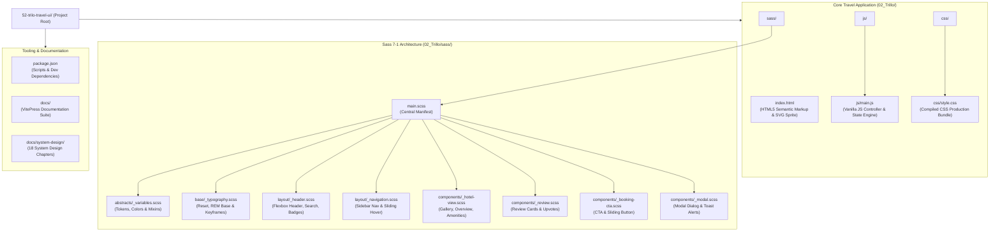

# 00. Project Map & Architecture Scan



---

## 1. Complete Repository Folder Tree

```text
52-trilo-travel-ui/
├── .DS_Store                             # macOS file system metadata (excluded in git)
├── .git/                                 # Git version control metadata directory
├── .gitattributes                        # Git line-ending and repository attributes
├── 02_Trillo/                            # Core Trillo travel web application directory
│   ├── .DS_Store                         # macOS folder attributes
│   ├── css/                              # Production compiled CSS directory
│   │   └── style.css                     # Zero-dependency compiled production stylesheet (650 lines)
│   ├── index.html                        # Main HTML5 application document with inline SVG sprite (260 lines)
│   ├── js/                               # Client JavaScript directory
│   │   └── main.js                       # Modular IIFE application controller and state engine (390 lines)
│   └── sass/                             # Source Sass (SCSS) preprocessor directory (7-1 pattern)
│       ├── abstracts/                    # Global tokens, variables, and mixins
│       │   └── _variables.scss           # Design tokens, color palette, shadows, and responsive mixins
│       ├── base/                         # Fundamental HTML resets and typography definitions
│       │   └── _typography.scss          # Box sizing reset, 62.5% font scaling, Open Sans, pulsate keyframes
│       ├── components/                   # Discrete, reusable UI component partials
│       │   ├── _booking-cta.scss         # Call-to-action booking banner and 2-state sliding button
│       │   ├── _hotel-view.scss          # Photo gallery hover zoom, overview bar, description, amenities list
│       │   ├── _modal.scss               # Glassmorphism booking modal, form controls, dropdowns, and toast
│       │   └── _review.scss              # User review cards, quotation mark pseudo-elements, upvotes
│       ├── layout/                       # Macro-layout structure partials
│       │   ├── _header.scss              # Header container, logo, expandable search, user notifications
│       │   └── _navigation.scss          # Sidebar navigation, sliding hover indicator, copyright text
│       └── main.scss                     # Master Sass manifest compiling all partials in order
├── 02_Trillo.zip                         # Archived project bundle
├── docs/                                 # Complete technical documentation suite (VitePress site)
│   ├── .vitepress/                       # VitePress theme, plugins, and navigation configuration
│   │   ├── config.js                     # Main VitePress configuration with Mermaid integration
│   │   └── theme/                        # Custom Pure Black theme definitions
│   │       ├── custom.css                # Dark mode pure black styling overrides
│   │       └── index.js                  # Theme registration file
│   ├── features/                         # Deep-dive breakdown of features F1 through F10
│   ├── system-design/                    # Complete 18-chapter system design curriculum
│   ├── 00-project-map.md                 # Project scan, folder tree, and dependencies map
│   ├── 00-project-type.md                # Project type detection and evidence
│   ├── 00a-project-analysis.md           # Full feature trace and component inventory
│   ├── 00b-project-pitch.md              # 30-second and 2-minute spoken interview elevator pitch
│   ├── 01-features.md                    # Comprehensive feature inventory overview
│   ├── 02-build-order.md                 # Step-by-step rebuild order from scratch
│   ├── 03-api-reference.md               # Web platform APIs, DOM event signatures, and catalog API
│   ├── 04-tech-comparisons.md            # Exhaustive technology trade-off comparison tables
│   ├── 05-architecture.md                # High-level architecture, data flows, and scaling
│   ├── 06-security.md                    # Client-side security audit and OWASP Top 10 mapping
│   ├── 07-ai-integration.md              # Proposed Travel Concierge LLM API architecture
│   ├── 08-quality-and-ops.md             # Testing, code quality, CWV, and deployment setup
│   ├── 09-interview-qa.md                # 150+ project-specific technical interview questions
│   ├── 10-gaps-and-improvements.md       # Known gaps, missing features, and recommended fixes
│   ├── 11-glossary.md                    # Technical glossary defining terms simply
│   ├── 12-confirm-list.md                # List of developer confirmation items
│   ├── 13-master-checklist.md            # Complete 275-item master checklist with coverage status
│   ├── 14-say-it-out-loud.md             # Master rehearsal script for all feature spoken answers
│   ├── index.md                          # VitePress documentation portal landing page
│   └── README.md                         # Master reading index and documentation guide
├── index.html                            # Root HTML redirector forwarding directly to 02_Trillo/index.html
├── node_modules/                         # Node devDependencies directory
├── package.json                          # Project manifest, npm run scripts, and dev dependencies
└── package-lock.json                     # Deterministic dependency lockfile
```

---

## 2. Technology Stack & Exact Versions

| Layer / Tool | Technology | Exact Version | Purpose & Functionality |
| :--- | :--- | :---: | :--- |
| **Markup Language** | HTML5 Standard | W3C Recommendation | Semantic document structure, accessibility landmarks, inline SVG sprite definitions. |
| **Styling Language** | CSS3 & Sass (SCSS) | CSS3 / SCSS | Custom properties, Flexbox layout, keyframe animations, 7-1 modular preprocessing. |
| **Scripting Language** | ECMAScript 2022+ | ES6+ Standard | Client-side DOM manipulation, event delegation, LocalStorage persistence, state engine. |
| **Documentation Engine**| VitePress | `^1.6.4` | Vite-powered static site generator producing the documentation portal. |
| **Diagramming Plugin** | VitePress Plugin Mermaid | `^2.0.17` | Direct rendering of Mermaid sequence, flowchart, and ER diagrams inside markdown. |
| **Diagram Engine** | Mermaid.js | `^11.17.2` | Core syntax parser for client-rendered technical diagrams. |
| **Local Web Server** | Serve | `^14.2.6` | Lightweight static web server for testing production builds locally. |
| **Node.js Runtime** | Node.js | `v22.23.2` | Local developer execution environment for running documentation and build scripts. |
| **Package Manager** | npm | `10.9.8` | Deterministic package management and script execution. |

---

## 3. Dependency Inventory (`package.json`)

```json
{
  "name": "trilo-travel-ui",
  "version": "1.0.0",
  "description": "Modern travel booking destination explorer & flight interface built with Sass 7-1 pattern and modern Vanilla JS",
  "type": "module",
  "scripts": {
    "start": "npx serve -l 5183 .",
    "docs:dev": "vitepress dev docs --port 5184",
    "docs:build": "vitepress build docs",
    "docs:preview": "vitepress preview docs --port 5184"
  },
  "devDependencies": {
    "mermaid": "^11.17.2",
    "serve": "^14.2.6",
    "vitepress": "^1.6.4",
    "vitepress-plugin-mermaid": "^2.0.17"
  }
}
```

### DevDependencies Breakdown
1. **`vitepress` (`^1.6.4`)**: Generates Vue.js-style static documentation with built-in dark mode, instant search, and code highlighting.
2. **`vitepress-plugin-mermaid` (`^2.0.17`)**: Wraps VitePress configuration with `withMermaid` to render real interactive SVG diagrams.
3. **`mermaid` (`^11.17.2`)**: The underlying diagramming engine transforming text declarations into visual flowcharts.
4. **`serve` (`^14.2.6`)**: Provides a zero-configuration HTTP file server with CORS and clean routing for previewing `02_Trillo/` locally.

---

## 4. Environment Variables & Secrets Audit

- **Environment Variables**: **None required**.
- **Reasoning**: Trillo is an entirely client-side web application running directly within the user's browser. It has no backend API keys, database connection strings, or cloud secrets.
- **Security Posture**: By design, zero secrets are bundled or exposed in client JavaScript files.

---

## 5. Third-Party Services & External CDNs

| Service | Provider | Resource Loaded | Code Reference | Fallback Strategy |
| :--- | :--- | :--- | :--- | :--- |
| **Google Fonts** | Google Inc. | `Open Sans` (weights 300, 400, 600, 700) | [`02_Trillo/index.html:12-14`](file:///Users/avishjain/avishjain9-repos/52-trilo-travel-ui/02_Trillo/index.html#L12-L14) | System font stack fallback (`-apple-system, BlinkMacSystemFont, Segoe UI, Roboto, Helvetica, Arial, sans-serif`). |
| **Unsplash Images** | Unsplash Inc. | High-res travel photography and user avatars | [`02_Trillo/index.html:86, 114, 153`](file:///Users/avishjain/avishjain9-repos/52-trilo-travel-ui/02_Trillo/index.html#L86) | Alt tags provided for screen readers; gracefully handled by browser cache. |

---

## 6. Application Entry Points

1. **User Client Entry**:
   - [`02_Trillo/index.html`](file:///Users/avishjain/avishjain9-repos/52-trilo-travel-ui/02_Trillo/index.html): Primary single-page HTML document loaded by the browser.
   - [`index.html`](file:///Users/avishjain/avishjain9-repos/52-trilo-travel-ui/index.html): Root redirector forwarding traffic to `02_Trillo/index.html`.
2. **JavaScript Controller Entry**:
   - [`02_Trillo/js/main.js`](file:///Users/avishjain/avishjain9-repos/52-trilo-travel-ui/02_Trillo/js/main.js): Loaded via `<script defer src="js/main.js"></script>`, executing the `init()` routine on `DOMContentLoaded`.
3. **Style Preprocessing Entry**:
   - [`02_Trillo/sass/main.scss`](file:///Users/avishjain/avishjain9-repos/52-trilo-travel-ui/02_Trillo/sass/main.scss): Primary SCSS manifest compiling all partials into `02_Trillo/css/style.css`.
4. **Documentation Portal Entry**:
   - `docs/index.md` & `docs/.vitepress/config.js`: Executed via `npm run docs:dev` on port `5184`.
