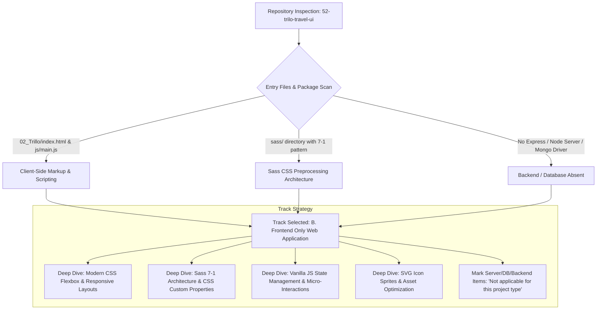

# 00. Project Type Classification & Track Selection

---

## 1. Project Type Determination

**Detected Project Type**: **`B. Frontend only`** (Modern Travel Destination Explorer & Luxury Booking UI).

### Concrete Code Evidence

1. **Client-Side Document Root**:
   - `02_Trillo/index.html`: Contains standard HTML5 document structure, embedded retina SVG icon sprite `<svg><symbol id="..."></symbol></svg>`, Google Fonts typography integration (`Open Sans`), and semantic elements (`<header class="header">`, `<nav class="sidebar">`, `<main class="hotel-view">`).
   - `index.html` (root): Lightweight browser redirect forwarder to `02_Trillo/index.html`.

2. **Styling & Preprocessing Architecture**:
   - `02_Trillo/sass/`: Implements the industry-standard **Sass 7-1 pattern**:
     - `sass/abstracts/_variables.scss`: SCSS variables and CSS custom properties (`--color-primary: #eb2f64`, `--shadow-dark`, responsive mixins `@mixin respond`).
     - `sass/base/_typography.scss`: CSS reset, REM base scaling (`62.5%` for 10px calculation), heading typography hierarchy, and keyframe animations (`@keyframes pulsate`).
     - `sass/layout/_header.scss`: Flexbox header container, logo micro-interactions, expandable focus-driven search bar, and user notification chips with badge animations.
     - `sass/layout/_navigation.scss`: Sidebar navigation list with dynamic sliding indicator `:before` animations (`cubic-bezier(1, 0, 0, 1)`).
     - `sass/components/_hotel-view.scss`: 3-column photo gallery zoom on hover, hotel overview ratings bar, responsive detail grid, amenities checkmark list, and social proof friend avatar pile.
     - `sass/components/_review.scss`: Card-based customer reviews with decorative pseudo-element quotation marks (`\201C`), rating badges, and helpful reaction buttons.
     - `sass/components/_booking-cta.scss`: Call to action banner with animated two-state sliding button (`.btn__visible` / `.btn__invisible`).
     - `sass/components/_modal.scss`: Accessible modal overlay, checkout form, price calculator summary, and floating toast notifications.
     - `sass/main.scss`: Centralized Sass manifest importing abstracts, base, layout, and components.
   - `02_Trillo/css/style.css`: Clean compiled CSS production bundle ready for zero-dependency standalone execution in any web browser.

3. **Client-Side Logic & State Engine**:
   - `02_Trillo/js/main.js`: Self-executing IIFE encapsulating:
     - Multi-tab travel booking explorer (`hotel`, `flight`, `car-rental`, `tours`) with catalog registry.
     - Real-time search query filtering over destination names, locations, and amenity tags.
     - Live interactive booking modal with date selection, room tier switching, and instant price calculator (`recalculateBookingTotal()`).
     - Dropdown navigation panels for saved bookmarks and concierge chat.
     - Review helpfulness upvoting with browser `localStorage` persistence.
     - Global toast feedback dispatching.

4. **Absence of Server / Database**:
   - No `server.js`, `app.js`, Express router, Mongoose schema, SQL migration, or Docker container for backend runtimes.
   - Node ecosystem (`package.json`) is utilized strictly for frontend development tooling: VitePress static documentation generation (`vitepress`), Mermaid diagram compilation (`vitepress-plugin-mermaid`), and local static preview serving (`serve`).

---

## 2. Adaptation Matrix & Prompt Track Rules

In accordance with **RULE 8 (ADAPT TO THE PROJECT TYPE)**:

| Category | Applicability | Documentation Strategy |
| :--- | :--- | :--- |
| **Frontend Architecture & DOM** | **Active & Deep** | Fully document layout patterns, Flexbox container mechanics, SVG sprite systems, Sass 7-1 modularity, CSS custom properties, and Vanilla JS event pipelines. |
| **State Management & Local Persistence** | **Active & Deep** | Document the centralized UI state object, DOM cache selectors, `localStorage` synchronization for review upvotes, and modal state machines. |
| **Responsive Design & Media Queries** | **Active & Deep** | Analyze mobile-first vs desktop-first breakpoints (`31.25em`, `37.5em`, `56.25em`, `68.75em`, `75em`), REM font scaling, and flex wrap transformations. |
| **Backend / Express / Node Server** | **Not Applicable** | Formally marked as *"Not applicable for this project type (Frontend-only client application with zero server runtime)"*. |
| **Database / MongoDB / Mongoose** | **Not Applicable** | Formally marked as *"Not applicable for this project type (Static UI architecture with in-memory catalog data and client browser storage)"*. |
| **REST / HTTP Server APIs** | **Not Applicable (Substituted)** | Document the Web Platform browser APIs (DOM Level 3 Events, LocalStorage API, History API, Window Dimensions) and the client-side destination data catalog API. |
| **Custom AI Model Training** | **Not Applicable** | Marked *"No custom model trained"*; document the proposed Pre-trained Travel Concierge LLM API integration architecture in Step 8. |
| **System Design** | **Active & Adapted** | Focus on client-side asset delivery, CDN edge caching, critical rendering path optimization, font loading strategies, SVG compression, and horizontal scaling if connected to a headless booking gateway. |

---

## 3. Evidence File Verification Table

| File Path | Lines of Code | Purpose & Functionality |
| :--- | :---: | :--- |
| [`02_Trillo/index.html`](file:///Users/avishjain/avishjain9-repos/52-trilo-travel-ui/02_Trillo/index.html) | 260 | Semantic HTML5 markup, SVG icon symbols, navigation, gallery, details, reviews, modal, and toast. |
| [`02_Trillo/js/main.js`](file:///Users/avishjain/avishjain9-repos/52-trilo-travel-ui/02_Trillo/js/main.js) | 390 | Vanilla JS controller: catalog registry, tab switching, search filter, price calculator, modal, and `localStorage`. |
| [`02_Trillo/sass/main.scss`](file:///Users/avishjain/avishjain9-repos/52-trilo-travel-ui/02_Trillo/sass/main.scss) | 16 | Central Sass import manifest following the 7-1 architecture pattern. |
| [`02_Trillo/sass/abstracts/_variables.scss`](file:///Users/avishjain/avishjain9-repos/52-trilo-travel-ui/02_Trillo/sass/abstracts/_variables.scss) | 65 | CSS custom properties, color tokens, elevation shadows, animation curves, and responsive mixins. |
| [`02_Trillo/sass/base/_typography.scss`](file:///Users/avishjain/avishjain9-repos/52-trilo-travel-ui/02_Trillo/sass/base/_typography.scss) | 85 | Base reset, 62.5% REM scaling, Open Sans font integration, pulsate animations, and utility buttons. |
| [`02_Trillo/sass/layout/_header.scss`](file:///Users/avishjain/avishjain9-repos/52-trilo-travel-ui/02_Trillo/sass/layout/_header.scss) | 160 | Header flexbox layout, logo animations, animated search bar, and user notification chips. |
| [`02_Trillo/sass/layout/_navigation.scss`](file:///Users/avishjain/avishjain9-repos/52-trilo-travel-ui/02_Trillo/sass/layout/_navigation.scss) | 100 | Sidebar navigation bar, sliding hover pseudo-element indicators, and copyright footer. |
| [`02_Trillo/sass/components/_hotel-view.scss`](file:///Users/avishjain/avishjain9-repos/52-trilo-travel-ui/02_Trillo/sass/components/_hotel-view.scss) | 225 | Gallery photo zoom, hotel overview rating bar, details grid, amenities checklist, and friend avatars. |
| [`02_Trillo/sass/components/_review.scss`](file:///Users/avishjain/avishjain9-repos/52-trilo-travel-ui/02_Trillo/sass/components/_review.scss) | 120 | Review quote card, decorative pseudo-element quotation marks, user rating pill, and helpful upvote button. |
| [`02_Trillo/sass/components/_booking-cta.scss`](file:///Users/avishjain/avishjain9-repos/52-trilo-travel-ui/02_Trillo/sass/components/_booking-cta.scss) | 80 | Call-to-action booking banner and two-state sliding hover button animation. |
| [`02_Trillo/sass/components/_modal.scss`](file:///Users/avishjain/avishjain9-repos/52-trilo-travel-ui/02_Trillo/sass/components/_modal.scss) | 185 | Glassmorphism modal backdrop, reservation input controls, dropdown panels, and toast alerts. |
| [`02_Trillo/css/style.css`](file:///Users/avishjain/avishjain9-repos/52-trilo-travel-ui/02_Trillo/css/style.css) | 650 | Compiled zero-dependency CSS bundle supporting modern browsers. |
| [`package.json`](file:///Users/avishjain/avishjain9-repos/52-trilo-travel-ui/package.json) | 28 | Project metadata, build scripts (`docs:dev`, `docs:build`), and VitePress dev dependencies. |
