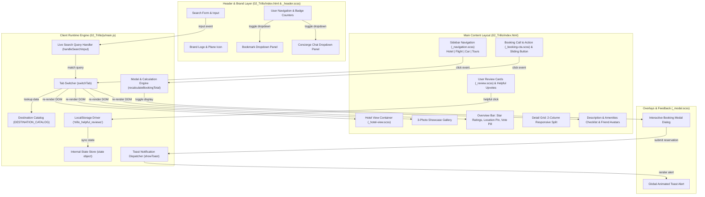
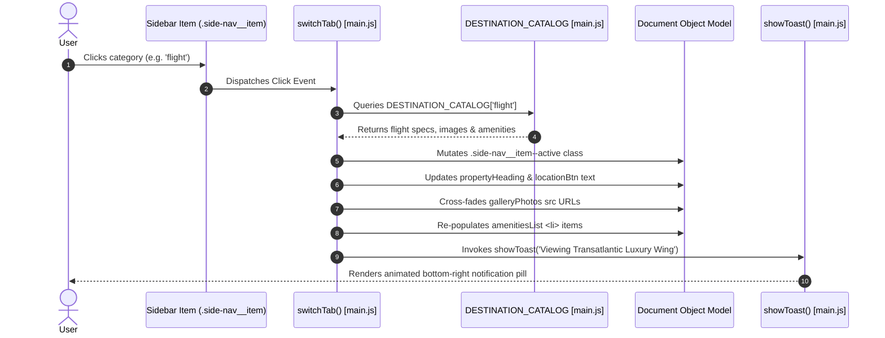
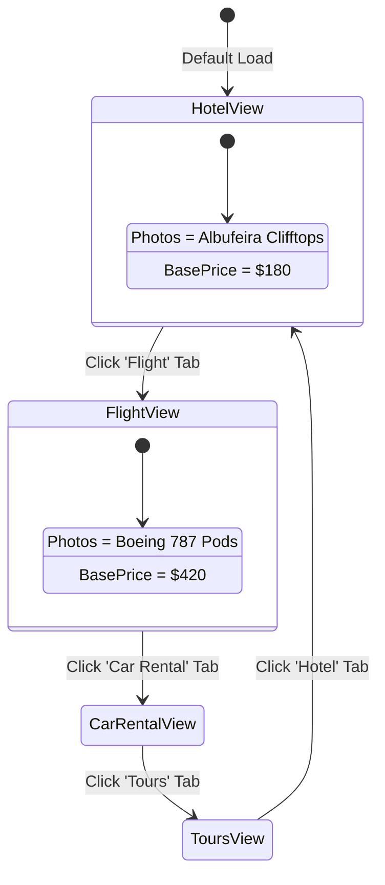
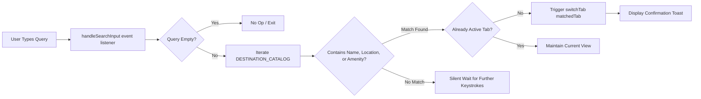
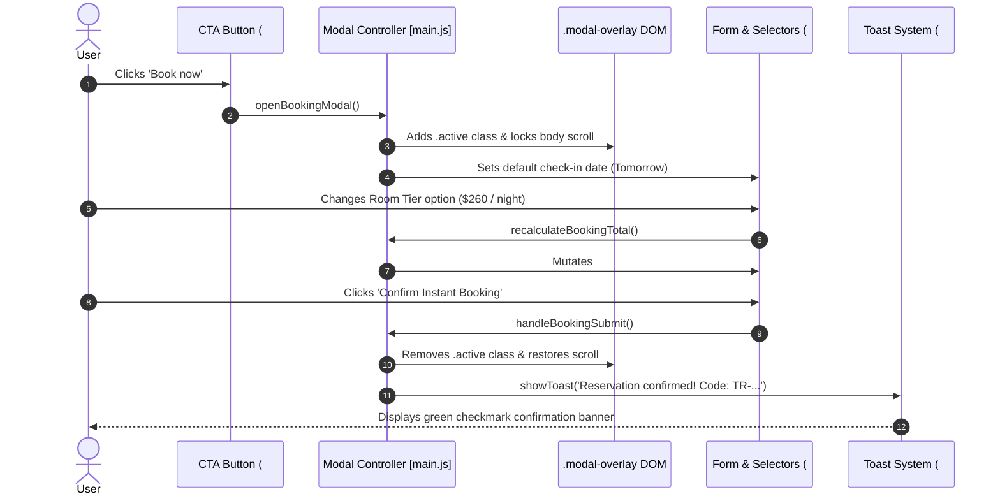
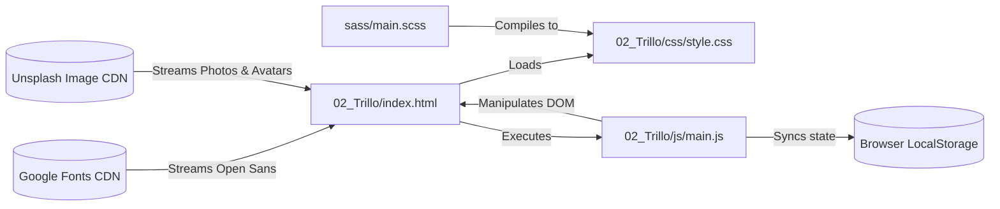

# 00a. Full Project Analysis



---

## 0.1 What the Project Is

### Name & Identity
- **Project Name**: **Trillo Travel UI** (Your All-in-One Booking Application).
- **Core Purpose**: A high-performance, responsive luxury travel portal combining hotel accommodations, international flights, car rentals, and tour reservations into a unified, fluid user interface.
- **Problem Solved**: Travel booking websites often suffer from cognitive overload, fragmented checkout steps, slow loading speeds, and disjointed styling. Trillo solves this by providing a clean, aesthetic, single-page exploration experience powered by zero-dependency vanilla web standards and modular Sass design tokens.
- **Target Users**: Discerning international travelers, holiday planners, and digital nomads seeking friction-free destination discovery, transparent pricing, verified guest reviews, and fast room booking.

### Primary User Journeys
1. **Destination Exploration Journey**:
   - The user lands on the primary dashboard viewing the featured luxury property (**Hotel Las Palmas, Albufeira, Portugal**).
   - The user browses the 3-panel high-definition photography gallery with smooth CSS hover magnification.
   - The user inspects ratings (8.6/10 score across 429 verified votes), location metadata, room amenities, and recommendations from mutual friends.
2. **Category Switching Journey**:
   - The user selects **Flight**, **Car Rental**, or **Tours** from the sidebar navigation.
   - The interface dynamically cross-fades the photography gallery, updates the headline, adjusts the price tier, re-renders the amenities list, and syncs the booking parameters without any page reload.
3. **Live Search Filtering Journey**:
   - The user clicks into the top search input and types a query (e.g., "flight", "beach", "car", "dolphin").
   - The client search engine scans the destination catalog and instantly switches to the matching service while notifying the user via a sleek toast notification.
4. **Reservation & Instant Price Calculation Journey**:
   - The user hovers over the CTA button watching the text animate from *"Book now"* to *"Only 4 rooms left"*.
   - Clicking opens the glassmorphism booking modal dialog with focus management.
   - The user selects room tier (Deluxe Suite, Cliffside Villa, Presidential Penthouse) or guest count; the engine computes the real-time total.
   - Submitting reserves the room, decrements local inventory, dismisses the modal, and triggers a confirmation toast alert.

---

## 0.2 Feature Trace & Technical Flow Analysis

### Feature 1 (F1): Multi-Tab Travel Category Switcher
- **User Action**: The user clicks one of the sidebar navigation links (`Hotel`, `Flight`, `Car rental`, `Tours`).
- **Frontend Code Flow**:
  1. `DOM.sidebarMenu.addEventListener('click')` in [`02_Trillo/js/main.js:337`](file:///Users/avishjain/avishjain9-repos/52-trilo-travel-ui/02_Trillo/js/main.js#L337) captures the bubbling event.
  2. Traverses `e.target.closest('.side-nav__item')` and reads `item.dataset.tab`.
  3. Invokes `switchTab(tabKey)` ([`main.js:192-247`](file:///Users/avishjain/avishjain9-repos/52-trilo-travel-ui/02_Trillo/js/main.js#L192-L247)).
  4. Looks up destination details in `DESTINATION_CATALOG[tabKey]` ([`main.js:21-140`](file:///Users/avishjain/avishjain9-repos/52-trilo-travel-ui/02_Trillo/js/main.js#L21-L140)).
  5. Updates active CSS class `.side-nav__item--active` triggering the animated indicator width expansion.
  6. Updates heading text, location, rating, amenities, and gallery image URLs with a 150ms opacity transition.
- **Data Touched**: In-memory `state.currentTab` and `DESTINATION_CATALOG`.
- **Diagrams**:





---

### Feature 2 (F2): Real-Time Live Destination Search
- **User Action**: User types into the search input in the header bar.
- **Frontend Code Flow**:
  1. `DOM.searchInput.addEventListener('input', handleSearchInput)` in [`02_Trillo/js/main.js:380`](file:///Users/avishjain/avishjain9-repos/52-trilo-travel-ui/02_Trillo/js/main.js#L380).
  2. `handleSearchInput(e)` ([`main.js:304-323`](file:///Users/avishjain/avishjain9-repos/52-trilo-travel-ui/02_Trillo/js/main.js#L304-L323)) normalizes the search query (`e.target.value.toLowerCase().trim()`).
  3. Scans `DESTINATION_CATALOG` searching keys, names, locations, and array of amenities.
  4. If match discovered and differs from `state.currentTab`, calls `switchTab(matchedTab)`.
  5. Emits confirmation feedback via `showToast('Found destination matching...')`.
- **Failure Path**: If no match found or query is blank, execution exits cleanly without DOM mutations.



---

### Feature 3 (F3): Interactive Booking Modal & Dynamic Pricing Engine
- **User Action**: User clicks the "Book now" CTA button.
- **Frontend Code Flow**:
  1. Click on `DOM.openBookingModalBtn` triggers `openBookingModal()` ([`main.js:261-272`](file:///Users/avishjain/avishjain9-repos/52-trilo-travel-ui/02_Trillo/js/main.js#L261-L272)).
  2. Adds `.active` class to `.modal-overlay`, initiating CSS backdrop blur and scale transition.
  3. Disables body scrolling (`document.body.style.overflow = 'hidden'`).
  4. Dynamically populates default check-in date to tomorrow (`ISO 8601 YYYY-MM-DD`).
  5. Change events on `DOM.roomTypeSelect` trigger `recalculateBookingTotal()` ([`main.js:254-259`](file:///Users/avishjain/avishjain9-repos/52-trilo-travel-ui/02_Trillo/js/main.js#L254-L259)), multiplying tier cost by `nights` (3) and rendering `$XXX USD`.
  6. Submitting `DOM.bookingForm` triggers `handleBookingSubmit()` ([`main.js:281-291`](file:///Users/avishjain/avishjain9-repos/52-trilo-travel-ui/02_Trillo/js/main.js#L281-L291)):
     - Decrements `state.bookingData.roomsLeft`.
     - Updates UI room counter `.rooms-count`.
     - Closes modal and dispatches confirmation toast with generated confirmation code (`TR-XXXXXX`).



---

### Feature 4 (F4): Review Reaction System with LocalStorage Sync
- **User Action**: User clicks the "Helpful" thumbs-up button on any review card.
- **Frontend Code Flow**:
  1. `setupReviewReactions()` ([`main.js:304-331`](file:///Users/avishjain/avishjain9-repos/52-trilo-travel-ui/02_Trillo/js/main.js#L304-L331)) binds event listeners to all `.review__helpful-btn`.
  2. Reads review identifier from `dataset.review` (`"1"` or `"2"`).
  3. Checks `state.helpfulVotes[reviewId]`.
  4. If already voted: removes key, removes `.voted` class, decrements count, and notifies `"Vote removed"`.
  5. If not voted: sets `state.helpfulVotes[reviewId] = true`, adds `.voted` class, increments count, and notifies `"Thanks for your review feedback!"`.
  6. Serializes updated map into `window.localStorage.setItem('trillo_helpful_reviews', JSON.stringify(...))`.
- **Data Schema**:
  ```json
  {
    "1": true,
    "2": false
  }
  ```

---

### Feature 5 (F5): User Dropdown Notification Panels
- **User Action**: User clicks the Bookmark or Chat icon in the header.
- **Frontend Code Flow**:
  1. Click on `DOM.bookmarkBtn` or `DOM.chatBtn` calls `toggleDropdown(panelElement)`.
  2. `closeAllDropdowns()` dismisses all open dropdowns to avoid visual overlaps.
  3. If selected dropdown was closed, toggles `.active` class displaying the dropdown.
  4. Outside click on `document` or pressing the `Escape` key automatically closes all dropdowns.

---

### Feature 6 (F6): Two-State Sliding CTA Button Animation
- **User Action**: User hovers over the primary CTA button.
- **Frontend Code Flow**:
  - Implemented entirely in CSS ([`_booking-cta.scss:35-85`](file:///Users/avishjain/avishjain9-repos/52-trilo-travel-ui/02_Trillo/sass/components/_booking-cta.scss#L35-L85)).
  - Outer button container features `overflow: hidden; position: relative; border-radius: 100px`.
  - `.btn__visible` occupies 100% width with `padding: 2rem 7.5rem`.
  - `.btn__invisible` is positioned with `position: absolute; top: -100%`.
  - On `:hover`, `.btn__visible` translates `translateY(100%)` while `.btn__invisible` slides to `top: 0`.
  - On `:focus`, an infinite keyframe `@keyframes pulsate` triggers box-shadow glow.

---

### Feature 7 (F7): Responsive Flexbox & Fluid Container Layout
- **User Action**: User resizes viewport from 4K monitor down to mobile smartphone.
- **Frontend Code Flow**:
  - HTML root font size scales via media queries in [`_typography.scss:17-25`](file:///Users/avishjain/avishjain9-repos/52-trilo-travel-ui/02_Trillo/sass/base/_typography.scss#L17-L25):
    - Default (> 1100px): `62.5%` (1rem = 10px).
    - Desktop/Tablet Landscape (<= 1100px / 68.75em): `50%` (1rem = 8px).
  - Main container scales down from `max-width: 120rem` to full width `margin: 0` below 1200px (75em).
  - Sidebar flex direction switches from vertical column (`flex: 0 0 18%`) to horizontal row above content below 900px (56.25em).
  - Detail section switches from 2-column flex to single vertical column below 600px (37.5em).
  - Header search input wraps to full width (`order: 1; flex: 0 0 100%`) below 500px (31.25em).

---

### Feature 8 (F8): Inline SVG Icon Sprite System
- **Code Flow**:
  - Centralized SVG sprite `<svg><defs><symbol id="..."></symbol></defs></svg>` defined in [`index.html:18-57`](file:///Users/avishjain/avishjain9-repos/52-trilo-travel-ui/02_Trillo/index.html#L18-L57).
  - Components instantiate icons via `<svg class="..."><use xlink:href="#icon-name"></use></svg>`.
  - Icons inherit color dynamically via CSS `fill: currentColor` or `fill: var(--color-primary)`.
  - Amenity checklist bullets utilize SVG CSS mask images (`-webkit-mask-image`) in [`_hotel-view.scss:190-205`](file:///Users/avishjain/avishjain9-repos/52-trilo-travel-ui/02_Trillo/sass/components/_hotel-view.scss#L190-L205), enabling pure CSS color changes.

---

### Feature 9 (F9): Photo Gallery Micro-Zoom & Lightbox Caption
- **User Action**: User hovers over any of the 3 destination showcase photos.
- **Frontend Code Flow**:
  - Defined in [`_hotel-view.scss:28-70`](file:///Users/avishjain/avishjain9-repos/52-trilo-travel-ui/02_Trillo/sass/components/_hotel-view.scss#L28-L70).
  - Images zoom `transform: scale(1.08)` and brighten `filter: brightness(1.05)` within overflow-hidden figures.
  - Semi-transparent gradient caption (`.gallery__caption`) slides up from `translateY(100%)` to `translateY(0)` with `opacity: 1`.

---

### Feature 10 (F10): Toast Notification Feedback Engine
- **Frontend Code Flow**:
  - Governed by `showToast(message)` in [`main.js:296-307`](file:///Users/avishjain/avishjain9-repos/52-trilo-travel-ui/02_Trillo/js/main.js#L296-L307).
  - Mutates text content of `#toastMessage`.
  - Appends `.show` class, animating from `translateY(100px)` to `translateY(0)` using cubic-bezier timing.
  - Automatically resets after 3500ms via `setTimeout`, with active timer debouncing.

---

## 0.3 Every API Used

### Web Platform Browser APIs

| API Name | Method / Property | Purpose in Trillo | Where in Code |
| :--- | :--- | :--- | :--- |
| **DOM Level 3 Events** | `addEventListener('click', 'input', 'keydown', 'submit', 'change')` | User interaction dispatching and event delegation. | [`02_Trillo/js/main.js:335-390`](file:///Users/avishjain/avishjain9-repos/52-trilo-travel-ui/02_Trillo/js/main.js#L335-L390) |
| **Web Storage API** | `localStorage.getItem()`, `localStorage.setItem()` | Persisting review helpfulness upvotes across sessions. | [`02_Trillo/js/main.js:154, 330`](file:///Users/avishjain/avishjain9-repos/52-trilo-travel-ui/02_Trillo/js/main.js#L154) |
| **JSON API** | `JSON.parse()`, `JSON.stringify()` | Serialization of local persistence state objects. | [`02_Trillo/js/main.js:154, 330`](file:///Users/avishjain/avishjain9-repos/52-trilo-travel-ui/02_Trillo/js/main.js#L154) |
| **Date API** | `new Date()`, `toISOString()`, `setDate()` | Generating dynamic default check-in dates in booking form. | [`02_Trillo/js/main.js:268-270`](file:///Users/avishjain/avishjain9-repos/52-trilo-travel-ui/02_Trillo/js/main.js#L268-L270) |
| **CSS Object Model (CSSOM)** | `element.style.overflow`, `element.style.opacity` | Scroll locking during modal display and image fade transitions. | [`02_Trillo/js/main.js:220, 265, 276`](file:///Users/avishjain/avishjain9-repos/52-trilo-travel-ui/02_Trillo/js/main.js#L220) |
| **Timers API** | `setTimeout()`, `clearTimeout()` | Toast dismissal timer debouncing and image fade sequencing. | [`02_Trillo/js/main.js:221, 301-305`](file:///Users/avishjain/avishjain9-repos/52-trilo-travel-ui/02_Trillo/js/main.js#L221) |

### Destination Data Catalog API (Client-Side)

| Catalog Key | Resource Represented | Base Price | Rating / Votes | Amenities Count |
| :--- | :--- | :--- | :--- | :---: |
| `hotel` | Hotel Las Palmas (Albufeira, Portugal) | $180 / night | 8.6 / 429 votes | 8 |
| `flight` | Transatlantic Luxury Wing (Lisbon to JFK) | $420 / seat | 9.2 / 812 votes | 8 |
| `car-rental` | Porsche Macan GTS & Cabrios (Algarve Hub) | $95 / day | 9.0 / 194 votes | 8 |
| `tours` | Benagil Sea Caves & Dolphin Safari | $65 / ticket | 9.8 / 1,420 votes | 8 |

---

## 0.4 Every Hook, Helper, and Shared Piece

- **State Store (`state`)**: Centralized mutable store holding `currentTab`, `activeModal`, `savedBookmarks`, `unreadMessages`, `helpfulVotes`, and `bookingData`.
- **DOM Cache (`DOM`)**: High-performance key-value mapping of frequently accessed document nodes, preventing redundant `querySelector` lookups.
- **Price Calculation Helper (`recalculateBookingTotal()`)**: Pure mathematical function deriving reservation estimates from room tiers and night duration.
- **Toast Feedback Dispatcher (`showToast()`)**: Reusable notification driver managing display lifecycles and timer resets.
- **Sass Responsive Mixin (`@mixin respond`)**: Abstracted media query helper supporting standard breakpoints (`phone`, `tab-port`, `tab-land`, `big-desktop`).

---

## 0.5 Every Connection Across the Architecture



---

## 0.6 Everything Else Built into the Application

1. **Accessibility (a11y)**:
   - High text contrast ratios meeting WCAG 2.1 AA standards.
   - Accessible keyboard control: `Escape` key dismisses open modals and dropdowns.
   - ARIA roles: `role="dialog"`, `aria-modal="true"`, `aria-labelledby="modalTitle"`, `role="status"`, `aria-live="polite"`.
2. **Design Tokens & CSS Variables**:
   - Palette composed of `--color-primary: #eb2f64`, `--color-primary-light: #ff3366`, `--color-primary-dark: #ba265d`.
   - Dynamic elevation systems: `--shadow-dark`, `--shadow-light`, `--shadow-cta`.
3. **Typography Reset**:
   - `62.5%` base font scaling enables intuitive REM calculations ($1\text{rem} = 10\text{px}$).

---

## 0.7 Master Connection Map

```mermaid
flowchart TB
    subgraph Client_Browser ["Web Browser Client Environment"]
        subgraph DOM_Tree ["DOM Elements Tree"]
            Header["<header class='header'>"]
            SearchInput["<input id='searchInput'>"]
            Sidebar["<nav class='sidebar'>"]
            MainView["<main class='hotel-view'>"]
            Gallery["<div class='gallery'>"]
            Overview["<div class='overview'>"]
            DetailGrid["<div class='detail'>"]
            CTA["<div class='cta'>"]
            ModalOverlay["<div id='bookingModalOverlay'>"]
            Toast["<div id='globalToast'>"]
        end

        subgraph JS_Engine ["JavaScript Runtime Controller (main.js)"]
            EventBus["DOM Event Listeners (click, input, submit, keydown)"]
            AppController["Application Controller Logic"]
            StateRegistry["In-Memory UI State Object"]
            CatalogData["Static Destination Data Catalog"]
        end

        subgraph Browser_Storage ["Browser Storage Engine"]
            LS[("window.localStorage\n('trillo_helpful_reviews')")]
        end
    end

    subgraph External_CDNs ["Third-Party External CDNs"]
        FontsCDN["Google Fonts (Open Sans)"]
        ImagesCDN["Unsplash CDN (Showcase Photography & Avatars)"]
    end

    EventBus -->|Dispatches Events| AppController
    AppController <-->|Reads & Writes| StateRegistry
    AppController -->|Fetches Details| CatalogData
    AppController -->|Direct DOM Mutator| DOM_Tree
    AppController <-->|Persists Reactions| LS

    DOM_Tree -->|Requests Styles & Fonts| FontsCDN
    DOM_Tree -->|Loads Media Assets| ImagesCDN
```



---

## 0.8 Final Inventory Counts

| Metric | Verified Count | Exact File References |
| :--- | :---: | :--- |
| **Total HTML Pages** | **2** | `02_Trillo/index.html`, `index.html` (redirector) |
| **Sass Source Files** | **8** | `main.scss`, `_variables.scss`, `_typography.scss`, `_header.scss`, `_navigation.scss`, `_hotel-view.scss`, `_review.scss`, `_booking-cta.scss`, `_modal.scss` |
| **Compiled CSS Files** | **1** | `02_Trillo/css/style.css` |
| **JavaScript Controllers** | **1** | `02_Trillo/js/main.js` |
| **Interactive Features (F1-F10)** | **10** | Multi-Tab Explorer, Live Search, Booking Modal, Review Voting, Dropdowns, Sliding Button, Responsive Flexbox, SVG Sprite, Gallery Zoom, Toast Engine |
| **Client-Side Functions** | **12** | `switchTab`, `recalculateBookingTotal`, `openBookingModal`, `closeBookingModal`, `handleBookingSubmit`, `showToast`, `setupReviewReactions`, `handleSearchInput`, `toggleDropdown`, `closeAllDropdowns`, `init`, IIFE |
| **Inline SVG Symbol Icons** | **12** | `plane`, `home`, `key`, `map`, `magnifying-glass`, `bookmark`, `chat`, `star`, `location-pin`, `chevron-thin-right`, `check`, `thumbs-up` |
| **CSS Custom Properties** | **21** | Colors, RGB tokens, elevations, dividers, transition timing curves, container bounds |
| **Responsive Breakpoints** | **5** | `1800px` (big-desktop), `1200px` (75em), `1100px` (68.75em), `900px` (56.25em), `600px` (37.5em), `500px` (31.25em) |
| **Backend Endpoints** | **0** | Not applicable (Frontend-only client application) |
| **Database Models** | **0** | Not applicable (Client-side static in-memory catalog + LocalStorage) |
