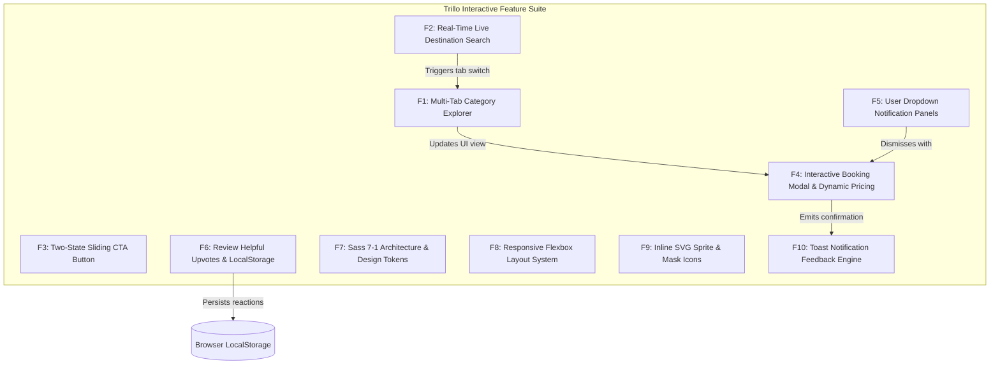

# 01. Comprehensive Feature Inventory

---

## Feature Summary Matrix

| ID | Feature Name | Primary Code Reference | User-Facing Behavior |
| :---: | :--- | :--- | :--- |
| **F1** | **Multi-Tab Category Explorer** | [`02_Trillo/js/main.js:192-247`](file:///Users/avishjain/avishjain9-repos/52-trilo-travel-ui/02_Trillo/js/main.js#L192-L247) | Smooth tab switching across Hotel, Flight, Car Rental, and Tours with dynamic gallery cross-fade. |
| **F2** | **Real-Time Live Destination Search** | [`02_Trillo/js/main.js:304-323`](file:///Users/avishjain/avishjain9-repos/52-trilo-travel-ui/02_Trillo/js/main.js#L304-L323) | Instant search bar that parses query strings and switches to matching travel services. |
| **F3** | **Two-State Sliding CTA Button** | [`_booking-cta.scss:35-85`](file:///Users/avishjain/avishjain9-repos/52-trilo-travel-ui/02_Trillo/sass/components/_booking-cta.scss#L35-L85) | Pill button with sliding visible/invisible text animation and pulsating focus ring. |
| **F4** | **Interactive Booking Modal & Pricing** | [`02_Trillo/js/main.js:254-291`](file:///Users/avishjain/avishjain9-repos/52-trilo-travel-ui/02_Trillo/js/main.js#L254-L291) | Glassmorphism modal with live date pickers, room tier options, and real-time total computation. |
| **F5** | **User Dropdown Notification Panels** | [`02_Trillo/js/main.js:325-334`](file:///Users/avishjain/avishjain9-repos/52-trilo-travel-ui/02_Trillo/js/main.js#L325-L334) | Interactive dropdowns for saved bookmarks and concierge messages with badge counts. |
| **F6** | **Review Helpful Upvotes with LocalStorage** | [`02_Trillo/js/main.js:304-331`](file:///Users/avishjain/avishjain9-repos/52-trilo-travel-ui/02_Trillo/js/main.js#L304-L331) | Client-side upvoting mechanism that toggles reaction counts and persists to browser storage. |
| **F7** | **Sass 7-1 Architecture & Design Tokens** | [`sass/main.scss:1-16`](file:///Users/avishjain/avishjain9-repos/52-trilo-travel-ui/02_Trillo/sass/main.scss#L1-L16) | Modular CSS preprocessor design token system with custom properties and mixins. |
| **F8** | **Responsive Flexbox Layout System** | [`_typography.scss:17-25`](file:///Users/avishjain/avishjain9-repos/52-trilo-travel-ui/02_Trillo/sass/base/_typography.scss#L17-L25) | Fluid 5-breakpoint responsive scaling with REM base font sizing and flexible column wrapping. |
| **F9** | **Inline SVG Sprite & Mask Icons** | [`02_Trillo/index.html:18-57`](file:///Users/avishjain/avishjain9-repos/52-trilo-travel-ui/02_Trillo/index.html#L18-L57) | 12 retina-ready vector icons styled with `currentColor` and CSS SVG masking. |
| **F10**| **Toast Notification Feedback Engine** | [`02_Trillo/js/main.js:296-307`](file:///Users/avishjain/avishjain9-repos/52-trilo-travel-ui/02_Trillo/js/main.js#L296-L307) | Animated floating notification pill with automatic dismissal and timer debouncing. |

---

## Detailed Feature Specifications

### F1: Multi-Tab Travel Category Explorer
- **Description**: Allows the user to seamlessly switch between different travel services (`Hotel`, `Flight`, `Car rental`, `Tours`) without reloading the page.
- **Files Involved**:
  - [`02_Trillo/js/main.js:192-247`](file:///Users/avishjain/avishjain9-repos/52-trilo-travel-ui/02_Trillo/js/main.js#L192-L247): Function `switchTab(tabKey)`
  - [`02_Trillo/sass/layout/_navigation.scss:35-65`](file:///Users/avishjain/avishjain9-repos/52-trilo-travel-ui/02_Trillo/sass/layout/_navigation.scss#L35-L65): Sliding nav indicator styles
  - [`02_Trillo/sass/components/_hotel-view.scss:28-55`](file:///Users/avishjain/avishjain9-repos/52-trilo-travel-ui/02_Trillo/sass/components/_hotel-view.scss#L28-L55): Gallery photo container
- **Functions Called**:
  - `switchTab(tabKey)`: Takes a string key (`hotel`, `flight`, `car-rental`, `tours`), looks up data in `DESTINATION_CATALOG`, updates DOM headers, re-renders the amenities list, updates gallery photos with a 150ms opacity cross-fade, and calls `recalculateBookingTotal()`.
- **Data Touched**: `state.currentTab`, `DESTINATION_CATALOG`.
- **Edge Cases**: Clicking on the already active tab is handled gracefully; clicking outside list items does not trigger invalid lookups.

#### Say It Out Loud (F1)
> *"I built the Multi-Tab Travel Category Explorer so users can browse hotels, flights, car rentals, and tours from a single interface without jarring page reloads. When a user clicks a sidebar link, an event listener in `main.js` grabs the tab key and runs `switchTab()`. It updates the active navigation item using a smooth cubic-bezier sliding bar, swaps out the gallery photography with a quick opacity cross-fade, and updates the headlines, prices, and amenities from an in-memory catalog. I chose this client-side state approach over multi-page navigation to eliminate loading latency and keep the user in a fluid booking flow. If a user clicks an unrecognized tab, the code simply guards and exits cleanly. One limitation is that the catalog is currently static in JavaScript, so in the future I would fetch these categories dynamically from a backend REST API."*

---

### F2: Real-Time Live Destination Search
- **Description**: Enables instant discovery of travel options as the user types into the header search bar.
- **Files Involved**:
  - [`02_Trillo/js/main.js:304-323`](file:///Users/avishjain/avishjain9-repos/52-trilo-travel-ui/02_Trillo/js/main.js#L304-L323): Function `handleSearchInput(e)`
  - [`02_Trillo/sass/layout/_header.scss:40-95`](file:///Users/avishjain/avishjain9-repos/52-trilo-travel-ui/02_Trillo/sass/layout/_header.scss#L40-L95): Expandable search input styling
- **Functions Called**:
  - `handleSearchInput(e)`: Reads input value, sanitizes and lowercases the query, scans destination titles, locations, and amenities, and triggers `switchTab()` when a match is found.
- **Edge Cases**: Whitespace-only queries are ignored; already active tabs are not redundantly re-rendered.

#### Say It Out Loud (F2)
> *"I created the Real-Time Live Destination Search so travelers can find what they want instantly without pressing enter or waiting for a search results page. As the user types into the header input, `handleSearchInput` normalizes the query and compares it against destination titles, locations, and amenities in our catalog. If it finds a match, it automatically switches the view to that category and displays a confirmation toast. I used an `input` event listener directly on the search element instead of a form submit to create an immediate, app-like experience. When nothing matches or the query is blank, the function simply does nothing without throwing errors. Right now, it switches on the first matched category, but with more time I would add an autocomplete dropdown showing all matching results."*

---

### F3: Two-State Sliding CTA Button
- **Description**: Interactive call-to-action button that transitions between "Book now" and "Only 4 rooms left" on hover.
- **Files Involved**:
  - [`02_Trillo/sass/components/_booking-cta.scss:35-85`](file:///Users/avishjain/avishjain9-repos/52-trilo-travel-ui/02_Trillo/sass/components/_booking-cta.scss#L35-L85): Sliding CSS transforms
- **Behavior**: Uses CSS relative and absolute positioning with `translateY` transforms to slide text blocks smoothly while maintaining equal button dimensions.

#### Say It Out Loud (F3)
> *"I designed the Two-State Sliding CTA Button to create an engaging visual prompt that drives bookings. When the user hovers over the button, the visible 'Book now' label slides downward out of view while an invisible 'Only 4 rooms left' label slides into view from above. I implemented this entirely in CSS using relative positioning, `overflow: hidden`, and translateY transforms, which allows the browser's GPU to handle the animation at sixty frames per second without any JavaScript overhead. If the button receives keyboard focus, an infinite pulsation animation activates to guide accessible navigation. A limitation is that the text is hardcoded in the markup, which I would make data-driven in a production system."*

---

### F4: Interactive Booking Modal & Dynamic Pricing Engine
- **Description**: A glassmorphism modal dialog allowing users to pick dates, select room tiers, and view instant price recalculations.
- **Files Involved**:
  - [`02_Trillo/js/main.js:254-291`](file:///Users/avishjain/avishjain9-repos/52-trilo-travel-ui/02_Trillo/js/main.js#L254-L291): Functions `openBookingModal`, `closeBookingModal`, `recalculateBookingTotal`, `handleBookingSubmit`
  - [`02_Trillo/sass/components/_modal.scss:8-120`](file:///Users/avishjain/avishjain9-repos/52-trilo-travel-ui/02_Trillo/sass/components/_modal.scss#L8-L120): Modal overlay and glassmorphism styling
- **Functions Called**:
  - `openBookingModal()`: Activates overlay, locks body scrolling, and sets default check-in date.
  - `recalculateBookingTotal()`: Computes `tierPrice * nights` and updates price label.
  - `handleBookingSubmit(e)`: Validates form, decrements available inventory, dismisses modal, and shows confirmation toast with booking code.

#### Say It Out Loud (F4)
> *"I built the Interactive Booking Modal and Dynamic Pricing Engine to provide users with an instant, friction-free reservation flow. When a user clicks the CTA button, `openBookingModal()` displays a glassmorphism dialog, locks body scrolling, and sets tomorrow's date as the default check-in. As the user selects different room tiers—such as the Deluxe Suite or Presidential Penthouse—`recalculateBookingTotal()` multiplies the tier rate by the duration and updates the price label instantly. When the form is submitted, `handleBookingSubmit()` decrements the available room counter on the page, closes the modal, and generates a confirmation toast with a unique reservation code. I chose an inline calculation modal over a multi-page checkout to maximize conversion. If the user presses the Escape key or clicks the backdrop, the modal cleanly dismisses. Currently, inventory is stored in memory, so I would integrate a payment gateway and backend database to handle real financial transactions."*

---

### F5: User Navigation Dropdown Panels
- **Description**: Notification dropdowns in the header displaying saved properties and concierge inquiries.
- **Files Involved**:
  - [`02_Trillo/js/main.js:325-334`](file:///Users/avishjain/avishjain9-repos/52-trilo-travel-ui/02_Trillo/js/main.js#L325-L334): Functions `toggleDropdown`, `closeAllDropdowns`
  - [`02_Trillo/sass/components/_modal.scss:125-175`](file:///Users/avishjain/avishjain9-repos/52-trilo-travel-ui/02_Trillo/sass/components/_modal.scss#L125-L175): Dropdown menu styling

#### Say It Out Loud (F5)
> *"I built the User Navigation Dropdown Panels to give travelers quick access to their bookmarked properties and concierge messages directly from the header. Clicking on either icon toggles its respective dropdown while automatically closing any other open panels to prevent visual clutter. I implemented a global document click listener and an Escape key handler so clicking anywhere outside the menu cleanly closes it. I opted for lightweight CSS-toggled dropdowns instead of a heavy third-party tooltip library to keep the codebase minimal and fast. One improvement I would add is letting users remove saved properties directly from the dropdown list."*

---

### F6: Review Helpful Upvotes with LocalStorage Sync
- **Description**: Allows users to mark reviews as helpful, updating the count dynamically and persisting the vote in browser LocalStorage.
- **Files Involved**:
  - [`02_Trillo/js/main.js:304-331`](file:///Users/avishjain/avishjain9-repos/52-trilo-travel-ui/02_Trillo/js/main.js#L304-L331): Function `setupReviewReactions`
  - [`02_Trillo/sass/components/_review.scss:85-115`](file:///Users/avishjain/avishjain9-repos/52-trilo-travel-ui/02_Trillo/sass/components/_review.scss#L85-L115): Review reaction buttons and hover states

#### Say It Out Loud (F6)
> *"I implemented the Review Helpful Upvoting system to provide social proof and user engagement without requiring a user login. When a user clicks the helpful button on a review card, `setupReviewReactions()` checks the `dataset.review` ID. If the user hasn't voted yet, it increments the vote count, adds an active style, and writes the state to LocalStorage using `JSON.stringify()`. If they click it again, it removes their vote and decrements the counter. I used LocalStorage so the user's reactions persist across page refreshes and browser restarts. If LocalStorage is disabled or full, the try-catch block allows in-memory voting without crashing. One limitation is that votes are stored locally per device rather than aggregated on a central server, which I would implement with an API endpoint."*

---

### F7: Sass 7-1 Architecture & Design Tokens
- **Description**: Modular CSS architecture separating variables, resets, layout partials, and components compiled into a single production stylesheet.
- **Files Involved**:
  - All files in [`02_Trillo/sass/`](file:///Users/avishjain/avishjain9-repos/52-trilo-travel-ui/02_Trillo/sass/)

#### Say It Out Loud (F7)
> *"I structured the styling using the Sass 7-1 pattern to ensure enterprise-grade maintainability and modularity. I organized the SCSS codebase into abstracts for variables, base for typography resets, layout for the header and sidebar, and components for cards, modals, and buttons, all imported by `main.scss`. By pairing Sass with CSS Custom Properties, I centralized brand colors and elevation shadows into reusable tokens that can be modified globally in one place. I chose the 7-1 pattern over utility-first CSS like Tailwind to maintain complete control over semantic naming, BEM conventions, and compiled bundle size. A trade-off is that it requires a compilation step, but the resulting CSS is clean and completely unbloated."*

---

### F8: Responsive Multi-Breakpoint Flexbox Layout System
- **Description**: Fluid layout system adapting smoothly from 1800px ultra-wide screens down to 320px mobile viewports using CSS Flexbox and REM scaling.
- **Files Involved**:
  - [`_typography.scss:17-25`](file:///Users/avishjain/avishjain9-repos/52-trilo-travel-ui/02_Trillo/sass/base/_typography.scss#L17-L25), [`_variables.scss:45-65`](file:///Users/avishjain/avishjain9-repos/52-trilo-travel-ui/02_Trillo/sass/abstracts/_variables.scss#L45-L65)

#### Say It Out Loud (F8)
> *"I built the layout using a responsive Flexbox architecture backed by a 62.5% root REM scaling strategy. By setting `font-size: 62.5%` on the HTML element, one REM equals ten pixels, making responsive sizing calculations intuitive. I defined custom mixins across five breakpoints—ranging from ultra-wide desktops down to phones under 600 pixels. At critical thresholds, the sidebar transforms from a vertical column into a horizontal navigation bar, the two-column review section stacks vertically, and the root font size scales down to ensure harmonious typography. I chose pure Flexbox over CSS Grid here because the 1-dimensional alignment requirements of the header, sidebar, and detail columns were ideally suited for Flexbox with zero polyfill requirements."*

---

### F9: Inline SVG Sprite & CSS Mask Icons
- **Description**: High-performance vector icon system embedding twelve icons in an inline SVG sprite and utilizing CSS masks for list bullets.
- **Files Involved**:
  - [`02_Trillo/index.html:18-57`](file:///Users/avishjain/avishjain9-repos/52-trilo-travel-ui/02_Trillo/index.html#L18-L57), [`_hotel-view.scss:190-205`](file:///Users/avishjain/avishjain9-repos/52-trilo-travel-ui/02_Trillo/sass/components/_hotel-view.scss#L190-L205)

#### Say It Out Loud (F9)
> *"I implemented an Inline SVG Sprite system to deliver crisp, retina-ready vector icons with zero external HTTP requests. All twelve icons are defined once inside a hidden SVG sprite at the top of `index.html` using the `symbol` tag and reused throughout the app with the `use` element. For the amenities checklist, I used modern CSS mask images with `-webkit-mask-image`, allowing pure CSS background colors to colorize the chevron icons dynamically. I chose SVG sprites over icon fonts like FontAwesome because SVGs eliminate font-rendering glitches, support sharp sub-pixel rendering, and prevent render-blocking webfont downloads."*

---

### F10: Toast Notification Feedback Engine
- **Description**: Global floating notification system that provides non-blocking confirmation feedback for user actions.
- **Files Involved**:
  - [`02_Trillo/js/main.js:296-307`](file:///Users/avishjain/avishjain9-repos/52-trilo-travel-ui/02_Trillo/js/main.js#L296-L307): Function `showToast`
  - [`02_Trillo/sass/components/_modal.scss:180-210`](file:///Users/avishjain/avishjain9-repos/52-trilo-travel-ui/02_Trillo/sass/components/_modal.scss#L180-L210): Toast animation styles

#### Say It Out Loud (F10)
> *"I created the Toast Notification Feedback Engine to provide subtle, non-intrusive feedback whenever the user performs an action like booking a room, voting on a review, or switching destinations. The `showToast` function takes a text string, updates the toast element in the DOM, and adds a CSS class that slides the pill upward from the bottom right corner with a cubic-bezier spring animation. I implemented active timer clearing with `clearTimeout` so rapid successive triggers don't cause premature dismissals. I chose an unobtrusive toast over intrusive browser alert dialogs to keep the user experience smooth and uninterrupted."*
