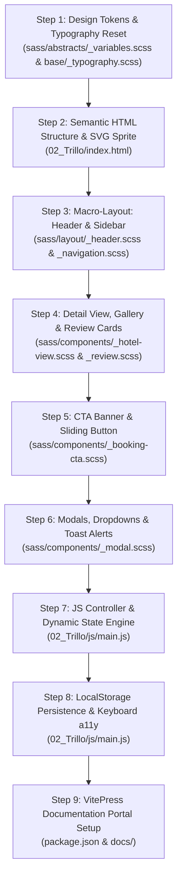

# 02. Step-by-Step Rebuild Order Guide



---

## Step 1: Design Tokens & Typography Foundation
- **Files Created**: [`02_Trillo/sass/abstracts/_variables.scss`](file:///Users/avishjain/avishjain9-repos/52-trilo-travel-ui/02_Trillo/sass/abstracts/_variables.scss), [`02_Trillo/sass/base/_typography.scss`](file:///Users/avishjain/avishjain9-repos/52-trilo-travel-ui/02_Trillo/sass/base/_typography.scss).
- **Reasoning**: Establishing CSS custom properties and the 62.5% REM reset before touching markup ensures every component built later relies on consistent tokens without magic numbers.

```scss
// Key snippet from _variables.scss:
:root {
  --color-primary: #eb2f64;
  --color-primary-light: #ff3366;
  --color-primary-dark: #ba265d;
  --shadow-dark: 0 2rem 6rem rgba(0, 0, 0, 0.3);
  --header-height: 7rem;
}

html {
  box-sizing: border-box;
  font-size: 62.5%; // 10px / 16px = 62.5% => 1rem = 10px
}
```

---

## Step 2: Semantic HTML5 Structure & Inline SVG Sprite
- **Files Created**: [`02_Trillo/index.html`](file:///Users/avishjain/avishjain9-repos/52-trilo-travel-ui/02_Trillo/index.html).
- **Reasoning**: Embeds the vector sprite at the top of the body inside a hidden SVG so all twelve icons are ready for reuse without external HTTP requests.

```html
<!-- Key snippet from index.html: -->
<svg style="position: absolute; width: 0; height: 0; overflow: hidden;">
  <defs>
    <symbol id="icon-plane" viewBox="0 0 24 24">
      <path d="M21 16v-2l-8-5V3.5c0-.83-.67-1.5-1.5-1.5S10 2.67 10 3.5V9l-8 5v2l8-2.5V19l-2 1.5V22l3.5-1 3.5 1v-1.5L13 19v-5.5l8 2.5z"/>
    </symbol>
  </defs>
</svg>
```

---

## Step 3: Macro-Layout: Header & Sidebar Navigation
- **Files Created**: [`02_Trillo/sass/layout/_header.scss`](file:///Users/avishjain/avishjain9-repos/52-trilo-travel-ui/02_Trillo/sass/layout/_header.scss), [`02_Trillo/sass/layout/_navigation.scss`](file:///Users/avishjain/avishjain9-repos/52-trilo-travel-ui/02_Trillo/sass/layout/_navigation.scss).
- **Reasoning**: Builds the outer shell using CSS Flexbox. The header uses `justify-content: space-between` and the sidebar uses `flex: 0 0 18%` with dynamic sliding hover indicators.

```scss
// Sliding hover animation on sidebar items:
.side-nav__item::before {
  content: "";
  position: absolute;
  top: 0; left: 0;
  height: 100%; width: 3px;
  background-color: var(--color-primary);
  transform: scaleY(0);
  transition: transform 0.2s, width 0.4s cubic-bezier(1, 0, 0, 1) 0.2s;
}

.side-nav__item:hover::before,
.side-nav__item--active::before {
  transform: scaleY(1);
  width: 100%;
}
```

---

## Step 4: Content Components: Hotel View, Gallery & Reviews
- **Files Created**: [`02_Trillo/sass/components/_hotel-view.scss`](file:///Users/avishjain/avishjain9-repos/52-trilo-travel-ui/02_Trillo/sass/components/_hotel-view.scss), [`02_Trillo/sass/components/_review.scss`](file:///Users/avishjain/avishjain9-repos/52-trilo-travel-ui/02_Trillo/sass/components/_review.scss).
- **Reasoning**: Implements the 3-photo gallery with zoom hover, the overview ratings bar, the 2-column description and review layout, and the CSS SVG mask checklist bullets.

---

## Step 5: Action Components: CTA Banner & Sliding Button
- **Files Created**: [`02_Trillo/sass/components/_booking-cta.scss`](file:///Users/avishjain/avishjain9-repos/52-trilo-travel-ui/02_Trillo/sass/components/_booking-cta.scss).
- **Reasoning**: Implements the 2-state sliding text button using CSS relative and absolute positioning, delivering 60fps animations with zero JavaScript.

---

## Step 6: Overlays: Booking Modal, Dropdowns & Toast Alerts
- **Files Created**: [`02_Trillo/sass/components/_modal.scss`](file:///Users/avishjain/avishjain9-repos/52-trilo-travel-ui/02_Trillo/sass/components/_modal.scss).
- **Reasoning**: Prepares the glassmorphism modal dialog (`backdrop-filter: blur(6px)`), user navigation dropdown panels, and fixed bottom-right toast container.

---

## Step 7: JavaScript Controller & State Management
- **Files Created**: [`02_Trillo/js/main.js`](file:///Users/avishjain/avishjain9-repos/52-trilo-travel-ui/02_Trillo/js/main.js).
- **Reasoning**: Implements the self-executing IIFE containing `DESTINATION_CATALOG`, `switchTab()`, `recalculateBookingTotal()`, live search filtering, and modal lifecycle management.

```javascript
// Key controller snippet from main.js:
function switchTab(tabKey) {
  if (!DESTINATION_CATALOG[tabKey]) return;
  state.currentTab = tabKey;
  const data = DESTINATION_CATALOG[tabKey];

  DOM.propertyHeading.textContent = data.name;
  DOM.locationBtn.textContent = data.location;
  DOM.ratingScore.textContent = data.rating;
  recalculateBookingTotal();
  showToast('Viewing ' + data.name);
}
```

---

## Step 8: Persistence & Keyboard Accessibility
- **Code Updates**: [`02_Trillo/js/main.js:304-331, 372-377`](file:///Users/avishjain/avishjain9-repos/52-trilo-travel-ui/02_Trillo/js/main.js#L304-L331).
- **Reasoning**: Integrates `localStorage.setItem('trillo_helpful_reviews')` and an `Escape` key listener to dismiss modals and dropdowns cleanly.

---

## Step 9: VitePress Documentation Portal Setup
- **Files Created**: [`package.json`](file:///Users/avishjain/avishjain9-repos/52-trilo-travel-ui/package.json), [`docs/.vitepress/config.js`](file:///Users/avishjain/avishjain9-repos/52-trilo-travel-ui/docs/.vitepress/config.js), [`docs/.vitepress/theme/custom.css`](file:///Users/avishjain/avishjain9-repos/52-trilo-travel-ui/docs/.vitepress/theme/custom.css).
- **Reasoning**: Packages the entire technical specification into a searchable VitePress site with pure black dark mode and Mermaid diagram rendering.
