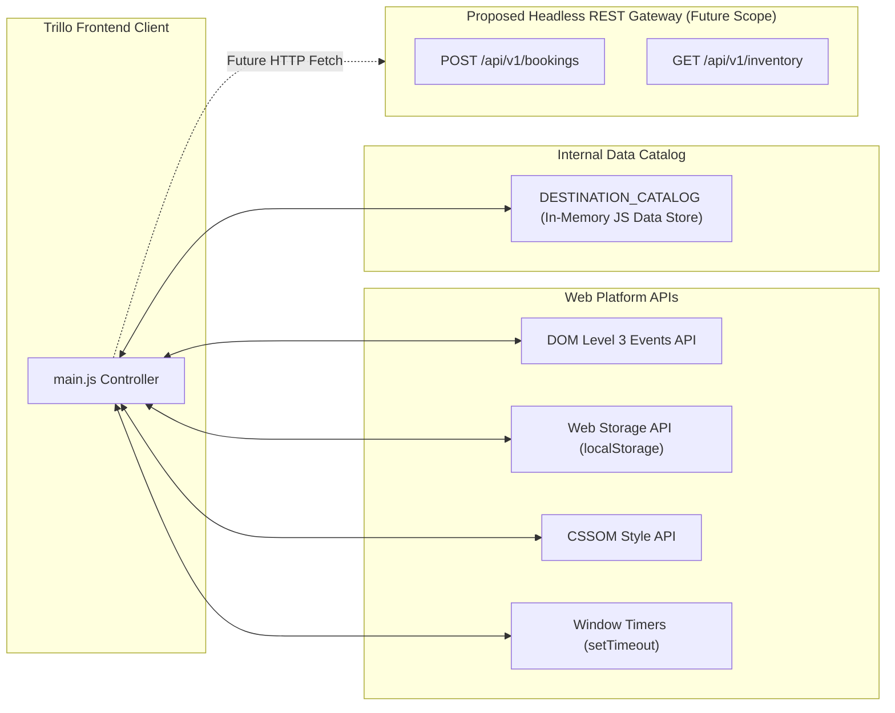

# 03. Web Platform & Data Catalog API Reference



---

## 1. Backend REST Endpoints Audit

> **Status**: **Not applicable for this project type** (Frontend-only client application with zero server runtime or database daemon).
>
> All destination specifications, amenity lists, image paths, and pricing tiers execute directly in the client browser via in-memory JavaScript structures and Web Storage.

---

## 2. Web Platform APIs Reference

### 2.1 DOM Event Signatures

| Event Type | Target Element | Listener Function | Purpose |
| :--- | :--- | :--- | :--- |
| `click` | `#sidebarMenu` | Event Delegation (`e.target.closest('.side-nav__item')`) | Handles category switching across Hotel, Flight, Car Rental, and Tours. |
| `input` | `#searchInput` | `handleSearchInput(e)` | Real-time live destination query scanning and filtering. |
| `click` | `#openBookingModalBtn` | `openBookingModal()` | Displays reservation dialog and locks background page scroll. |
| `click` | `#closeModalBtn`, `.modal-overlay` | `closeBookingModal()` | Dismisses modal dialog and restores window scrolling. |
| `change` | `#roomType` | `recalculateBookingTotal()` | Dynamically multiplies tier rate by nights to compute price. |
| `submit` | `#bookingForm` | `handleBookingSubmit(e)` | Validates booking, decrements room inventory, and triggers toast. |
| `click` | `.review__helpful-btn` | `setupReviewReactions()` handler | Toggles review upvote state and synchronizes with `localStorage`. |
| `click` | `#bookmarkBtn`, `#chatBtn` | `toggleDropdown(el)` | Toggles saved bookmark and concierge message notification panels. |
| `keydown` | `document` | Global key listener (`e.key === 'Escape'`) | Dismisses active modals and dropdown menus for accessible navigation. |

---

### 2.2 Web Storage API Reference

```javascript
// Storage Key:
'trillo_helpful_reviews'

// Serialized Data Schema:
{
  "1": true,  // Review ID 1 has been upvoted
  "2": false  // Review ID 2 has not been upvoted
}
```

- **Read**: `JSON.parse(localStorage.getItem('trillo_helpful_reviews') || '{}')`
- **Write**: `localStorage.setItem('trillo_helpful_reviews', JSON.stringify(state.helpfulVotes))`
- **Fault Tolerance**: Wrapped in try-catch handling to ensure in-memory voting continues even if LocalStorage is disabled by strict browser privacy modes.

---

## 3. Client-Side Destination Data Catalog API

The application exposes a structured in-memory data catalog in [`02_Trillo/js/main.js:21-140`](file:///Users/avishjain/avishjain9-repos/52-trilo-travel-ui/02_Trillo/js/main.js#L21-L140).

### Catalog Schema Specification

```typescript
interface DestinationItem {
  name: string;             // Display headline (e.g., 'Hotel Las Palmas')
  location: string;         // Geographic location (e.g., 'Albufeira, Portugal')
  stars: number;            // Rating stars count (1-5)
  rating: string;           // Average score (e.g., '8.6')
  votes: string;            // Vote count label (e.g., '429 votes')
  roomsLeft: number;        // Available room inventory
  basePrice: number;        // Base price in USD
  photos: string[];         // 3 Unsplash high-res showcase photo URLs
  captions: string[];       // 3 Photo overlay caption strings
  desc1: string;            // Primary description paragraph
  desc2: string;            // Secondary suite details paragraph
  amenities: string[];      // Array of 8 feature strings
}
```

---

## 4. Proposed Headless Booking Gateway REST API (Future Evolution)

If Trillo is connected to a live microservice backend, the client would communicate via standard REST endpoints:

### Endpoint: `POST /api/v1/reservations`
- **Purpose**: Creates a verified room or flight reservation.
- **Request Headers**: `Content-Type: application/json`, `X-Idempotency-Key: uuidv4`
- **Request Body**:
  ```json
  {
    "propertyId": "hotel-las-palmas",
    "tier": "deluxe-terrace-suite",
    "checkInDate": "2026-11-01",
    "durationNights": 3,
    "guests": 2,
    "totalAmount": 540.00,
    "currency": "USD"
  }
  ```
- **Success Response (201 Created)**:
  ```json
  {
    "status": "success",
    "bookingId": "TR-849201",
    "confirmationCode": "CONF-LP-772",
    "property": "Hotel Las Palmas",
    "totalBilled": 540.00
  }
  ```
- **Error Responses**:
  - `400 Bad Request`: Validation failure (invalid check-in date in the past).
  - `409 Conflict`: Room inventory exhausted (zero rooms remaining for selected dates).
  - `429 Too Many Requests`: Rate limit exceeded on booking endpoint.
