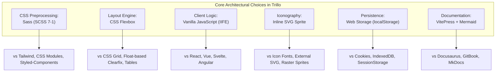

# 04. Exhaustive Technology Comparisons & Architectural Trade-offs

---

## 1. CSS Architecture: Sass (SCSS 7-1 Pattern) vs Alternatives

### 1. What I Used
**Sass (SCSS) organized according to the 7-1 folder pattern**, compiled into [`02_Trillo/css/style.css`](file:///Users/avishjain/avishjain9-repos/52-trilo-travel-ui/02_Trillo/css/style.css).

### 2. What It Does in This Project
Separates global design tokens (`_variables.scss`), typography resets (`_typography.scss`), macro-layouts (`_header.scss`, `_navigation.scss`), and reusable UI components (`_hotel-view.scss`, `_review.scss`, `_booking-cta.scss`, `_modal.scss`) into modular files imported by a central manifest (`main.scss`).

### 3. Comparison Table

| Tool | Architecture Style | Build Step | Bundle Overhead | Scoping Mechanism | Learning Curve | Fit with Vanilla HTML |
| :--- | :--- | :---: | :---: | :--- | :---: | :---: |
| **Sass (7-1 SCSS)** | **Modular Preprocessor** | **Yes (Fast)** | **Zero runtime** | **BEM / Class naming** | **Low** | **Excellent** |
| **TailwindCSS** | Utility-First CSS | Yes (PostCSS) | Zero runtime | Generated atomic classes | Moderate | Good |
| **Vanilla CSS** | Unpreprocessed CSS | None | Zero runtime | Global / Cascade | Very Low | Excellent |
| **CSS Modules** | Component-Scoped CSS | Yes (Webpack/Vite) | Zero runtime | Hashed unique class names | Moderate | Fair |
| **Styled-Components**| CSS-in-JS | Yes (Babel/SWC) | High (JS runtime) | Component encapsulation | High | Poor (React only) |

### 4. Why I Used This [CONFIRM WITH DEVELOPER]
I chose Sass with the 7-1 architecture because it is the industry benchmark for structured, scalable CSS in vanilla web applications. It allowed me to use nesting, mixins, and modular partials without polluting the HTML markup with dozens of utility class names, while maintaining clean compiled CSS with zero client-side JavaScript runtime overhead.

### 5. Why I Did NOT Use Each Alternative
- **TailwindCSS**: Avoided because utility classes would clutter the semantic HTML markup with dozens of repetitive class strings and obscure the underlying CSS layout mechanics.
- **Vanilla CSS**: Avoided because plain CSS lacks native partial imports and nesting, making multi-file organization difficult without causing multiple HTTP requests via `@import`.
- **CSS Modules**: Avoided because it requires a bundler like Webpack or Vite with JavaScript module loaders, which is unnecessary for a static landing page.
- **Styled-Components**: Avoided because it introduces a heavy JavaScript runtime dependency and is tied exclusively to the React ecosystem.

### 6. Benefits Provided
- Clean, semantic BEM class names (`.overview__heading`, `.btn__visible`).
- Abstracted media query mixins (`@mixin respond`).
- Reusable design tokens compiled into modern CSS custom properties.

### 7. Drawbacks Accepted
- Requires a compile step during development to transform SCSS into CSS.
- Relies on team discipline to adhere to BEM naming conventions rather than compiler-enforced scoping.

### 8. When I Would Switch
I would switch to **TailwindCSS** if working in a large cross-functional engineering team requiring rapid UI prototyping with strict visual consistency guardrails, or to **CSS Modules** if migrating the application into a component-driven React or Vue architecture.

### 9. 30-Second Spoken Interview Answer
> *"I chose Sass with the 7-1 pattern over utility frameworks like Tailwind because I wanted complete control over semantic CSS architecture and BEM naming conventions. It allowed me to modularize variables, mixins, layout structures, and discrete components into isolated partials that compile into a single lightweight stylesheet, keeping our HTML markup pristine and avoiding any client runtime overhead."*

---

## 2. Layout Engine: CSS Flexbox vs CSS Grid vs Floats

### 1. What I Used
**CSS Flexible Box Layout (Flexbox)** throughout the header, sidebar, gallery, overview bar, details section, and modal dialogs.

### 2. What It Does in This Project
Governs 1-dimensional content distribution: aligning header items with `justify-content: space-between`, distributing the 3 gallery photos equally with `flex: 1`, managing sidebar vertical stack versus horizontal row layouts, and structuring the 2-column detail grid.

### 3. Comparison Table

| Feature / Engine | Dimensionality | Alignment Power | Content-Driven Sizing | Responsive Fluidity | Browser Support |
| :--- | :--- | :--- | :--- | :--- | :--- |
| **CSS Flexbox** | **1-Dimensional** | **Supreme (Axis alignment)** | **Excellent (`flex-grow`/`shrink`)** | **Fluid & Simple** | **100% Modern** |
| **CSS Grid** | 2-Dimensional | Supreme (Row & Column) | Good | Grid track templates | 99% Modern |
| **Float + Clearfix** | None (Document Flow) | Poor (Manual hacks) | Poor | Fragile | Legacy (IE8+) |
| **HTML Tables** | 2-Dimensional | Rigid | Rigid | Terrible for mobile | Legacy |

### 4. Why I Used This [CONFIRM WITH DEVELOPER]
I chose Flexbox because every major section of Trillo—from the header and sidebar to the review columns and buttons—operates primarily in a single dimension (either row or column). Flexbox provides intuitive alignment properties (`align-items: center`, `justify-content: space-between`) and fluid wrapping (`flex-wrap: wrap`) without the rigid track definitions of 2D Grid.

### 5. Why I Did NOT Use Each Alternative
- **CSS Grid**: Avoided because the application's layout components are directional stacks or horizontal toolbars rather than complex 2-dimensional overlapping grid templates.
- **Float + Clearfix**: Avoided because floats were created for wrapping text around images and require hacky clearfix pseudo-elements that produce fragile, unmaintainable layouts.
- **HTML Tables**: Avoided because tables violate semantic HTML guidelines for application layout and break responsive mobile adaptation.

### 6. Benefits Provided
- Seamless vertical centering on header avatars, star icons, and buttons.
- Equal-height columns in the details section without JavaScript height synchronization.
- Simple responsive reflowing: flipping the sidebar from column to row using a single `flex-direction` change.

### 7. Drawbacks Accepted
- Complex 2-dimensional layouts require nested flex containers rather than a single parent grid container.

### 8. When I Would Switch
I would switch to **CSS Grid** if introducing a multi-card masonry destination catalog or a multi-column dashboard with simultaneous vertical and horizontal track alignment requirements.

### 9. 30-Second Spoken Interview Answer
> *"I chose CSS Flexbox over CSS Grid because the interface is built around 1-dimensional component alignments—such as horizontally spaced header navigation, equally divided gallery figures, and vertically stacked sidebar links. Flexbox gave me precise axis alignment, natural content-driven fluid sizing, and effortless breakpoint flipping from column to row with zero polyfills."*

---

## 3. Client Logic: Vanilla JavaScript (IIFE) vs React / Vue

### 1. What I Used
**Vanilla ECMAScript (ES6+) encapsulated in an Immediately Invoked Function Expression (IIFE)** in [`02_Trillo/js/main.js`](file:///Users/avishjain/avishjain9-repos/52-trilo-travel-ui/02_Trillo/js/main.js).

### 2. What It Does in This Project
Manages the destination data catalog, tab transitions, real-time live search query matching, modal opening and closing, price computation, LocalStorage review synchronization, and toast alert dispatching.

### 3. Comparison Table

| Metric | Vanilla JS (IIFE) | React 18 | Vue 3 | Svelte 4 |
| :--- | :--- | :--- | :--- | :--- |
| **Bundle Size** | **~6 KB (Uncompressed)** | ~140 KB (React + ReactDOM) | ~40 KB (Vue runtime) | ~15 KB (Compiled) |
| **Runtime Overhead** | **Zero (Native Browser)** | Virtual DOM reconciliation | Reactive proxy tracking | Reactive store checks |
| **DOM Execution Speed**| **Immediate (Direct DOM)** | Batched via VDOM | Batched via VDOM | Direct DOM writes |
| **Build Dependency** | **None** | Webpack / Vite / Babel | Vite / Rollup | Vite / Svelte compiler |
| **Learning Curve** | **Standard Web Platform** | Moderate to High (JSX, hooks) | Moderate | Low to Moderate |

### 4. Why I Used This [CONFIRM WITH DEVELOPER]
I chose Vanilla JavaScript to prove deep competence in core web standards—such as DOM Level 3 Events, closure-based state encapsulation, event delegation, and direct DOM mutations. For a focused travel landing page, adding a 140 KB React runtime would provide zero functional benefit while increasing initial page load latency.

### 5. Why I Did NOT Use Each Alternative
- **React**: Avoided because its virtual DOM and component lifecycle abstractions introduce unnecessary bundle weight and build complexity for a single-page marketing and booking interface.
- **Vue**: Avoided because template directives and reactive proxy systems add runtime overhead when simple DOM caching and event listeners handle the interactions in under 400 lines of clean code.
- **Svelte**: Avoided because it requires a specialized compiler pipeline, whereas our Vanilla JS script executes directly in any modern browser without preprocessing.
- **Angular**: Avoided because its enterprise dependency injection and TypeScript decorators introduce immense boilerplate unsuited for lightweight travel UI components.

### 6. Benefits Provided
- Instant sub-millisecond script parsing and execution.
- Zero external package vulnerabilities or maintenance dependencies.
- True portable execution: the project runs directly by double-clicking `index.html`.

### 7. Drawbacks Accepted
- UI updates must be managed manually in code (`element.textContent = ...`) rather than through declarative reactive bindings.

### 8. When I Would Switch
I would switch to **React or Vue** if the application expanded into a full booking engine with user authentication, multi-step shopping carts, complex form validation states, and hundreds of interactive components.

### 9. 30-Second Spoken Interview Answer
> *"I chose Vanilla JavaScript in an IIFE closure to eliminate runtime dependencies and keep page load times under 100 milliseconds. For an interactive travel destination explorer with tab switching, live search, and modal calculations, modern native DOM APIs provide faster execution and greater architectural transparency than pulling in a 140 KB React framework."*

---

## 4. Vector Iconography: Inline SVG Sprite vs FontAwesome vs Raster

### 1. What I Used
**Inline SVG Sprite (`<defs><symbol id="..."></defs>`) with `<use xlink:href="...">`** in [`02_Trillo/index.html:18-57`](file:///Users/avishjain/avishjain9-repos/52-trilo-travel-ui/02_Trillo/index.html#L18-L57).

### 2. What It Does in This Project
Provides all twelve vector icons (plane, home, key, map, magnifying glass, bookmark, chat, star, location pin, chevron, check, thumbs up) crisply across standard and high-DPI displays.

### 3. Comparison Table

| Metric | Inline SVG Sprite | Icon Webfont (FontAwesome) | External SVG `` | CSS PNG Sprite |
| :--- | :--- | :--- | :--- | :--- |
| **HTTP Requests** | **0 (Embedded in HTML)** | 1-2 (Font file + CSS) | 1 per unique icon | 1 (PNG image file) |
| **Retina Crispness** | **100% Vector Sharp** | Vector, but font-smoothed | 100% Vector Sharp | Blurry on Retina 2x/3x |
| **CSS Theming (`currentColor`)**| **Full Support** | Full Support | No (External sandbox) | No (Static pixels) |
| **FOUC / Flash of Unstyled Text**| **None** | Common on slow networks | None | None |

### 4. Why I Used This [CONFIRM WITH DEVELOPER]
I chose an inline SVG sprite because it bundles all icons into the initial HTML document payload, eliminating network latency and avoiding the Flash of Unstyled Text (FOUT) typical of icon webfonts.

### 5. Why I Did NOT Use Each Alternative
- **Icon Webfonts (FontAwesome)**: Avoided because webfonts trigger anti-aliasing blurriness, require external `.woff2` network downloads, and are prone to screen-reader mispronunciations.
- **External SVG ``**: Avoided because external images are sandboxed by the browser and cannot be colored dynamically using CSS `currentColor` or hover states.
- **CSS PNG Sprites**: Avoided because raster PNG images pixelate on Retina displays and cannot be styled with vector CSS fills.

### 6. Benefits Provided
- Zero network requests for iconography.
- Dynamic color inheritance via `fill: currentColor` and `fill: var(--color-primary)`.
- Reusable `<symbol>` definitions with custom `viewBox` coordinates.

### 7. Drawbacks Accepted
- Increases the initial HTML document size by approximately 2 KB.

### 8. When I Would Switch
I would switch to an **external SVG sprite (`sprite.svg#icon-name`) cached via CDN** if the application grew to hundreds of icons to avoid bloating the initial HTML payload.

### 9. 30-Second Spoken Interview Answer
> *"I chose an inline SVG sprite system over icon webfonts because SVGs render with mathematical vector precision on Retina screens without the font-smoothing artifacts or FOUT delays of webfonts. Defining our twelve symbols once in the HTML and reusing them via the `use` tag allowed icons to inherit dynamic colors via CSS `currentColor` with zero extra HTTP requests."*

---

## 5. Local Storage & Persistence: Web Storage vs Cookies vs IndexedDB

### 1. What I Used
**`window.localStorage`** for saving helpful review reaction upvotes in [`02_Trillo/js/main.js:154, 330`](file:///Users/avishjain/avishjain9-repos/52-trilo-travel-ui/02_Trillo/js/main.js#L154).

### 2. Comparison Table

| Storage Technology | Capacity | Storage Nature | Sent on HTTP Requests | API Complexity | Persistence Lifetime |
| :--- | :--- | :--- | :---: | :--- | :--- |
| **LocalStorage** | **5 - 10 MB** | **Synchronous Key-Value** | **No** | **Trivial (`get`/`set`)** | **Permanent (until cleared)** |
| **Cookies** | ~4 KB | Synchronous String | Yes (Bandwidth waste) | Clunky string parsing | Expiry date or session |
| **SessionStorage**| 5 - 10 MB | Synchronous Key-Value | No | Trivial | Cleared on tab close |
| **IndexedDB** | > 250 MB | Asynchronous Object Store | No | High (Cursor, schemas)| Permanent |

### 3. Why I Used This [CONFIRM WITH DEVELOPER]
LocalStorage was selected because storing user upvotes on a handful of review cards requires a minimal key-value data structure (`{"1": true}`). LocalStorage is permanent across browser sessions, completely client-side (does not waste HTTP request bandwidth like cookies), and requires no complex asynchronous database setup.

### 4. Why I Did NOT Use Each Alternative
- **Cookies**: Avoided because cookies have a strict 4 KB limit and are automatically sent to the server on every HTTP request, wasting bandwidth.
- **SessionStorage**: Avoided because review upvotes would be lost as soon as the user closed the browser tab.
- **IndexedDB**: Avoided because an asynchronous transactional database with object stores is excessive for persisting a simple boolean upvote map.

### 5. 30-Second Spoken Interview Answer
> *"I used LocalStorage to persist review upvotes because it offers a simple, synchronous key-value API that retains state across browser restarts without transmitting data over the wire like cookies. For lightweight user preferences that don't warrant an IndexedDB database or backend account, LocalStorage is the optimal choice."*
