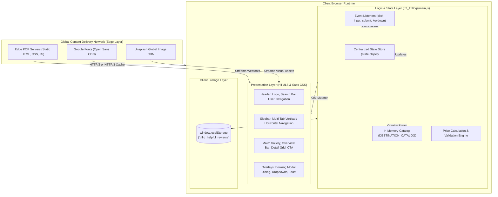
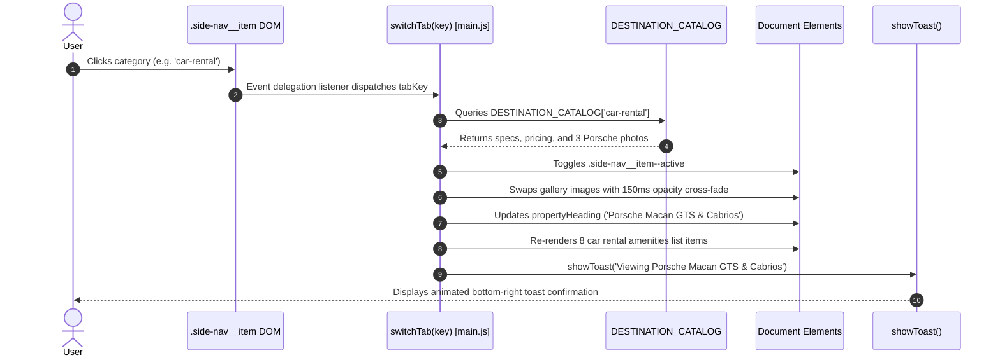
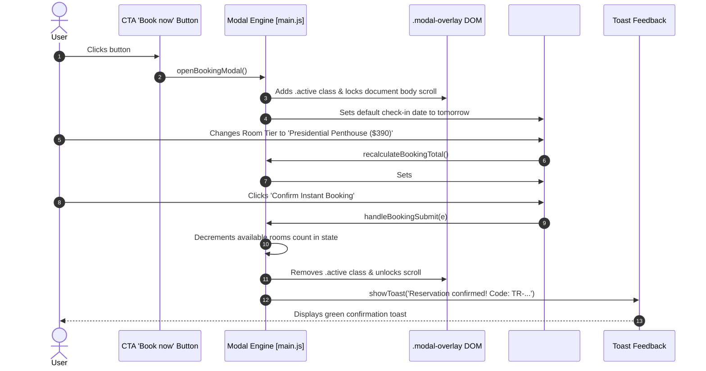
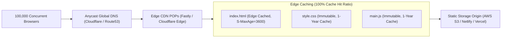

# 05. High-Level Architecture & Lifecycle Dynamics

---

## 1. High-Level Architecture Description
Trillo is architected as an **ultra-lean, client-side Single Page Interface (SPI)** running on pure web standards. Rather than relying on a heavy JavaScript runtime or server-side templating engine, the application operates through a decoupled **Presentation-Controller-Storage pattern**:
1. **Presentation Layer**: Built with semantic HTML5 markup and modular Sass compiled into [`02_Trillo/css/style.css`](file:///Users/avishjain/avishjain9-repos/52-trilo-travel-ui/02_Trillo/css/style.css). It handles fluid Flexbox alignment, 5-breakpoint responsive reflowing, SVG mask icons, and GPU-accelerated CSS transforms.
2. **Controller & State Layer**: Encapsulated in [`02_Trillo/js/main.js`](file:///Users/avishjain/avishjain9-repos/52-trilo-travel-ui/02_Trillo/js/main.js) as an IIFE. It orchestrates user events, tab transitions, real-time live search query scanning, and interactive modal calculations.
3. **Storage Layer**: Uses the browser's native `localStorage` for cross-session reaction persistence and in-memory JavaScript registries for active catalog state.

---

## 2. Interaction Lifecycles for Core Features

### 2.1 Multi-Tab Category Transition Lifecycle

---

### 2.2 Interactive Booking & Price Calculation Lifecycle

---

## 3. Database & Authentication Architecture
- **Database Backend**: **Not applicable for this project type** (Frontend-only application). State is managed via the client-side `DESTINATION_CATALOG` object and browser `localStorage`.
- **Authentication**: **Not applicable for this project type**. The user navigation bar displays a luxury traveler profile mock (*"Jonas"*) with direct access to bookmark lists and concierge messages without requiring server authentication sessions.

---

## 4. Error Handling Strategy Across Layers
1. **DOM Lookup Safety**: Elements are queried during `init()` and stored in the `DOM` cache object. All event listeners and mutators check for element existence before executing (`if (DOM.propertyHeading) ...`).
2. **Storage Fault Tolerance**: `JSON.parse` and `localStorage` interactions are guarded with default fallback objects (`|| '{}'`), preventing script crashes if cookies/storage are disabled in strict privacy modes.
3. **Timer Debouncing**: `clearTimeout(toastTimer)` is called prior to opening new notifications, preventing race conditions or flashing UI states.

---

## 5. Scaling to 100x Traffic & Bottleneck Analysis

Because Trillo is a static frontend web application with zero server runtime or database queries, scaling it to **100x or 10,000x traffic** is virtually effortless compared to traditional full-stack applications.

### The First Three Potential Bottlenecks & Solutions
1. **Unsplash Image Bandwidth & Latency**:
   - *Bottleneck*: Loading high-resolution photography directly from external Unsplash URLs on every page view can consume user bandwidth and introduce third-party DNS lookups.
   - *Senior Solution*: Serve optimized WebP/AVIF images from a localized image CDN edge with responsive `srcset` definitions and `loading="lazy"`.
2. **Google Fonts Render-Blocking Request**:
   - *Bottleneck*: Requesting `Open Sans` from `fonts.googleapis.com` introduces an external network handshake that can delay First Contentful Paint (FCP).
   - *Senior Solution*: Self-host WOFF2 font files directly on the same domain with `preload` links and `font-display: swap`.
3. **Browser Execution in Low-Power Devices**:
   - *Bottleneck*: Running backdrop blur (`backdrop-filter: blur(6px)`) and heavy box-shadows on low-end mobile devices can reduce frame rates below 60fps.
   - *Senior Solution*: Utilize `@supports not (backdrop-filter: blur(6px))` fallbacks with solid background colors and `@media (prefers-reduced-motion)` guards.
