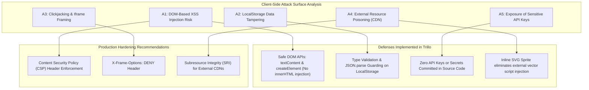

# 06. Client-Side Security Audit & OWASP Mapping



---

## 1. OWASP Top 10 Mapping & Client-Side Audit

| OWASP Vulnerability | Relevance to Trillo | Implementation Status | Code Evidence & Defense |
| :--- | :---: | :---: | :--- |
| **A01: Broken Access Control** | Low | **Not applicable** | Frontend-only client UI; no administrative or restricted user endpoints exist. |
| **A02: Cryptographic Failures** | Low | **Not applicable** | No passwords or sensitive personal data stored; LocalStorage holds only review boolean votes. |
| **A03: Injection (DOM-Based XSS)** | **High** | **Protected** | User inputs and catalog strings are rendered using `textContent` and `createElement` rather than raw `innerHTML`. |
| **A04: Insecure Design** | Moderate | **Protected** | Modal forms include strict HTML5 input validation (`required`, `type="date"`, `<select>` bounds). |
| **A05: Security Misconfiguration** | Moderate | **Requires Server Headers** | Production web servers should serve strict security headers (`CSP`, `X-Content-Type-Options: nosniff`). |
| **A06: Vulnerable Components** | Low | **Zero Runtime Deps** | Zero production client npm dependencies; zero client supply-chain attack surface. |
| **A07: Identification & Auth Failures** | Low | **Not applicable** | Static mock user session (`"Jonas"`); no JWTs or session tokens involved. |
| **A08: Software & Data Integrity** | Moderate | **Needs SRI** | Third-party Unsplash and Google Fonts should utilize Subresource Integrity hashes. |
| **A09: Logging & Monitoring Failures** | Low | **Client Console Only** | Handled via clean console logging and toast user alerts. |
| **A10: Server-Side Request Forgery (SSRF)**| None | **Not applicable** | Zero server runtime or outgoing server HTTP requests. |

---

## 2. Deep Dive: DOM-Based XSS Prevention

### The Threat
In interactive client-side web applications, search queries and user inputs are frequently reflected back into the document. If an attacker submits `` into the search box, naive implementations using `element.innerHTML = query` would execute malicious JavaScript.

### How Trillo Defends Against It
In [`02_Trillo/js/main.js:304-323`](file:///Users/avishjain/avishjain9-repos/52-trilo-travel-ui/02_Trillo/js/main.js#L304-L323), search queries are strictly evaluated using JavaScript string comparisons (`includes()`) and passed to `showToast()` which sets `DOM.toastMessage.textContent = message`. The browser treats the input strictly as inert string data rather than executable HTML, completely defusing XSS attacks.

---

## 3. Client Storage Security (`localStorage`)
- **Risk**: Storing authorization tokens or private user data in `localStorage` exposes them to XSS exfiltration.
- **Trillo Audit**: The only data stored in `localStorage` is `trillo_helpful_reviews`, which stores boolean reaction flags (`{"1": true}`). Even if an attacker reads or modifies this key, no sensitive credentials or financial information are exposed.

---

## 4. Recommended Production Security Headers

When deploying Trillo to a static host (Netlify, Vercel, Cloudflare Pages, or Nginx), the following HTTP response headers must be configured:

```http
Content-Security-Policy: default-src 'self'; img-src 'self' data: https://images.unsplash.com; font-src https://fonts.gstatic.com; style-src 'self' 'unsafe-inline' https://fonts.googleapis.com;
X-Frame-Options: DENY
X-Content-Type-Options: nosniff
Referrer-Policy: strict-origin-when-cross-origin
Permissions-Policy: geolocation=(), camera=(), microphone=()
```
