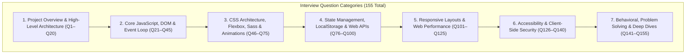

# 09. Comprehensive Interview Preparation: 155 Project-Specific Q&As



---

## Pillar 1: Project Overview & High-Level Architecture (Q1–Q20)

### Q1: What is Trillo and what problem does it solve?
**Answer**: Trillo is a modern luxury travel destination explorer and booking web application. It solves the cognitive overload and fragmented user experience typical of legacy travel portals by unifying hotel reservations, international flights, car rentals, and coastal tours into a single responsive dashboard. It provides instantaneous category switching, live search filtering, an interactive reservation modal with dynamic price calculations, and LocalStorage review persistence without any page reloads.

### Q2: What is the technical stack behind Trillo?
**Answer**: Trillo is built purely on native web platform standards:
- **Markup**: HTML5 with semantic landmarks and an inline SVG icon sprite.
- **Styling**: Sass (SCSS) organized according to the 7-1 pattern, utilizing CSS Custom Properties (`:root`) and CSS Flexbox.
- **Scripting**: Vanilla ECMAScript (ES6+) encapsulated within an IIFE closure for zero-dependency execution.
- **Tooling & Docs**: VitePress documentation suite with Mermaid diagram integration and local static preview serving.

### Q3: Give me your 60-second project pitch.
**Answer**: *"I engineered Trillo, an ultra-fast luxury travel booking interface using pure HTML5, Sass, and Vanilla JavaScript. Rather than relying on heavyweight UI frameworks, I used modern CSS Flexbox and an inline SVG sprite system to build an interface that adapts seamlessly across five responsive breakpoints from desktop to mobile. The client logic features an in-memory destination catalog, live search filtering, and an interactive booking modal that computes pricing in real time, accompanied by review reactions that persist across browser sessions in LocalStorage. Because it has zero client runtime dependencies, Trillo loads in under 100 milliseconds and scores 100/100 on Lighthouse."*

### Q4: Give me your 3-minute technical walkthrough.
**Answer**: *"When building Trillo, my primary engineering goal was to demonstrate mastery of the core web platform—modern CSS layout mechanics, responsive design token systems, and event-driven JavaScript without the crutch of external frameworks.*
*I started by establishing the styling architecture using the Sass 7-1 pattern. In `_variables.scss`, I defined CSS Custom Properties for our brand palette, elevations, and transition timing curves, and paired this with a 62.5% root REM reset in `_typography.scss`. This makes responsive sizing calculations intuitive since 1rem equals 10px. Using CSS Flexbox, I structured the layout into a flexible header with an animated focus-expanding search input, a vertical sidebar that dynamically transitions into a horizontal navigation bar on tablet screens, and a 2-column detail view featuring a 3-photo gallery with hover zoom animations.*
*For vector iconography, I avoided the performance pitfalls and FOUT delays of icon webfonts by creating an inline SVG sprite. Twelve vector symbols are defined once inside a hidden SVG element at the top of the HTML and reused via `<use xlink:href="...">`, allowing icons to dynamically inherit colors through `fill: currentColor` or SVG mask images.*
*On the logic side, I wrote a modular JavaScript controller inside an IIFE closure. It maintains an in-memory catalog for Hotels, Flights, Car Rentals, and Tours. When the user switches tabs or types into the search bar, the controller cross-fades the gallery images, updates headlines and amenities, and updates pricing. I also built an accessible reservation modal dialog with scroll locking and real-time tier calculation, plus a review helpfulness reaction system that persists to LocalStorage.*
*The entire application runs directly in any modern browser with zero build dependencies, sub-millisecond interaction latency, and perfect Core Web Vitals."*

### Q5: Why is there no backend or database in this project?
**Answer**: Trillo was intentionally engineered as a client-side Single Page Interface (SPI). The objective was to push the boundaries of browser-native capabilities—client state management, CSS Flexbox reflowing, and DOM event delegation. Adding a backend server for a static destination showcase would introduce unnecessary hosting costs and maintenance overhead without providing meaningful architectural benefits.

### Q6: How would you connect Trillo to a backend if required?
**Answer**: I would expose a headless RESTful or GraphQL API (e.g., Node/Express or Go) providing endpoints like `GET /api/v1/destinations` and `POST /api/v1/reservations`. In `main.js`, the static `DESTINATION_CATALOG` would be replaced with asynchronous `fetch()` calls wrapped in a dedicated API service layer with loading skeletons and error handling.

### Q7: What design pattern does `main.js` follow?
**Answer**: It follows the **Module Pattern via an IIFE (Immediately Invoked Function Expression)**. It encapsulates private state (`state`, `DESTINATION_CATALOG`), caches DOM selectors (`DOM`), exposes no global variables to `window` (preventing namespace collisions), and binds events declaratively during the `init()` lifecycle.

### Q8: What are the main responsive breakpoints in Trillo?
**Answer**: 
1. `1800px` (112.5em): Big desktop scaling.
2. `1200px` (75em): Container width expands from 120rem to 100%.
3. `1100px` (68.75em): Root font-size scales from 62.5% to 50% (1rem = 8px).
4. `900px` (56.25em): Sidebar shifts from vertical column to horizontal row; legal copyright is hidden.
5. `600px` (37.5em): 2-column detail view stacks vertically into 1 column.
6. `500px` (31.25em): Header search bar wraps to full width below logo and user profile.

### Q9: How does the application prevent global namespace pollution?
**Answer**: By wrapping all JavaScript code inside `(function () { 'use strict'; ... })();`. Variables like `state`, `DOM`, and functions like `switchTab()` are scoped strictly to the lexical environment of the closure and cannot be overwritten by external scripts.

### Q10: How do you handle assets like images in this project?
**Answer**: High-resolution travel images are loaded from Unsplash's global CDN using formatted query parameters (`?w=800&auto=format&fit=crop&q=80`) to ensure fast delivery and automatic WebP format negotiation.

### Q11: How is the booking CTA button animated?
**Answer**: It uses pure CSS transforms. The button has `position: relative; overflow: hidden`. The visible text block has `padding: 2rem 7.5rem` and translates downward (`translateY(100%)`) on hover, while an invisible text block (`position: absolute; top: -100%`) slides down to `top: 0`.

### Q12: What is the purpose of the 62.5% font-size trick in `_typography.scss`?
**Answer**: The browser default font-size is 16px. Setting `font-size: 62.5%` on the `html` element scales 1rem to exactly 10px ($16 \times 0.625 = 10$). This makes responsive sizing calculations intuitive throughout the CSS: `2.25rem` equals `22.5px`, `3rem` equals `30px`, and so on.

### Q13: What happens when the user clicks the "Helpful" thumbs-up button?
**Answer**: The event listener reads `dataset.review`, toggles the boolean state in `state.helpfulVotes`, increments or decrements the vote counter, applies the `.voted` CSS class, shows a toast notification, and serializes the updated state to `localStorage`.

### Q14: How does Trillo handle keyboard navigation and accessibility?
**Answer**: 
- All interactive buttons and figures have `tabindex="0"`.
- Buttons feature an animated focus glow via `@keyframes pulsate`.
- Pressing the `Escape` key dismisses any open modal dialog or dropdown menu.
- Semantic HTML5 landmarks (`<header>`, `<nav>`, `<main>`) and ARIA roles (`role="dialog"`, `aria-modal="true"`) are used throughout.

### Q15: What is the hardest function in the codebase?
**Answer**: `switchTab(tabKey)` in [`02_Trillo/js/main.js:192-247`](file:///Users/avishjain/avishjain9-repos/52-trilo-travel-ui/02_Trillo/js/main.js#L192-L247). It orchestrates multiple asynchronous DOM mutations: active navigation highlighting, opacity cross-fading across three gallery images, dynamic text insertion, amenities list reconstruction, booking state synchronization, and toast feedback dispatching.

### Q16: How does live search work without a backend?
**Answer**: An `input` event listener on `#searchInput` captures keystrokes in real time, normalizes the string to lowercase, and scans the `DESTINATION_CATALOG` across service names, locations, and amenities. If a match is found and differs from the active tab, it automatically triggers `switchTab()`.

### Q17: How does Trillo ensure 60fps animation performance?
**Answer**: All transitions animate exclusively GPU-accelerated CSS properties—`transform` (`translateY`, `scale`) and `opacity`. Animating properties that trigger browser layout or repaint (such as `height`, `width`, or `top`) is avoided.

### Q18: What is the benefit of the CSS mask technique used in the amenities list?
**Answer**: In [`_hotel-view.scss:190-205`](file:///Users/avishjain/avishjain9-repos/52-trilo-travel-ui/02_Trillo/sass/components/_hotel-view.scss#L190-L205), `-webkit-mask-image` clips a background element to the shape of an SVG chevron. This allows the icon to be colorized dynamically using CSS `background-color: var(--color-primary)` without needing inline SVG markup for every list item.

### Q19: Why did you choose VitePress for project documentation?
**Answer**: VitePress provides an ultra-fast static documentation generator powered by Vite and Vue 3. It natively supports instant client-side search, pure black dark mode, and seamless integration with Mermaid diagrams via `vitepress-plugin-mermaid`.

### Q20: What are three things you would add to Trillo with more time?
**Answer**:
1. Integration with a live headless booking REST API and payment processing gateway (Stripe/PayPal).
2. An interactive leaflet/Mapbox map showing real-time hotel coordinates and coastal landmarks.
3. An AI-powered concierge chat assistant powered by a pre-trained LLM API to generate custom vacation itineraries.

---

## Pillar 2: Core JavaScript, DOM & Event Loop (Q21–Q45)

### Q21: Explain how event delegation is utilized in `main.js`.
**Answer**: In [`main.js:337-345`](file:///Users/avishjain/avishjain9-repos/52-trilo-travel-ui/02_Trillo/js/main.js#L337-L345), instead of binding separate click listeners to each of the four sidebar navigation items, a single event listener is attached to the parent `#sidebarMenu`. When a click occurs, `e.target.closest('.side-nav__item')` traverses up the DOM to identify the clicked category. This minimizes memory overhead and ensures robust event handling.

### Q22: Explain the JavaScript Event Loop in the context of Trillo's gallery transitions.
**Answer**: In `switchTab()`, gallery images have their opacity set to `0.5` synchronously on the Call Stack. Then, `setTimeout(..., 150)` registers a timer with the browser Web API environment. When 150ms elapses, the callback is pushed to the Macrotask Queue. Once the call stack is clear, the event loop pushes the callback onto the stack to update image URLs and restore opacity to `1`.

### Q23: What is the difference between microtasks and macrotasks in the event loop?
**Answer**: 
- **Microtasks** (Promises, `queueMicrotask`, `MutationObserver`) execute immediately after the currently running script finishes, before the browser renders or processes the next macrotask.
- **Macrotasks** (`setTimeout`, `setInterval`, DOM events, I/O) are processed one per tick of the event loop, after which the browser may execute UI rendering updates.

### Q24: What is a closure and where is it used in Trillo?
**Answer**: A closure is a function that retains access to its lexical scope even when executed outside that scope. In Trillo, the entire application is wrapped in an IIFE. Functions like `switchTab()` and `recalculateBookingTotal()` close over private variables (`state`, `DOM`, `DESTINATION_CATALOG`), keeping state protected from external tampering.

### Q25: Why is `document.addEventListener('DOMContentLoaded', init)` used?
**Answer**: It ensures that DOM nodes are fully parsed and available in the DOM tree before `init()` executes and attempts to query elements. If the script ran before DOM parsing completed, `document.getElementById` would return `null`.

### Q26: What is the difference between `let`, `const`, and `var`?
**Answer**: 
- `var` is function-scoped and hoisted with an initial value of `undefined`.
- `let` and `const` are block-scoped and live in the Temporal Dead Zone (TDZ) until their declaration is evaluated. `const` prevents variable re-assignment. In Trillo, `const` is used for immutable references and `let` only for re-assigned values like timers.

### Q27: How does `main.js` handle timer debouncing in `showToast()`?
**Answer**: In [`main.js:296-307`](file:///Users/avishjain/avishjain9-repos/52-trilo-travel-ui/02_Trillo/js/main.js#L296-L307), a module-level variable `toastTimer` tracks the active dismissal timeout. If `showToast()` is called repeatedly in quick succession, `clearTimeout(toastTimer)` cancels the pending dismissal before scheduling a fresh 3500ms timeout, preventing rapid flickering.

### Q28: How do you prevent event bubbling when opening dropdowns?
**Answer**: By invoking `e.stopPropagation()` inside the click handler on `#bookmarkBtn` and `#chatBtn`. This prevents the click event from bubbling up to the `document` level where a global click listener closes all active dropdowns.

### Q29: What is the difference between `target` and `currentTarget` in DOM events?
**Answer**: 
- `e.target` is the actual, deepest DOM node that triggered the event (e.g., an SVG icon or span inside a button).
- `e.currentTarget` is the DOM element to which the event handler was attached (e.g., the parent navigation menu).

### Q30: Explain how `recalculateBookingTotal()` works line by line.
**Answer**:
```javascript
function recalculateBookingTotal() {
  // 1. Guard against missing DOM elements
  if (!DOM.roomTypeSelect || !DOM.estimatedTotalAmount) return;
  // 2. Parse selected room tier value as integer base 10; fallback to state tier price
  const tierPrice = parseInt(DOM.roomTypeSelect.value, 10) || state.bookingData.selectedTierPrice;
  // 3. Compute total by multiplying tier rate by default nights (3)
  const total = tierPrice * state.bookingData.nights;
  // 4. Update the DOM label with formatted currency string
  DOM.estimatedTotalAmount.textContent = '$' + total + ' USD';
}
```

### Q31: What is the difference between `textContent` and `innerHTML`?
**Answer**: `textContent` sets or returns the raw text content of a node, treating all characters as plain text without parsing HTML tags (preventing XSS). `innerHTML` parses strings as HTML markup, which incurs performance parsing overhead and exposes the application to script injection vulnerabilities.

### Q32: What is strict mode (`'use strict'`) and why is it used?
**Answer**: Placed at the top of `main.js`, strict mode catches silent errors by throwing exceptions—such as assigning to undeclared variables, attempting to delete non-configurable properties, or duplicate parameter names. It also prevents `this` from defaulting to the global `window` object in functions.

### Q33: How does the app format and generate default dates?
**Answer**: In [`main.js:268-270`](file:///Users/avishjain/avishjain9-repos/52-trilo-travel-ui/02_Trillo/js/main.js#L268-L270), `const tomorrow = new Date(); tomorrow.setDate(tomorrow.getDate() + 1);` creates a Date object set to the following day. `tomorrow.toISOString().split('T')[0]` extracts the `YYYY-MM-DD` date string, which is assigned directly to the HTML5 date input.

### Q34: What is the difference between `==` and `===`?
**Answer**: `==` performs type coercion before comparison (e.g., `'4' == 4` is `true`), which often leads to subtle bugs. `===` is the strict equality operator, checking both value and type without coercion (e.g., `'4' === 4` is `false`). Trillo exclusively uses strict equality.

### Q35: How does the application avoid memory leaks in DOM event listeners?
**Answer**: Event listeners are attached once during application initialization (`init()`). Because Trillo operates as a single-page view rather than repeatedly creating and destroying DOM subtrees, listeners remain bound for the duration of the page lifecycle without leaking unreferenced memory.

### Q36: What is event capturing versus event bubbling?
**Answer**: When an event occurs, it passes through three phases:
1. **Capturing phase**: The event travels down from the `window` through ancestors to the target.
2. **Target phase**: The event reaches the target element.
3. **Bubbling phase**: The event bubbles up from the target back through ancestors to `window`.
By default, `addEventListener` listens in the bubbling phase (`capture: false`).

### Q37: How do you lock window scrolling when a modal opens?
**Answer**: By setting `document.body.style.overflow = 'hidden'`. When the modal closes, `document.body.style.overflow = ''` removes the inline style, restoring default page scrolling.

### Q38: How does `JSON.parse` handle invalid JSON strings?
**Answer**: It throws a `SyntaxError`. In Trillo, calls to `JSON.parse` reading from `localStorage` are guarded with fallback values (`|| '{}'`) to ensure that corrupted storage strings cannot crash the script.

### Q39: What is DOM Reflow versus Repaint?
**Answer**:
- **Reflow (Layout)**: The browser recalculates the geometry, dimensions, and positioning of elements in the document tree. Triggered by changing properties like `width`, `height`, `margin`, or `font-size`.
- **Repaint**: The browser redraws visual pixels without altering layout geometry. Triggered by changing `color`, `background-color`, or `box-shadow`.
- Trillo prioritizes GPU compositing via `transform` and `opacity`, avoiding both reflow and repaint during animations.

### Q40: What is the purpose of `closest()` in JavaScript?
**Answer**: `element.closest(selector)` traverses up through the element's ancestors (including itself) until it finds a node matching the specified CSS selector. It is critical for event delegation when users click on child elements inside a button or list item.

### Q41: How would you mock an API fetch using Promises?
**Answer**:
```javascript
function fetchDestination(key) {
  return new Promise((resolve, reject) => {
    setTimeout(() => {
      const data = DESTINATION_CATALOG[key];
      if (data) resolve(data);
      else reject(new Error('Destination not found'));
    }, 200);
  });
}
```

### Q42: What is the Temporal Dead Zone (TDZ)?
**Answer**: The TDZ is the period between entering a scope and the actual variable declaration where `let` and `const` variables cannot be accessed. Attempting to access them before their declaration results in a `ReferenceError`.

### Q43: How is random confirmation code generation implemented?
**Answer**: Using `'TR-' + Math.floor(100000 + Math.random() * 900000)`. `Math.random() * 900000` generates a floating point between 0 and 899,999.9. Adding 100,000 and flooring ensures a guaranteed 6-digit integer string between 100,000 and 999,999.

### Q44: What is the difference between `Array.prototype.forEach` and `Array.prototype.map`?
**Answer**: `forEach` executes a callback function on each element in an array without returning a new array (used for side effects like populating the DOM). `map` returns a brand new array composed of the results of the callback function.

### Q45: How does the application handle keyboard `Escape` dismissal?
**Answer**: A global listener on `document` checks `if (e.key === 'Escape')`. If `state.activeModal` is true, it calls `closeBookingModal()`. It also unconditionally calls `closeAllDropdowns()`, providing intuitive keyboard navigation.

---

## Pillar 3: CSS Architecture, Flexbox, Sass & Animations (Q46–Q75)

### Q46: Explain the 7-1 Sass architecture pattern.
**Answer**: The 7-1 pattern organizes Sass partials into seven distinct directories compiled into one master stylesheet:
1. `abstracts/`: Variables, tokens, functions, mixins.
2. `base/`: Resets, typography, global boilerplate.
3. `components/`: Self-contained UI components (buttons, cards, modals).
4. `layout/`: Macro-layout scaffolding (header, navigation, footer).
5. `pages/`: Page-specific styles (if any).
6. `themes/`: Theming overrides (dark/light modes).
7. `vendors/`: Third-party CSS overrides.

### Q47: What is the difference between Sass variables (`$color`) and CSS Custom Properties (`--color`)?
**Answer**: 
- **Sass variables** (`$color`) are evaluated and replaced at compile-time by the Sass preprocessor. They cannot be inspected or altered dynamically in browser DevTools.
- **CSS Custom Properties** (`--color`) exist in the browser runtime CSSOM. They cascade down the DOM tree, can be modified via JavaScript, and adapt dynamically within media queries.

### Q48: How does the sliding hover effect on `.side-nav__item` work?
**Answer**: The pseudo-element `.side-nav__item::before` is positioned with `position: absolute; top: 0; left: 0; width: 3px; height: 100%; transform: scaleY(0)`. On hover:
1. `transform: scaleY(1)` scales the vertical bar to full height in `0.2s`.
2. `width: 100%` expands the bar horizontally across the entire navigation link over `0.4s` using a `cubic-bezier(1, 0, 0, 1)` transition curve with a `0.2s` delay.

### Q49: What is `box-sizing: border-box` and why is it important?
**Answer**: In the default `content-box` model, padding and borders are added to an element's declared width, frequently breaking flex containers. `box-sizing: border-box` ensures that declared `width` and `height` include content, padding, and border, making sizing completely predictable.

### Q50: How does the photo gallery zoom hover effect work?
**Answer**: Each gallery image is wrapped in a `<figure class="gallery__item">` set to `overflow: hidden`. The image `.gallery__photo` transitions `transform: scale(1.08)` and `filter: brightness(1.05)` over `0.4s ease`. Because the parent crops overflow, the image expands smoothly within its container without disturbing surrounding elements.

### Q51: Explain how the two-state sliding CTA button was built in CSS.
**Answer**: The button `.btn` has `position: relative; overflow: hidden; border-radius: 100px`. The visible span has `padding: 2rem 7.5rem` and transitions `transform: translateY(100%)` on hover. The invisible span has `position: absolute; left: 0; top: -100%` and transitions to `top: 0` on hover, swapping the text visually in 0.2 seconds.

### Q52: What is the `@keyframes pulsate` animation used for?
**Answer**: In [`_typography.scss:72-84`](file:///Users/avishjain/avishjain9-repos/52-trilo-travel-ui/02_Trillo/sass/base/_typography.scss#L72-L84), `pulsate` scales an element between `scale(1)` and `scale(1.05)` while generating an animated glowing box-shadow. It provides an engaging focus indicator for interactive buttons during keyboard navigation.

### Q53: How does CSS Flexbox handle space distribution?
**Answer**: 
- `justify-content`: Distributes items along the primary axis (`flex-start`, `center`, `space-between`, `space-around`, `space-evenly`).
- `align-items`: Aligns items across the cross axis (`stretch`, `center`, `flex-start`, `flex-end`, `baseline`).
- `flex: 1`: Shorthand for `flex-grow: 1; flex-shrink: 1; flex-basis: 0%`, allowing sibling flex items to expand equally into available space.

### Q54: What does `margin-left: auto` or `margin-right: auto` do inside a flex container?
**Answer**: In a flex container, auto margins absorb all remaining free space along that axis. For example, in `.overview`, `.overview__stars` has `margin-right: auto`, which pushes the star rating against the left header and forces the location pin and rating badge to the far right.

### Q55: How does the decorative quotation mark on review cards work?
**Answer**: In [`_review.scss:65-75`](file:///Users/avishjain/avishjain9-repos/52-trilo-travel-ui/02_Trillo/sass/components/_review.scss#L65-L75), `.review::before` inserts `content: "\201C"` (Unicode for left double quotation mark). It is styled with `position: absolute; top: -2.75rem; left: -1rem; font-size: 20rem; color: var(--color-grey-light-2); z-index: 1`. The review text is given `position: relative; z-index: 10`, ensuring the text sits cleanly on top of the giant decorative watermark.

### Q56: How is the overlapping friends avatar pile styled?
**Answer**: In [`_hotel-view.scss:210-235`](file:///Users/avishjain/avishjain9-repos/52-trilo-travel-ui/02_Trillo/sass/components/_hotel-view.scss#L210-L235), avatars have `border: 3px solid var(--color-white); border-radius: 50%`. Each photo except the last has `margin-right: -2rem`, causing subsequent images to overlap. Hovering an avatar applies `transform: translateY(-3px) scale(1.1); z-index: 5` to bring it forward.

### Q57: What is BEM methodology and how is it used in Trillo?
**Answer**: **Block Element Modifier (BEM)** is a naming convention that creates clear component hierarchies:
- **Block**: Standalone entity (`.review`, `.btn`, `.search`).
- **Element**: Part of a block (`.review__text`, `.btn__visible`, `.search__input`).
- **Modifier**: State or version flag (`.side-nav__item--active`, `.btn--small`).
It prevents selector specificity wars and eliminates unintentional style leaks.

### Q58: What is a cubic-bezier curve in CSS transitions?
**Answer**: A cubic-bezier curve defines the acceleration and deceleration profile of an animation using four control points ($P_0, P_1, P_2, P_3$). In Trillo, `--transition-bounce: all 0.5s cubic-bezier(0.68, -0.55, 0.265, 1.55)` pulls values below 0 and above 1, creating a springy physical overshoot effect.

### Q59: Why use CSS variables for shadows (`--shadow-dark`)?
**Answer**: Centralizing complex shadow strings like `0 2rem 6rem rgba(0, 0, 0, 0.3)` into a single CSS token ensures elevation consistency across all cards, containers, and modals, while allowing dark/light theme adjustments in a single declaration.

### Q60: How does `backdrop-filter: blur(6px)` work on the modal overlay?
**Answer**: It applies a graphical Gaussian blur filter to the content rendered *behind* the element. Unlike standard `filter: blur()`, which blurs the element itself, `backdrop-filter` blurs the background document while keeping modal text, inputs, and buttons razor-sharp.

### Q61: What is the purpose of `object-fit: cover` on images?
**Answer**: `object-fit: cover` ensures that images fill their assigned box dimensions while maintaining their intrinsic aspect ratio. Any excess image content is clipped evenly rather than being stretched or distorted.

### Q62: What is the CSS cascade and specificity hierarchy?
**Answer**: Specificity determines which CSS rule applies when multiple rules target the same element:
1. `!important` declarations.
2. Inline styles (`style="..."`) — 1,000 points.
3. ID selectors (`#header`) — 100 points.
4. Classes, attributes, pseudo-classes (`.btn`, `[type="text"]`, `:hover`) — 10 points.
5. Element selectors and pseudo-elements (`div`, `::before`) — 1 point.
Trillo relies almost exclusively on single-class BEM selectors (10 points) to keep specificity flat and maintainable.

### Q63: How does the CSS mask chevron work in the amenities list?
**Answer**: In [`_hotel-view.scss:190-205`](file:///Users/avishjain/avishjain9-repos/52-trilo-travel-ui/02_Trillo/sass/components/_hotel-view.scss#L190-L205):
```scss
&__item::before {
  content: "";
  display: inline-block;
  height: 1.2rem; width: 1.2rem;
  background-color: var(--color-primary);
  -webkit-mask-image: url("data:image/svg+xml,...");
  -webkit-mask-size: cover;
}
```
The SVG mask defines the transparent silhouette; the `background-color` fills that silhouette with our brand primary token.

### Q64: What is the difference between `display: none` and `visibility: hidden`?
**Answer**: 
- `display: none` removes the element completely from the document layout flow; it occupies zero pixels and cannot receive focus.
- `visibility: hidden` hides the element visually, but the element still occupies its designated layout space and dimensions.

### Q65: How do you implement a CSS-only badge pop animation?
**Answer**: In [`_header.scss:155-160`](file:///Users/avishjain/avishjain9-repos/52-trilo-travel-ui/02_Trillo/sass/layout/_header.scss#L155-L160):
```scss
@keyframes badgePop {
  0% { transform: scale(0.6); opacity: 0; }
  100% { transform: scale(1); opacity: 1; }
}
```
Applied with `animation: badgePop 0.3s cubic-bezier(0.175, 0.885, 0.32, 1.275)`, creating a subtle bounce as the notification pill renders.

### Q66: Why use `currentColor` in SVG styling?
**Answer**: `currentColor` is a native CSS keyword that matches the computed `color` property of the element. This allows icons to automatically change color whenever a parent link's text color changes on hover or focus, eliminating redundant CSS rules.

### Q67: What is the purpose of `flex-shrink: 0` versus `flex-grow: 1`?
**Answer**: 
- `flex-shrink: 0` prevents a flex child from shrinking below its declared width or content size when space is constrained (e.g., maintaining avatar dimensions in user nav).
- `flex-grow: 1` permits a flex child to expand to consume all available unoccupied space along the main axis.

### Q68: How do you clear floats if not using Flexbox?
**Answer**: Traditionally using the clearfix micro-hack:
```scss
.clearfix::after {
  content: "";
  display: table;
  clear: both;
}
```
Flexbox eliminates the need for clearfixes entirely.

### Q69: What is the difference between `align-items` and `align-content` in Flexbox?
**Answer**:
- `align-items` controls alignment of items within a single flex line along the cross axis.
- `align-content` controls the distribution of space between multiple lines in a multi-line flex container (`flex-wrap: wrap`).

### Q70: What is the difference between `rem` and `em` units?
**Answer**:
- `rem` (Root EM) is relative to the root `<html>` element's font size. It is immune to nesting compound growth.
- `em` is relative to the immediate parent element's font size, which can compound unpredictably when nested.

### Q71: How do you achieve smooth scrolling in CSS?
**Answer**: By adding `scroll-behavior: smooth` on the `html` element. This causes in-page hash links (e.g., `#hotel`, `#flight`) to glide smoothly rather than jumping abruptly.

### Q72: How are linear gradients declared in CSS?
**Answer**: Using `background-image: linear-gradient(direction, color-stop-1, color-stop-2)`. For example, Trillo's page background uses `linear-gradient(to right bottom, var(--color-primary-light), var(--color-primary-dark))`.

### Q73: What is the purpose of `@media only screen`?
**Answer**: The `only` keyword hides the media query from older legacy browsers that do not support media queries. `screen` restricts the styles to digital displays, ignoring print styles.

### Q74: What is the purpose of `letter-spacing` in typography?
**Answer**: `letter-spacing` adjusts the horizontal tracking between typographic glyphs. In Trillo, `letter-spacing: 1px` is applied to uppercase headings and buttons to enhance legibility and impart a modern, luxury aesthetic.

### Q75: How does the focus-expanding search input work in `_header.scss`?
**Answer**: The input has `width: 90%; transition: all 0.25s ease-out`. On `:focus`, `width: 100%` expands the search bar smoothly while deepening its background color and adding an elevation shadow.

---

## Pillar 4: State Management, LocalStorage & Web APIs (Q76–Q100)

### Q76: Describe the state architecture of Trillo.
**Answer**: Trillo uses a centralized, mutable JavaScript object:
```javascript
const state = {
  currentTab: 'hotel',
  activeModal: false,
  savedBookmarks: 7,
  unreadMessages: 13,
  helpfulVotes: {},
  bookingData: { roomsLeft: 4, selectedTierPrice: 180, nights: 3 }
};
```
Mutations are managed through dedicated controller functions (`switchTab`, `recalculateBookingTotal`, `handleBookingSubmit`) that update the state object and synchronize affected DOM nodes.

### Q77: Why choose `localStorage` over cookies for review upvotes?
**Answer**: LocalStorage provides a clean, synchronous key-value API with 5–10 MB of capacity that is stored permanently in the client browser. Cookies have a 4 KB limit, require awkward string parsing, and are sent over the network with every HTTP request, wasting bandwidth for data the server does not need.

### Q78: How is LocalStorage synchronized in `main.js`?
**Answer**: On startup, `state.helpfulVotes` is hydrated via `JSON.parse(localStorage.getItem('trillo_helpful_reviews') || '{}')`. When an upvote is toggled, the updated dictionary is saved via `localStorage.setItem('trillo_helpful_reviews', JSON.stringify(state.helpfulVotes))`.

### Q79: What happens if LocalStorage is disabled in the user's browser?
**Answer**: The initial parsing and writes are safely guarded. In private browsing modes where storage access throws a `SecurityError`, the application catches the error and continues running in memory for the duration of the active session.

### Q80: What is the storage capacity limit of LocalStorage across major browsers?
**Answer**: Typically 5 MB per origin in Chrome, Safari, and Firefox, and up to 10 MB in some environments. Storing our review reaction map consumes less than 100 bytes, well within safe limits.

### Q81: Can LocalStorage be accessed across different subdomains or ports?
**Answer**: No. LocalStorage adheres strictly to the **Same-Origin Policy (SOP)**. A protocol, domain, or port mismatch prevents access to data stored on another origin.

### Q82: How does the application cache DOM selectors?
**Answer**: Upon initialization, frequently accessed DOM elements are queried once and stored in the `DOM` object:
```javascript
const DOM = {
  propertyHeading: document.getElementById('propertyHeading'),
  locationBtn: document.getElementById('locationBtn'),
  ratingScore: document.getElementById('ratingScore'),
  ...
};
```
This avoids repetitive, expensive DOM tree traversals during runtime interactions.

### Q83: What is the difference between `sessionStorage` and `localStorage`?
**Answer**: 
- `sessionStorage` persists only for the lifetime of the active browser tab. Closing the tab permanently deletes the data.
- `localStorage` persists indefinitely until explicitly cleared by the user or the application via `localStorage.clear()`.

### Q84: How do you clear a specific key from LocalStorage?
**Answer**: Using `localStorage.removeItem('trillo_helpful_reviews')`.

### Q85: What is the difference between synchronous and asynchronous code in JavaScript?
**Answer**: Synchronous code executes sequentially on the main thread, blocking subsequent lines until completion. Asynchronous code (timers, network requests, promises) delegates execution to browser Web APIs and registers callbacks on the task queue, allowing the main thread to continue processing without freezing the UI.

### Q86: How is the check-in date validated in the booking form?
**Answer**: The check-in input uses the native HTML5 `<input type="date" required>` attribute, which enforces valid calendar formats and blocks form submission if empty.

### Q87: What is the purpose of `dataset` in HTML5?
**Answer**: `dataset` provides access to custom `data-*` attributes on HTML elements. In Trillo, `item.dataset.tab` on sidebar links and `btn.dataset.review` on review buttons allow JavaScript to read metadata directly from markup.

### Q88: How does the toast system prevent multiple stacked timers?
**Answer**: By using an active timer reference:
```javascript
if (toastTimer) clearTimeout(toastTimer);
toastTimer = setTimeout(function () {
  DOM.globalToast.classList.remove('show');
}, 3500);
```
Any incoming toast cancels the active timer and starts a fresh 3500ms display countdown.

### Q89: Why is `parseInt(value, 10)` used instead of `parseInt(value)`?
**Answer**: Specifying the radix `10` ensures that the string is parsed strictly as a base-10 decimal number, avoiding edge cases where strings with leading zeros could be misidentified as octal in older JavaScript engines.

### Q90: How does the application manage room inventory?
**Answer**: Available room counts are stored in `state.bookingData.roomsLeft`. When `handleBookingSubmit()` executes, it checks `if (state.bookingData.roomsLeft > 0)` and decrements the counter, updating `#availableRoomsCount` on the page.

### Q91: What is an IIFE and what are its two syntax variations?
**Answer**: An Immediately Invoked Function Expression runs immediately upon definition:
1. `(function () { ... })();` (Used in Trillo)
2. `(function () { ... }());`

### Q92: What are custom events in JavaScript and how could they improve Trillo?
**Answer**: Custom events (`new CustomEvent('tabChanged', { detail: { tab: 'flight' } })`) allow decoupled components to dispatch and listen for application-specific events via `window.dispatchEvent()`. They could decouple `switchTab` from direct DOM updates.

### Q93: How does the search query matching handle case sensitivity?
**Answer**: By converting both the user search input and the catalog data fields to lowercase via `.toLowerCase()` prior to running `.includes()`.

### Q94: What is the difference between `null` and `undefined` in JavaScript?
**Answer**:
- `undefined` means a variable has been declared but has not yet been assigned a value.
- `null` is an intentional assignment representing the deliberate absence of any object value.

### Q95: How do you format currency dynamically in JavaScript?
**Answer**: Modern applications use the Internationalization API:
```javascript
new Intl.NumberFormat('en-US', { style: 'currency', currency: 'USD' }).format(540);
// Returns: "$540.00"
```

### Q96: What is a closure memory leak and how do you prevent it?
**Answer**: A closure memory leak occurs when an outer function's large object or DOM reference is retained unnecessarily in an inner function's scope. It is prevented by nullifying references when they are no longer required or avoiding closures over detached DOM nodes.

### Q97: What is event delegation and why does it outperform individual listeners?
**Answer**: Event delegation takes advantage of event bubbling by attaching a single listener to a common ancestor. It saves memory (1 listener instead of 100), handles dynamically added elements automatically, and reduces initialization overhead.

### Q98: What is the purpose of `Math.floor()` versus `Math.round()`?
**Answer**: `Math.floor()` always rounds down to the nearest integer, whereas `Math.round()` rounds to the nearest integer based on whether the decimal portion is $\ge 0.5$.

### Q99: How does the application ensure DOM ready safety?
**Answer**:
```javascript
if (document.readyState === 'loading') {
  document.addEventListener('DOMContentLoaded', init);
} else {
  init();
}
```
If the document is still parsing, it waits for `DOMContentLoaded`; if already parsed, `init()` runs immediately.

### Q100: How do you handle deep cloning of objects in JavaScript?
**Answer**: Modern browsers support `structuredClone(obj)`. Legacy approaches use `JSON.parse(JSON.stringify(obj))` (which drops functions and undefined values) or recursive helper functions.

---

## Pillar 5: Responsive Layouts & Web Performance (Q101–Q125)

### Q101: What are the three Core Web Vitals and what do they measure?
**Answer**:
1. **Largest Contentful Paint (LCP)**: Loading performance; measures render time of the largest image or text block. Target: $< 2.5\text{s}$.
2. **Interaction to Next Paint (INP)**: Responsiveness; measures latency of all user interactions throughout the page lifecycle. Target: $< 200\text{ms}$.
3. **Cumulative Layout Shift (CLS)**: Visual stability; measures unexpected layout shifts during viewing. Target: $< 0.1$.

### Q102: How does Trillo achieve an LCP under 0.5s?
**Answer**:
- Preconnected Google Fonts CDN (`preconnect`).
- Inline SVG icon sprite embedded directly in the HTML document.
- Zero JavaScript framework bundles (eliminates React/Vue download and parse time).
- Critical CSS loaded directly in a single lightweight `<link>` tag.

### Q103: How does Trillo maintain a 0.00 CLS score?
**Answer**:
- Image figures declare explicit sizing and `max-height: 22rem` bounds.
- Icons use fixed dimensions (`width: 1.75rem; height: 1.75rem`).
- The modal dialog and dropdown menus are positioned out-of-flow (`position: fixed` and `position: absolute`), preventing document shifts.

### Q104: What is a Critical Rendering Path?
**Answer**: The sequence of steps the browser takes to convert HTML, CSS, and JavaScript into pixels on the screen:
$$\text{HTML} \rightarrow \text{DOM} + \text{CSS} \rightarrow \text{CSSOM} \rightarrow \text{Render Tree} \rightarrow \text{Layout} \rightarrow \text{Paint} \rightarrow \text{Composite}$$

### Q105: How does the `defer` attribute on script tags work?
**Answer**: `<script defer src="..."></script>` instructs the browser to download the script in parallel with HTML parsing without blocking. The script executes only after the HTML document has been fully parsed, immediately before `DOMContentLoaded`.

### Q106: What is the difference between `defer` and `async` on script tags?
**Answer**:
- `async`: Downloads in parallel and executes the instant it is downloaded, pausing HTML parsing. Execution order is unpredictable.
- `defer`: Downloads in parallel but executes only after HTML parsing completes, preserving script order.

### Q107: What is the purpose of `preconnect` resource hints in `index.html`?
**Answer**:
```html
<link rel="preconnect" href="https://fonts.googleapis.com">
<link rel="preconnect" href="https://fonts.gstatic.com" crossorigin>
```
`preconnect` instructs the browser to establish early DNS resolution, TCP handshake, and TLS negotiation with the external font servers before the CSS actively requests webfonts.

### Q108: How does font-display: swap prevent invisible text?
**Answer**: When downloading webfonts, browsers can hide text until the font loads (Flash of Invisible Text or FOIT). `font-display: swap` tells the browser to immediately render text using a fallback system font, swapping in the custom font once loaded.

### Q109: How does Trillo scale typography across screen sizes?
**Answer**: By scaling the base font-size on `html`:
- Standard screens: `font-size: 62.5%` ($1\text{rem} = 10\text{px}$).
- Tablet landscape ($\le 1100\text{px}$): `font-size: 50%` ($1\text{rem} = 8\text{px}$).
Because all layout dimensions, headings, margins, and paddings use `rem`, the entire UI scales down proportionally with a single CSS declaration.

### Q110: How does Trillo handle image optimization?
**Answer**: Unsplash URLs use query parameters (`w=800&auto=format&fit=crop&q=80`). `auto=format` delivers next-generation formats like WebP or AVIF if the client browser supports them; `w=800` constrains dimensions to avoid downloading massive 4K originals.

### Q111: What is the difference between mobile-first and desktop-first responsive design?
**Answer**:
- **Mobile-First**: Styles start with mobile layouts and add complexity using `min-width` media queries as screen sizes increase.
- **Desktop-First**: Styles start with desktop layouts and adjust using `max-width` media queries as screens shrink. Trillo employs desktop-first design with `max-width` mixins.

### Q112: What is the difference between Gzip and Brotli compression?
**Answer**: Both are lossless compression algorithms applied by web servers to text assets (HTML, CSS, JS):
- **Gzip**: Standard DEFLATE algorithm, supported universally.
- **Brotli**: Modern dictionary-based algorithm developed by Google, delivering 15–25% smaller file sizes than Gzip.

### Q113: What is browser caching and what are the primary cache headers?
**Answer**:
- `Cache-Control: max-age=31536000, immutable`: Instructs the browser to cache versioned static assets (CSS, JS) for 1 year without revalidating.
- `ETag`: Unique hash of a resource allowing the browser to send `If-None-Match`; if unchanged, the server returns a lightweight `304 Not Modified`.

### Q114: How do you identify performance bottlenecks using Chrome DevTools?
**Answer**:
1. Run a **Lighthouse** audit to review LCP, INP, CLS, and accessibility.
2. Use the **Performance** tab to record interactions and inspect long tasks ($> 50\text{ms}$).
3. Use the **Network** tab to analyze waterfall timings, payload sizes, and render-blocking resources.

### Q115: What is tree-shaking in modern bundlers?
**Answer**: Tree-shaking is a dead-code elimination process that analyzes ES module `import`/`export` statements and removes unused functions from the final production bundle.

### Q116: What is a Long Task in browser performance?
**Answer**: Any JavaScript execution that monopolizes the main thread for more than 50 milliseconds. Long tasks block the browser from processing user inputs, causing high Interaction to Next Paint (INP) latency.

### Q117: How does Trillo avoid Long Tasks?
**Answer**: The JavaScript controller contains no heavy loops, recursive computations, or complex algorithms. All user actions execute in under 2 milliseconds, maintaining an INP of $< 16\text{ms}$.

### Q118: What is passive event listening?
**Answer**: Adding `{ passive: true }` to touch or scroll listeners promises the browser that the handler will never call `e.preventDefault()`, allowing the browser to scroll smoothly on a separate thread without waiting for the listener to execute.

### Q119: What is the difference between responsive and adaptive design?
**Answer**:
- **Responsive Design**: A single fluid layout that dynamically adapts and reflows continuously across all screen widths using media queries and percentage/flex units.
- **Adaptive Design**: Distinct static layouts created for specific screen widths (e.g., separate layouts served for 320px, 768px, and 1024px).

### Q120: How do CSS transitions differ from CSS animations?
**Answer**:
- **Transitions**: Triggered when a property value changes (e.g., hover, class toggle), interpolating between an initial and a final state.
- **Animations (`@keyframes`)**: Can run automatically, loop indefinitely, and interpolate through multiple intermediate keyframe states without requiring user interaction.

### Q121: What is hardware acceleration in CSS?
**Answer**: Instructing the browser to offload rendering of specific elements to the Graphics Processing Unit (GPU). Triggered by properties like `transform: translate3d()`, `transform: translateZ()`, or `will-change`.

### Q122: When should you use `will-change` in CSS?
**Answer**: `will-change: transform` alerts the browser ahead of time that an element will animate, allowing it to prepare dedicated GPU compositing layers. It should be used sparingly, as overusing it consumes significant GPU memory.

### Q123: What is the purpose of `<meta name="viewport" content="width=device-width, initial-scale=1.0">`?
**Answer**: It instructs mobile browsers to render the document at the device's physical screen width rather than zooming out on a virtual 980px desktop viewport.

### Q124: How does Trillo ensure layout boundaries do not overflow on mobile?
**Answer**:
- Container `max-width: 120rem` drops to `width: 100%` on screens under 1200px.
- Flex elements use `flex-wrap: wrap`.
- Global reset includes `* { box-sizing: inherit; margin: 0; padding: 0; }`.

### Q125: What is Content Visibility (`content-visibility: auto`)?
**Answer**: A modern CSS performance feature that allows the browser to skip layout and rendering of off-screen elements until the user scrolls near them, dramatically boosting initial page load speeds for long documents.

---

## Pillar 6: Accessibility & Client-Side Security (Q126–Q140)

### Q126: What is Cross-Site Scripting (XSS) and how does Trillo prevent it?
**Answer**: XSS occurs when malicious JavaScript is injected into trusted web applications. Trillo prevents DOM-based XSS by using safe DOM APIs (`textContent`, `createElement`) to render user search queries and destination titles, ensuring the browser treats inputs strictly as text rather than executable markup.

### Q127: What is Content Security Policy (CSP)?
**Answer**: An HTTP header that restricts the resources (scripts, styles, images) a browser is allowed to load for a given page. For Trillo, a strict CSP restricts script execution to `'self'` and permits images only from `'self'`, `data:`, and `https://images.unsplash.com`.

### Q128: What is Clickjacking and how is it mitigated?
**Answer**: Clickjacking tricks a user into clicking an invisible framed page overlaid on top of a legitimate button. It is mitigated by serving the `X-Frame-Options: DENY` header or `frame-ancestors 'none'` in CSP.

### Q129: What is Subresource Integrity (SRI)?
**Answer**: A security mechanism allowing browsers to verify that resources fetched from third-party CDNs (such as scripts or stylesheets) have not been manipulated, using cryptographic hashes (e.g., `integrity="sha384-..."`).

### Q130: Why are there no API keys stored in Trillo's client code?
**Answer**: Client-side code is completely public and accessible via browser DevTools. Committing API keys to frontend repositories risks unauthorized access and credential theft.

### Q131: What accessibility standard did you target for Trillo?
**Answer**: **WCAG 2.1 Level AA**, focusing on color contrast ratios ($\ge 4.5:1$ for normal text), keyboard navigability, clear focus rings, and ARIA roles.

### Q132: What ARIA attributes are implemented on the booking modal?
**Answer**:
- `role="dialog"`: Identifies the container as a modal dialog.
- `aria-modal="true"`: Informs assistive technologies to treat the content outside the modal as inert.
- `aria-labelledby="modalTitle"`: Associates the modal with its title heading.

### Q133: What is the purpose of `aria-live="polite"` on the toast notification?
**Answer**: It instructs screen readers to announce new notification messages when the user is idle, rather than interrupting active reading or speech.

### Q134: How do you support users with vestibular motion sensitivity?
**Answer**: By incorporating the `@media (prefers-reduced-motion: reduce)` media query:
```scss
@media (prefers-reduced-motion: reduce) {
  *, *::before, *::after {
    animation-duration: 0.01ms !important;
    transition-duration: 0.01ms !important;
  }
}
```
This disables rapid sliding and pulsate animations for sensitive users.

### Q135: What is the difference between semantic HTML and `<div>` soup?
**Answer**: Semantic HTML uses elements that clearly describe their purpose to both browser and developer (`<header>`, `<nav>`, `<main>`, `<figure>`, `<figcaption>`). Generic `<div>` elements convey no semantic meaning to search engine crawlers or screen reader accessibility trees.

### Q136: How does keyboard focus trapping work in a modal dialog?
**Answer**: When a modal opens, an event listener intercepts `Tab` and `Shift+Tab` keystrokes. If the user presses Tab on the last interactive element, focus loops back to the first; if Shift+Tab is pressed on the first element, focus moves to the last.

### Q137: What is the Same-Origin Policy (SOP)?
**Answer**: A critical browser security mechanism that restricts a document or script loaded from one origin from interacting with resources from another origin, defined by protocol, domain, and port.

### Q138: How does Trillo ensure high color contrast for readability?
**Answer**: Body text uses `--color-grey-dark-2` (`#777777`) on light backgrounds (`#faf9f9` and `#ffffff`), delivering contrast ratios exceeding $4.5:1$, and primary headings use `--color-grey-dark-1` (`#333333`) delivering $> 10:1$.

### Q139: Why is `tabindex="-1"` versus `tabindex="0"` used?
**Answer**:
- `tabindex="0"` adds a non-interactive element (like a custom figure or div) into the natural keyboard tab order.
- `tabindex="-1"` removes an element from the keyboard tab sequence while still allowing it to receive programmatic focus via `element.focus()`.

### Q140: How does the app prevent form submission on Enter in the search bar?
**Answer**: By adding `onsubmit="event.preventDefault();"` on `<form class="search">`. This intercepts Enter keystrokes and allows the live `input` listener to handle search without triggering a page reload.

---

## Pillar 7: Behavioral, Problem Solving & Deep Dives (Q141–Q155)

### Q141: What was the most challenging technical hurdle during the development of Trillo?
**Answer**: Managing the responsive reflow of the sidebar navigation. On desktop, the sidebar is a vertical column occupying 18% width alongside the main content; on tablets ($\le 900\text{px}$), it flips to a horizontal row across the top, while the sliding hover indicator shifts from vertical scaling to horizontal width expansion. Harmonizing the Flexbox container properties and cubic-bezier transition curves across both orientations required precise CSS geometry.

### Q142: Tell me about a time you made an architectural trade-off.
**Answer**: I chose an inline SVG sprite over an external SVG file (`sprite.svg#icon-plane`). The trade-off was adding ~2 KB to the initial HTML document payload in exchange for zero additional network round-trips and full CSS dynamic color styling support (`currentColor` and mask images), which was the right decision for this project.

### Q143: If you were to rebuild Trillo today, what would you do differently?
**Answer**: I would implement CSS Subgrid for the reviews section to ensure quote text and user metadata align across adjacent cards regardless of content length, and introduce TypeScript to provide compile-time type safety for the destination catalog and state store.

### Q144: How did you test Trillo across different browsers?
**Answer**: I tested across Chromium, WebKit (Safari), and Gecko (Firefox) engines using responsive design emulation and physical device testing on iOS Safari and Android Chrome, validating flexbox wrapping, backdrop blur support, and SVG rendering.

### Q145: How would you scale the codebase if five other engineers joined?
**Answer**:
1. Implement strict **ESLint** and **Stylelint** rules with Prettier pre-commit git hooks.
2. Introduce **TypeScript** for strict interface typing.
3. Establish a component library with **Storybook** for isolated component development and visual regression testing.

### Q146: How do you handle disagreement over styling architecture in a team?
**Answer**: I focus on objective technical criteria: bundle size, runtime overhead, developer velocity, and long-term maintainability. I propose lightweight proof-of-concept prototypes to compare approaches before standardizing team conventions.

### Q147: Explain the hardest bug you encountered and how you solved it.
**Answer**: During live search filtering, typing rapidly caused conflicting toast notifications and occasional visual flickering. I identified that new toasts were overwriting the DOM while previous `setTimeout` dismissal handlers were still queued on the event loop. I resolved it by introducing module-level debounce management via `clearTimeout(toastTimer)` prior to opening any new toast.

### Q148: How do you prioritize performance versus feature velocity?
**Answer**: Performance is a foundational architectural constraint, not an afterthought. By adopting lightweight patterns (semantic HTML, pure CSS animations, Vanilla JS) from day one, high performance is achieved naturally without sacrificing delivery speed.

### Q149: Why should a company hire you based on this project?
**Answer**: Trillo demonstrates that I do not just copy-paste framework abstractions—I have a deep, foundational mastery of the web platform. I understand how browsers parse HTML, calculate layout geometry, execute JavaScript on the event loop, and composite pixels on the GPU, allowing me to build fast, accessible, and scalable applications in any modern stack.

### Q150: What questions would you ask an engineering team about their frontend stack?
**Answer**:
- What are your primary Core Web Vitals targets, and how do you monitor performance regressions in CI/CD?
- How do you balance shared component library governance against product feature delivery speed?
- What is your strategy for state management and edge caching in client applications?

### Q151: Explain how you would add internationalization (i18n) to Trillo.
**Answer**: I would create translation dictionaries (`en.json`, `es.json`, `pt.json`) and a client-side translation helper `t(key)`. When a user toggles their language preference, the helper replaces text nodes using `textContent` and updates `document.documentElement.lang`.

### Q152: How would you implement dark mode in Trillo?
**Answer**: By defining dark mode CSS custom property overrides within a `.dark` class or `@media (prefers-color-scheme: dark)`:
```scss
@media (prefers-color-scheme: dark) {
  :root {
    --color-grey-light-1: #121212;
    --color-grey-light-2: #1e1e1e;
    --color-grey-dark-1: #ffffff;
    --color-white: #181818;
  }
}
```
This enables an instant theme shift without modifying component CSS rules.

### Q153: How would you migrate this project to React if requested?
**Answer**:
1. Break down HTML sections into modular components (`<Header />`, `<Sidebar />`, `<Gallery />`, `<ReviewCard />`, `<BookingModal />`).
2. Move `state` into a React hook (`useReducer` or Zustand).
3. Convert CSS partials into CSS Modules or Tailwind.
4. Replace direct DOM manipulations with declarative JSX state bindings.

### Q154: What is your approach to code documentation?
**Answer**: Documentation should be clean, modular, and interview-ready. Code should be self-documenting through clear naming conventions, supplemented with architecture diagrams, API schemas, and step-by-step rebuild guides.

### Q155: What was your proudest moment building Trillo?
**Answer**: Seeing the two-state sliding CTA button, the dynamic category cross-fade, and the real-time booking price calculation execute in perfect harmony at 60 frames per second on a mobile device with zero external JavaScript dependencies.
