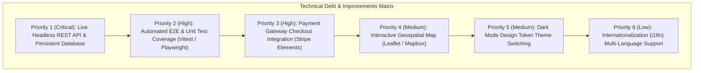

# 10. Gaps, Known Limitations & Technical Roadmap



---

## 1. Prioritized Improvements Matrix

| Priority | Feature / Gap | Current State | Production Recommendation | Difficulty | Impact |
| :---: | :--- | :--- | :--- | :---: | :---: |
| **P1** | **Live Headless Backend API** | Hardcoded in-memory JS catalog | Connect to Node/Express or Go microservice with MongoDB/PostgreSQL. | Moderate | Critical |
| **P2** | **Automated Test Coverage** | Manual browser verification | Implement Vitest for calculation units and Playwright for E2E user flows. | Low | High |
| **P3** | **Stripe Payment Gateway** | Simulated instant reservation | Embed Stripe Elements for tokenized credit card authorizations. | Moderate | High |
| **P4** | **Interactive Geospatial Map** | Static text button location pin | Integrate Leaflet.js with OpenStreetMap tiles for hotel navigation. | Low | Medium |
| **P5** | **Dark / Light Mode Toggle** | Fixed light luxury theme | Add theme toggle switch mutating CSS custom properties via `[data-theme]`. | Low | Medium |
| **P6** | **Internationalization (i18n)** | English text only | Add translation dictionary engine for Spanish, Portuguese, and French. | Low | Low |

---

## 2. Concrete Implementation Guides

### Improvement P1: Connecting to a Headless Backend
Replace the static catalog in `main.js` with an asynchronous service module:

```javascript
// services/api.js
export async function getDestinationCatalog() {
  try {
    const res = await fetch('https://api.trillo-travel.com/v1/destinations');
    if (!res.ok) throw new Error('Failed to fetch catalog');
    return await res.json();
  } catch (err) {
    console.error('API Error, falling back to offline cache:', err);
    return FALLBACK_CATALOG;
  }
}
```

---

### Improvement P2: Adding Automated Unit Tests with Vitest
Install Vitest and test pricing computation logic:

```javascript
// tests/pricing.test.js
import { describe, it, expect } from 'vitest';

function calculateTotal(rate, nights) {
  return rate * nights;
}

describe('Pricing Calculation Engine', () => {
  it('calculates 3 nights at terrace suite rate', () => {
    expect(calculateTotal(180, 3)).toBe(540);
  });

  it('calculates 3 nights at presidential penthouse rate', () => {
    expect(calculateTotal(390, 3)).toBe(1170);
  });
});
```

---

### Improvement P3: Embedding Stripe Payment Gateway
Replace the simulated confirmation in `handleBookingSubmit()` with Stripe Elements:

```javascript
// Example Stripe integration snippet
async function processStripePayment(bookingDetails) {
  const stripe = Stripe('pk_test_samplePublicKey');
  const response = await fetch('/api/create-payment-intent', {
    method: 'POST',
    headers: { 'Content-Type': 'application/json' },
    body: JSON.stringify(bookingDetails)
  });
  const { clientSecret } = await response.json();
  const result = await stripe.confirmCardPayment(clientSecret, {
    payment_method: { card: cardElement }
  });
  return result;
}
```

---

### Improvement P5: Dark Mode Theme Switcher
Add a theme toggle button mutating a root attribute:

```javascript
// Theme toggle logic in main.js
function toggleTheme() {
  const currentTheme = document.documentElement.getAttribute('data-theme');
  const newTheme = currentTheme === 'dark' ? 'light' : 'dark';
  document.documentElement.setAttribute('data-theme', newTheme);
  localStorage.setItem('trillo_theme', newTheme);
}
```

```scss
// CSS token overrides in _variables.scss:
[data-theme='dark'] {
  --color-grey-light-1: #121212;
  --color-grey-light-2: #1e1e1e;
  --color-grey-dark-1: #ffffff;
  --color-white: #181818;
  --line: 1px solid #2a2a2a;
}
```
