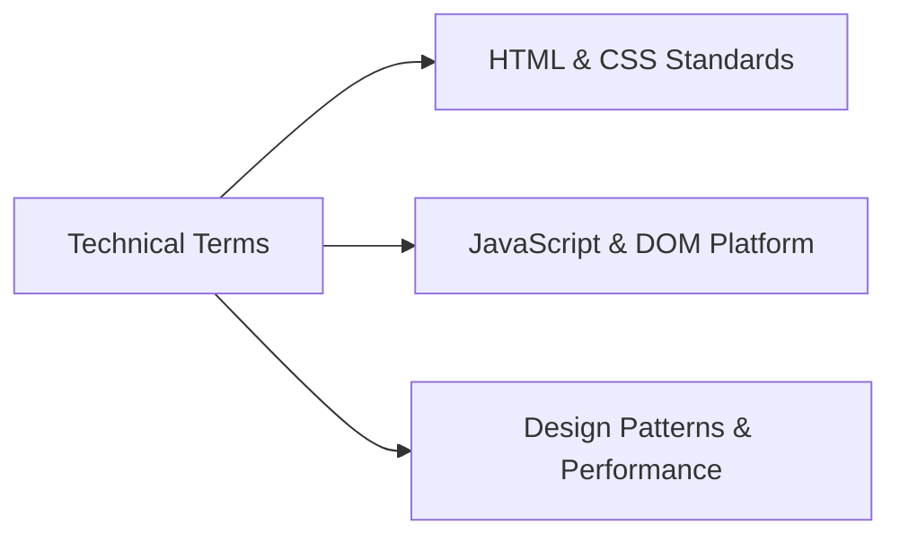

# 11. Technical Glossary

---

## A–E

- **Accessibility (a11y)**: The practice of designing web interfaces usable by people of all abilities, including those who rely on screen readers or keyboard navigation.
- **BEM (Block Element Modifier)**: A CSS class naming convention (`.block__element--modifier`) that clarifies relationships and prevents selector specificity wars.
- **Brotli**: A modern lossless compression algorithm developed by Google that delivers 15–25% smaller file sizes than traditional Gzip.
- **CLS (Cumulative Layout Shift)**: A Core Web Vital measuring unexpected layout shifts during a page's viewing session. Target score is $< 0.1$.
- **CSS Custom Properties**: Native CSS variables (e.g., `--color-primary`) declared on `:root` that cascade down the DOM and can be updated at runtime.
- **CSS Flexbox**: A 1-dimensional CSS layout model providing flexible item distribution, alignment, and wrapping along horizontal or vertical axes.
- **CSS Mask (`-webkit-mask-image`)**: A CSS feature that clips an element's background to the shape of an image or SVG silhouette.
- **Cubic-Bezier**: A mathematical curve defining acceleration over time in CSS animations, enabling physical spring and bounce effects.
- **Debounce**: A programming pattern that delays executing a function until a specified time has passed since the last invocation, preventing rapid duplicate calls.
- **DOM (Document Object Model)**: The tree-like in-memory object representation of an HTML document constructed by the browser.

---

## F–M

- **FCP (First Contentful Paint)**: A performance metric measuring the time from page navigation until the browser renders the first piece of DOM content.
- **IIFE (Immediately Invoked Function Expression)**: A JavaScript design pattern that executes a function immediately upon definition, encapsulating private variables.
- **INP (Interaction to Next Paint)**: A Core Web Vital measuring the latency of user interactions (clicks, keypresses) until the next frame is presented. Target is $< 200\text{ms}$.
- **LCP (Largest Contentful Paint)**: A Core Web Vital measuring when the largest visual content element (hero image or heading) finishes rendering. Target is $< 2.5\text{s}$.
- **LocalStorage**: A synchronous, persistent browser key-value storage mechanism holding 5–10 MB of data across browser sessions per origin.
- **Media Query**: A CSS feature (`@media screen and (max-width: ...)`) that applies styling rules conditionally based on device screen dimensions.
- **Micro-Interaction**: A subtle, focused animation or visual response to user action (e.g., sliding button text, hover badge bounce) that enhances engagement.
- **Modal Dialog**: An overlay window displayed on top of the main document that disables interaction with the background until dismissed.

---

## N–Z

- **OWASP (Open Web Application Security Project)**: A global non-profit organization focused on improving software security, known for the OWASP Top 10 list.
- **Reflow (Layout)**: The browser process of calculating the exact physical positions and dimensions of all elements in the document tree.
- **Repaint**: The browser process of redrawing pixels on the screen after styling changes that do not alter layout geometry (e.g., color, visibility).
- **REM (Root EM)**: A CSS unit relative to the font-size of the root `<html>` element. When root font-size is 62.5%, 1rem equals 10px.
- **Sass (Syntactically Awesome Style Sheets)**: A CSS preprocessor adding modular partials, nesting, mixins, and functions compiled into standard CSS.
- **Sass 7-1 Architecture**: An industry pattern organizing SCSS files across seven functional folders: abstracts, base, components, layout, pages, themes, and vendors.
- **SVG Sprite**: An SVG technique that embeds multiple vector icons inside `<symbol>` definitions in a single document for reuse with `<use>`.
- **Toast Notification**: A small, non-intrusive floating feedback banner that appears temporarily in response to an action before disappearing automatically.
- **VitePress**: A static site generator engineered by the Vue.js team, powered by Vite and Vue 3 for building high-speed documentation portals.
- **WCAG (Web Content Accessibility Guidelines)**: Technical specifications developed by the W3C defining accessibility standards for digital products.
- **XSS (Cross-Site Scripting)**: A security vulnerability enabling attackers to inject malicious client-side scripts into web pages viewed by other users.
