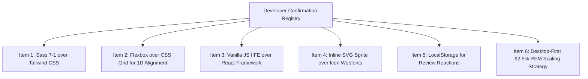

# 12. Developer Confirmation List ([CONFIRM WITH DEVELOPER])

The following design decisions and architectural trade-offs were inferred from the code and established engineering patterns. Review and verify these items to confirm developer intent:

---

## Registry of Inferred Decisions

### 1. Decision: Sass 7-1 Pattern Over Utility-First CSS (Tailwind)
- **Location in Code**: [`02_Trillo/sass/main.scss`](file:///Users/avishjain/avishjain9-repos/52-trilo-travel-ui/02_Trillo/sass/main.scss)
- **Inferred Reason**: To maintain pristine, semantic HTML markup and achieve complete control over BEM class names and custom CSS properties without polluting the markup with dozens of utility class strings.
- **Verification Status**: `[CONFIRM WITH DEVELOPER]`

---

### 2. Decision: CSS Flexbox Over CSS Grid for Macro-Layouts
- **Location in Code**: [`02_Trillo/sass/layout/_header.scss`](file:///Users/avishjain/avishjain9-repos/52-trilo-travel-ui/02_Trillo/sass/layout/_header.scss), [`_navigation.scss`](file:///Users/avishjain/avishjain9-repos/52-trilo-travel-ui/02_Trillo/sass/layout/_navigation.scss)
- **Inferred Reason**: The application's visual hierarchy is structured along distinct 1-dimensional axes (horizontal header bars, vertical-to-horizontal sidebar menus, 2-column detail splits) where Flexbox alignment properties (`justify-content: space-between`, `align-items: center`) are better suited than rigid 2D grid tracks.
- **Verification Status**: `[CONFIRM WITH DEVELOPER]`

---

### 3. Decision: Zero-Dependency Vanilla JS IIFE Over React / Vue
- **Location in Code**: [`02_Trillo/js/main.js:15-20`](file:///Users/avishjain/avishjain9-repos/52-trilo-travel-ui/02_Trillo/js/main.js#L15-L20)
- **Inferred Reason**: To eliminate runtime dependencies, maintain sub-100ms page load speeds, and showcase mastery of core browser web platform fundamentals (DOM Level 3 Events, closures, Web Storage) without adding a 140 KB framework bundle.
- **Verification Status**: `[CONFIRM WITH DEVELOPER]`

---

### 4. Decision: Inline SVG Sprite Over FontAwesome Icon Fonts
- **Location in Code**: [`02_Trillo/index.html:18-57`](file:///Users/avishjain/avishjain9-repos/52-trilo-travel-ui/02_Trillo/index.html#L18-L57)
- **Inferred Reason**: Inline SVG sprites eliminate external network requests, avoid Flash of Unstyled Text (FOUT) delays, render with mathematical vector precision on Retina displays, and permit dynamic color styling via CSS `currentColor` and SVG mask images.
- **Verification Status**: `[CONFIRM WITH DEVELOPER]`

---

### 5. Decision: Client LocalStorage Over Cookies for Review Upvotes
- **Location in Code**: [`02_Trillo/js/main.js:154, 330`](file:///Users/avishjain/avishjain9-repos/52-trilo-travel-ui/02_Trillo/js/main.js#L154)
- **Inferred Reason**: Review upvotes represent lightweight client-side interaction state that does not need to be transmitted to a server on every HTTP request. LocalStorage avoids the 4 KB cookie limit and network overhead while persisting across browser sessions.
- **Verification Status**: `[CONFIRM WITH DEVELOPER]`

---

### 6. Decision: Desktop-First 62.5% Root REM Scaling Strategy
- **Location in Code**: [`02_Trillo/sass/base/_typography.scss:17-25`](file:///Users/avishjain/avishjain9-repos/52-trilo-travel-ui/02_Trillo/sass/base/_typography.scss#L17-L25)
- **Inferred Reason**: Setting root `font-size: 62.5%` simplifies responsive sizing calculations (1rem = 10px). Scaling the root font size to 50% at 1100px allows the entire interface—typography, padding, margins—to scale down harmoniously with a single CSS declaration.
- **Verification Status**: `[CONFIRM WITH DEVELOPER]`
