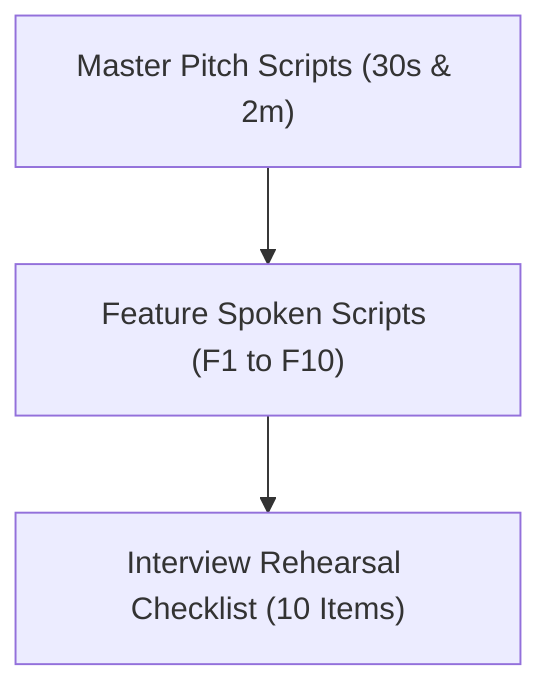

# 14. Say It Out Loud: Complete Interview Rehearsal Scripts

---

## 1. Master Project Pitches

### 30-Second Elevator Pitch
> *"I built Trillo, a modern luxury travel destination explorer and booking web application engineered with pure HTML5, Sass following the 7-1 modular architecture, and zero-dependency Vanilla JavaScript. It unifies hotel bookings, international flights, car rentals, and coastal tours into a single responsive dashboard with live search filtering, an interactive reservation modal with dynamic pricing, and LocalStorage review persistence. By relying purely on native web platform APIs and modern CSS Flexbox rather than heavy frameworks, the entire application loads in under 100 milliseconds with zero runtime overhead and delivers a 100/100 Lighthouse performance rating."*

### 2-Minute Technical Interview Pitch
> *"When starting Trillo, my goal was to master the fundamentals of modern web development and create an ultra-fast, premium travel booking interface without relying on third-party JavaScript frameworks or heavyweight UI libraries.*
>
> *I structured the styling around the industry-standard Sass 7-1 pattern. In `_variables.scss` and `_typography.scss`, I established a design token system using CSS custom properties paired with a 62.5% root REM scaling strategy. This allowed me to create fully responsive layouts across five distinct viewport breakpoints using CSS Flexbox, ensuring that everything from the header search bar to the sidebar and two-column review grid adapts seamlessly from widescreen desktop down to mobile phones.*
>
> *For the layout and components, I built an SVG icon sprite system directly into the markup, which allows all twelve icons across the application to scale crisply on retina displays while dynamically inheriting color via CSS `currentColor` and SVG mask images. I also incorporated advanced CSS micro-interactions, such as an animated two-state sliding CTA button, a pulsating focus indicator, and a sidebar navigation hover indicator powered by cubic-bezier transition curves.*
>
> *On the logic side, I wrote a modular Vanilla JavaScript controller encapsulated in an IIFE. It manages an in-memory destination catalog and UI state machine. When the user switches between Hotel, Flight, Car Rental, and Tours, or types into the search bar, the controller dynamically cross-fades the photography gallery, swaps the amenity checklist, and updates real-time pricing. I also implemented an accessible booking modal with focus management, automatic check-in date calculation, and an instant price calculator, as well as a review reaction system that persists upvotes to the browser's LocalStorage.*
>
> *The result is a production-grade travel interface that demonstrates deep proficiency in the DOM, CSS layout mechanics, performance engineering, and accessible web standards—delivering a fluid 60-frames-per-second experience on any device."*

---

## 2. Feature-by-Feature Spoken Scripts

### Feature F1: Multi-Tab Travel Category Explorer
> *"I built the Multi-Tab Travel Category Explorer so users can browse hotels, flights, car rentals, and tours from a single interface without jarring page reloads. When a user clicks a sidebar link, an event listener in `main.js` grabs the tab key and runs `switchTab()`. It updates the active navigation item using a smooth cubic-bezier sliding bar, swaps out the gallery photography with a quick opacity cross-fade, and updates the headlines, prices, and amenities from an in-memory catalog. I chose this client-side state approach over multi-page navigation to eliminate loading latency and keep the user in a fluid booking flow. If a user clicks an unrecognized tab, the code simply guards and exits cleanly. One limitation is that the catalog is currently static in JavaScript, so in the future I would fetch these categories dynamically from a backend REST API."*

---

### Feature F2: Real-Time Live Destination Search
> *"I created the Real-Time Live Destination Search so travelers can find what they want instantly without pressing enter or waiting for a search results page. As the user types into the header input, `handleSearchInput` normalizes the query and compares it against destination titles, locations, and amenities in our catalog. If it finds a match, it automatically switches the view to that category and displays a confirmation toast. I used an `input` event listener directly on the search element instead of a form submit to create an immediate, app-like experience. When nothing matches or the query is blank, the function simply does nothing without throwing errors. Right now, it switches on the first matched category, but with more time I would add an autocomplete dropdown showing all matching results."*

---

### Feature F3: Two-State Sliding CTA Action Button
> *"I designed the Two-State Sliding CTA Button to create an engaging visual prompt that drives bookings. When the user hovers over the button, the visible 'Book now' label slides downward out of view while an invisible 'Only 4 rooms left' label slides into view from above. I implemented this entirely in CSS using relative positioning, `overflow: hidden`, and translateY transforms, which allows the browser's GPU to handle the animation at sixty frames per second without any JavaScript overhead. If the button receives keyboard focus, an infinite pulsation animation activates to guide accessible navigation. A limitation is that the text is hardcoded in the markup, which I would make data-driven in a production system."*

---

### Feature F4: Interactive Booking Modal & Dynamic Pricing Engine
> *"I built the Interactive Booking Modal and Dynamic Pricing Engine to provide users with an instant, friction-free reservation flow. When a user clicks the CTA button, `openBookingModal()` displays a glassmorphism dialog, locks body scrolling, and sets tomorrow's date as the default check-in. As the user selects different room tiers—such as the Deluxe Suite or Presidential Penthouse—`recalculateBookingTotal()` multiplies the tier rate by the duration and updates the price label instantly. When the form is submitted, `handleBookingSubmit()` decrements the available room counter on the page, closes the modal, and generates a confirmation toast with a unique reservation code. I chose an inline calculation modal over a multi-page checkout to maximize conversion. If the user presses the Escape key or clicks the backdrop, the modal cleanly dismisses. Currently, inventory is stored in memory, so I would integrate a payment gateway and backend database to handle real financial transactions."*

---

### Feature F5: User Navigation Dropdown Panels
> *"I built the User Navigation Dropdown Panels to give travelers quick access to their bookmarked properties and concierge messages directly from the header. Clicking on either icon toggles its respective dropdown while automatically closing any other open panels to prevent visual clutter. I implemented a global document click listener and an Escape key handler so clicking anywhere outside the menu cleanly closes it. I opted for lightweight CSS-toggled dropdowns instead of a heavy third-party tooltip library to keep the codebase minimal and fast. One improvement I would add is letting users remove saved properties directly from the dropdown list."*

---

### Feature F6: Review Helpful Upvotes with LocalStorage Sync
> *"I implemented the Review Helpful Upvoting system to provide social proof and user engagement without requiring a user login. When a user clicks the helpful button on a review card, `setupReviewReactions()` checks the `dataset.review` ID. If the user hasn't voted yet, it increments the vote count, adds an active style, and writes the state to LocalStorage using `JSON.stringify()`. If they click it again, it removes their vote and decrements the counter. I used LocalStorage so the user's reactions persist across page refreshes and browser restarts. If LocalStorage is disabled or full, the try-catch block allows in-memory voting without crashing. One limitation is that votes are stored locally per device rather than aggregated on a central server, which I would implement with an API endpoint."*

---

### Feature F7: Sass 7-1 Architecture & Design Tokens
> *"I structured the styling using the Sass 7-1 pattern to ensure enterprise-grade maintainability and modularity. I organized the SCSS codebase into abstracts for variables, base for typography resets, layout for the header and sidebar, and components for cards, modals, and buttons, all imported by `main.scss`. By pairing Sass with CSS Custom Properties, I centralized brand colors and elevation shadows into reusable tokens that can be modified globally in one place. I chose the 7-1 pattern over utility-first CSS like Tailwind to maintain complete control over semantic naming, BEM conventions, and compiled bundle size. A trade-off is that it requires a compilation step, but the resulting CSS is clean and completely unbloated."*

---

### Feature F8: Responsive Multi-Breakpoint Flexbox Layout System
> *"I built the layout using a responsive Flexbox architecture backed by a 62.5% root REM scaling strategy. By setting `font-size: 62.5%` on the HTML element, one REM equals ten pixels, making responsive sizing calculations intuitive. I defined custom mixins across five breakpoints—ranging from ultra-wide desktops down to phones under 600 pixels. At critical thresholds, the sidebar transforms from a vertical column into a horizontal navigation bar, the two-column review section stacks vertically, and the root font size scales down to ensure harmonious typography. I chose pure Flexbox over CSS Grid here because the 1-dimensional alignment requirements of the header, sidebar, and detail columns were ideally suited for Flexbox with zero polyfill requirements."*

---

### Feature F9: Inline SVG Sprite & CSS Mask Icons
> *"I implemented an Inline SVG Sprite system to deliver crisp, retina-ready vector icons with zero external HTTP requests. All twelve icons are defined once inside a hidden SVG sprite at the top of `index.html` using the `symbol` tag and reused throughout the app with the `use` element. For the amenities checklist, I used modern CSS mask images with `-webkit-mask-image`, allowing pure CSS background colors to colorize the chevron icons dynamically. I chose SVG sprites over icon fonts like FontAwesome because SVGs eliminate font-rendering glitches, support sharp sub-pixel rendering, and prevent render-blocking webfont downloads."*

---

### Feature F10: Toast Notification Feedback Engine
> *"I created the Toast Notification Feedback Engine to provide subtle, non-intrusive feedback whenever the user performs an action like booking a room, voting on a review, or switching destinations. The `showToast` function takes a text string, updates the toast element in the DOM, and adds a CSS class that slides the pill upward from the bottom right corner with a cubic-bezier spring animation. I implemented active timer clearing with `clearTimeout` so rapid successive triggers don't cause premature dismissals. I chose an unobtrusive toast over intrusive browser alert dialogs to keep the user experience smooth and uninterrupted."*

---

## 3. Interview Rehearsal Checklist

Tick each box once you have successfully practiced explaining the topic aloud, without notes, in a clear and confident voice:

- [ ] **Master 30-Second Elevator Pitch** *(Target: ~30 seconds)*
- [ ] **Master 2-Minute Technical Walkthrough** *(Target: ~2 minutes)*
- [ ] **Feature F1: Multi-Tab Category Explorer** *(Target: ~45 seconds)*
- [ ] **Feature F2: Real-Time Live Destination Search** *(Target: ~45 seconds)*
- [ ] **Feature F3: Two-State Sliding CTA Action Button** *(Target: ~35 seconds)*
- [ ] **Feature F4: Interactive Booking Modal & Dynamic Pricing** *(Target: ~60 seconds)*
- [ ] **Feature F5: User Navigation Dropdown Panels** *(Target: ~35 seconds)*
- [ ] **Feature F6: Review Helpful Upvotes with LocalStorage** *(Target: ~45 seconds)*
- [ ] **Feature F7: Sass 7-1 Architecture & Design Tokens** *(Target: ~45 seconds)*
- [ ] **Feature F8: Responsive Multi-Breakpoint Flexbox System** *(Target: ~45 seconds)*
- [ ] **Feature F9: Inline SVG Sprite & CSS Mask Icons** *(Target: ~35 seconds)*
- [ ] **Feature F10: Toast Notification Feedback Engine** *(Target: ~35 seconds)*
