# Trillo Travel UI: Master Documentation Index & Guide

Welcome to the definitive technical documentation suite for **Trillo Travel UI**—a modern luxury travel destination explorer and flight interface engineered with semantic HTML5, Sass (7-1 modular architecture), and zero-dependency Vanilla JavaScript.

This documentation is written in the style of the official Vue.js documentation: clear, step-by-step, deeply technical, and structured to prepare engineers for any technical interview question from entry-level to staff engineer.

```mermaid
flowchart TD
    Index[docs/README.md Master Index] --> Overview[00. Overview & Map]
    Index --> Features[01. Feature Deep Dives]
    Index --> Build[02. Step-by-Step Build Order]
    Index --> APIs[03. Web APIs & Data Schemas]
    Index --> TechComp[04. Tech Choice Comparisons]
    Index --> Arch[05. High-Level Architecture]
    Index --> Sec[06. Security Audit & OWASP]
    Index --> AI[07. AI Integration Deep Dive]
    Index --> Ops[08. Quality, Operations & CWV]
    Index --> QA[09. 155 Interview Questions & Answers]
    Index --> SysDesign[14. System Design Curriculum]
    Index --> Checklist[13. Master 275-Item Checklist]
    Index --> Spoken[14. Say It Out Loud Scripts]
```



---

## Complete Reading Order

### 1. Project Orientation & Analysis
- [00. Project Type Classification](file:///Users/avishjain/avishjain9-repos/52-trilo-travel-ui/docs/00-project-type.md): Track B (Frontend Only) evidence, stack verification, and prompt adaptation matrix.
- [00a. Full Project Analysis](file:///Users/avishjain/avishjain9-repos/52-trilo-travel-ui/docs/00a-project-analysis.md): Complete feature trace (F1–F10), state architecture, Web APIs, and verified inventory counts.
- [00b. Project Elevator Pitch](file:///Users/avishjain/avishjain9-repos/52-trilo-travel-ui/docs/00b-project-pitch.md): 30-second elevator pitch, 2-minute comprehensive walkthrough, and interview soundbites.
- [00. Project Map & File Tree](file:///Users/avishjain/avishjain9-repos/52-trilo-travel-ui/docs/00-project-map.md): Annotated repository folder tree, exact package versions, and entry points.

### 2. Feature Architecture & Deep Dives
- [01. Feature Inventory Overview](file:///Users/avishjain/avishjain9-repos/52-trilo-travel-ui/docs/01-features.md): Master matrix of all ten features, line references, and spoken interview scripts.
- [F1: Multi-Tab Category Explorer](file:///Users/avishjain/avishjain9-repos/52-trilo-travel-ui/docs/features/f1-multi-tab-travel-explorer.md): Tab transitions, catalog lookup, and gallery cross-fading.
- [F2: Real-Time Destination Search](file:///Users/avishjain/avishjain9-repos/52-trilo-travel-ui/docs/features/f2-realtime-destination-search.md): Instant search input query matching across amenities and titles.
- [F3: Two-State Sliding CTA Button](file:///Users/avishjain/avishjain9-repos/52-trilo-travel-ui/docs/features/f3-booking-cta-sliding-button.md): GPU-accelerated CSS transforms and pulsating focus rings.
- [F4: Interactive Booking Modal](file:///Users/avishjain/avishjain9-repos/52-trilo-travel-ui/docs/features/f4-interactive-booking-modal.md): Dynamic price calculation engine, date pickers, and room counters.
- [F5: Notification Dropdown Panels](file:///Users/avishjain/avishjain9-repos/52-trilo-travel-ui/docs/features/f5-notification-dropdown-system.md): Anchored dropdown menus for saved bookmarks and concierge messages.
- [F6: Review Helpful Upvotes with LocalStorage](file:///Users/avishjain/avishjain9-repos/52-trilo-travel-ui/docs/features/f6-review-reaction-persistence.md): Client-side persistence and quotation mark styling.
- [F7: Sass 7-1 Architecture & Design Tokens](file:///Users/avishjain/avishjain9-repos/52-trilo-travel-ui/docs/features/f7-sass-7-1-design-tokens.md): Modular preprocessor organization and CSS Custom Properties.
- [F8: Responsive Flexbox Layout System](file:///Users/avishjain/avishjain9-repos/52-trilo-travel-ui/docs/features/f8-responsive-flexbox-grid-system.md): Fluid 5-breakpoint responsive reflowing and 62.5% REM scaling.
- [F9: Inline SVG Sprite & CSS Mask Icons](file:///Users/avishjain/avishjain9-repos/52-trilo-travel-ui/docs/features/f9-svg-sprite-retina-icons.md): 12 retina vector symbols and SVG mask checklist bullets.
- [F10: Toast Notification Feedback Engine](file:///Users/avishjain/avishjain9-repos/52-trilo-travel-ui/docs/features/f10-toast-feedback-engine.md): Floating notification pills with timer debouncing.

### 3. Implementation, APIs & Technical Trade-offs
- [02. Step-by-Step Rebuild Guide](file:///Users/avishjain/avishjain9-repos/52-trilo-travel-ui/docs/02-build-order.md): 9-step rebuild order from scratch with key code snippets.
- [03. API & Data Catalog Reference](file:///Users/avishjain/avishjain9-repos/52-trilo-travel-ui/docs/03-api-reference.md): Web Platform DOM APIs, LocalStorage schemas, and proposed REST endpoints.
- [04. Tech Choice Comparisons](file:///Users/avishjain/avishjain9-repos/52-trilo-travel-ui/docs/04-tech-comparisons.md): Exhaustive comparison tables (Sass vs Tailwind, Flexbox vs Grid, Vanilla JS vs React).
- [05. High-Level Architecture](file:///Users/avishjain/avishjain9-repos/52-trilo-travel-ui/docs/05-architecture.md): System topologies, request lifecycles, and scaling to 100x traffic.
- [06. Security Audit & OWASP](file:///Users/avishjain/avishjain9-repos/52-trilo-travel-ui/docs/06-security.md): Client-side security audit, DOM-based XSS defense, and CSP headers.
- [07. AI Integration Specification](file:///Users/avishjain/avishjain9-repos/52-trilo-travel-ui/docs/07-ai-integration.md): Proposed AI Concierge RAG pipeline using Gemini 1.5 Flash.
- [08. Engineering Quality & Operations](file:///Users/avishjain/avishjain9-repos/52-trilo-travel-ui/docs/08-quality-and-ops.md): Core Web Vitals, Vitest/Playwright testing, and GitHub Actions CI/CD.

### 4. Technical Interview Preparation & Master Checklist
- [09. 155 Project-Specific Interview Q&As](file:///Users/avishjain/avishjain9-repos/52-trilo-travel-ui/docs/09-interview-qa.md): Exhaustive question-and-answer repository across seven technical pillars.
- [10. Technical Gaps & Improvements Roadmap](file:///Users/avishjain/avishjain9-repos/52-trilo-travel-ui/docs/10-gaps-and-improvements.md): Prioritized P1–P6 engineering backlog with concrete code solutions.
- [11. Technical Glossary](file:///Users/avishjain/avishjain9-repos/52-trilo-travel-ui/docs/11-glossary.md): Definitive dictionary of technical terms defined in plain English.
- [12. Developer Confirmation List](file:///Users/avishjain/avishjain9-repos/52-trilo-travel-ui/docs/12-confirm-list.md): Inferred architectural choices marked `[CONFIRM WITH DEVELOPER]`.
- [13. Master 275-Item Technical Checklist](file:///Users/avishjain/avishjain9-repos/52-trilo-travel-ui/docs/13-master-checklist.md): Comprehensive evaluation of all 275 items with 7-part criteria and coverage table.
- [14. Say It Out Loud Rehearsal Scripts](file:///Users/avishjain/avishjain9-repos/52-trilo-travel-ui/docs/14-say-it-out-loud.md): Spoken interview answers for every feature with a 10-point rehearsal checklist.

### 5. System Design Deep Dive (18 Chapters)
- [System Design Curriculum Index](file:///Users/avishjain/avishjain9-repos/52-trilo-travel-ui/docs/system-design/README.md): Master index of all 18 system design chapters.
- [14.1 Requirements & Capacity Estimation](file:///Users/avishjain/avishjain9-repos/52-trilo-travel-ui/docs/system-design/01-requirements-and-estimation.md): DAU, RPS, bandwidth, and 5-year storage growth calculations.
- [14.2 Architecture Styles](file:///Users/avishjain/avishjain9-repos/52-trilo-travel-ui/docs/system-design/02-architecture-styles.md): Monolith vs modular monolith vs microservices evolution.
- [14.3 Networking & Communication](file:///Users/avishjain/avishjain9-repos/52-trilo-travel-ui/docs/system-design/03-networking-and-communication.md): DNS, CDN, TLS 1.3, HTTP/2 vs HTTP/3 QUIC, REST vs gRPC.
- [14.4 Load Balancing & Scaling](file:///Users/avishjain/avishjain9-repos/52-trilo-travel-ui/docs/system-design/04-load-balancing-and-scaling.md): Layer 4 vs Layer 7 load balancers, least connections, SPOF elimination.
- [14.5 Databases & Storage](file:///Users/avishjain/avishjain9-repos/52-trilo-travel-ui/docs/system-design/05-databases-and-storage.md): SQL vs NoSQL, PostgreSQL row-level locking, ACID, and indexing.
- [14.6 Caching Strategies](file:///Users/avishjain/avishjain9-repos/52-trilo-travel-ui/docs/system-design/06-caching.md): Browser, CDN, Redis cluster, cache stampede, and Bloom filters.
- [14.7 Messaging & Queues](file:///Users/avishjain/avishjain9-repos/52-trilo-travel-ui/docs/system-design/07-messaging-queues-async.md): Apache Kafka, BullMQ, transactional outbox pattern, and idempotent consumers.
- [14.8 Consistency & Concurrency](file:///Users/avishjain/avishjain9-repos/52-trilo-travel-ui/docs/system-design/08-consistency-concurrency-distributed.md): Race conditions, Saga pattern, compensating transactions, and Redlock.
- [14.9 Reliability & Resilience](file:///Users/avishjain/avishjain9-repos/52-trilo-travel-ui/docs/system-design/09-reliability-and-resilience.md): Circuit breakers, exponential backoff, bulkheads, SLI/SLO/SLA, chaos testing.
- [14.10 API Design & Rate Limiting](file:///Users/avishjain/avishjain9-repos/52-trilo-travel-ui/docs/system-design/10-api-design-rate-limiting.md): Token bucket, sliding window counters, idempotency keys, and OpenAPI.
- [14.11 Security Architecture](file:///Users/avishjain/avishjain9-repos/52-trilo-travel-ui/docs/system-design/11-security-architecture.md): Zero Trust, OAuth2/OIDC, JWT rotation, WAF, and DDoS defense.
- [14.12 Search & AI Systems](file:///Users/avishjain/avishjain9-repos/52-trilo-travel-ui/docs/system-design/12-search-and-ai-architecture.md): Elasticsearch inverted index, vector embeddings, and RAG pipelines.
- [14.13 Real-Time Systems](file:///Users/avishjain/avishjain9-repos/52-trilo-travel-ui/docs/system-design/13-real-time-systems.md): WebSockets vs SSE, cluster scaling, and Redis pub/sub backplane.
- [14.14 Observability & Operations](file:///Users/avishjain/avishjain9-repos/52-trilo-travel-ui/docs/system-design/14-observability-and-operations.md): Prometheus, Grafana, OpenTelemetry, structured logs, canary deploys.
- [14.15 Performance Engineering](file:///Users/avishjain/avishjain9-repos/52-trilo-travel-ui/docs/system-design/15-performance-engineering.md): Latency percentiles (p50/p95/p99), Little's Law, N+1 query joins, PgBouncer.
- [14.16 Cost & Cloud Trade-offs](file:///Users/avishjain/avishjain9-repos/52-trilo-travel-ui/docs/system-design/16-cost-and-tradeoffs.md): Current vs 100x cloud budget breakdown, build vs buy matrix.
- [14.17 Classic System Design Problems](file:///Users/avishjain/avishjain9-repos/52-trilo-travel-ui/docs/system-design/17-classic-questions.md): 100x scale, notification engine, search, media uploads, URL shortener.
- [14.18 Master Architectural Decision Log (ADR)](file:///Users/avishjain/avishjain9-repos/52-trilo-travel-ui/docs/system-design/decisions.md): Complete ADR table covering every major technical choice.

---

## How to Run Locally

```bash
# 1. Install dependencies
npm install

# 2. Preview the live application
npm start
# Opens on http://localhost:5183

# 3. Launch the VitePress documentation portal
npm run docs:dev
# Opens on http://localhost:5184

# 4. Build the documentation for production
npm run docs:build
```
