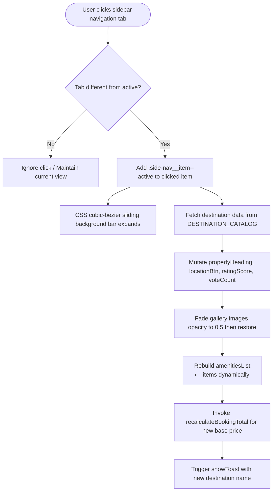
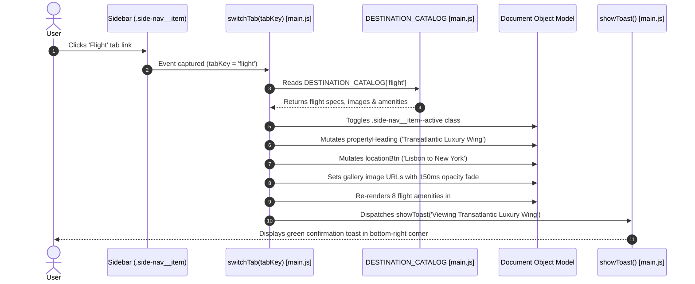

# Feature F1: Multi-Tab Travel Category Explorer



---

## 1. Feature Overview & User-Facing Behavior
The **Multi-Tab Travel Category Explorer** allows users to browse across four distinct travel verticals—**Hotels**, **Flights**, **Car Rentals**, and **Tours**—directly from the sidebar navigation. Clicking any tab instantly transitions the hero showcase, photography gallery, headline text, destination location, star rating, verified guest vote tally, amenity checklist, and base pricing tier without causing any browser page reload or latency.

---

## 2. Files and Functions Involved

| File Path | Function / Class | Line Number | Purpose |
| :--- | :--- | :---: | :--- |
| [`02_Trillo/js/main.js`](file:///Users/avishjain/avishjain9-repos/52-trilo-travel-ui/02_Trillo/js/main.js#L192-L247) | `switchTab(tabKey)` | L192–L247 | Core state and DOM updater routing catalog data into active views. |
| [`02_Trillo/js/main.js`](file:///Users/avishjain/avishjain9-repos/52-trilo-travel-ui/02_Trillo/js/main.js#L21-L140) | `DESTINATION_CATALOG` | L21–L140 | In-memory mock data store containing specs, images, and prices. |
| [`02_Trillo/js/main.js`](file:///Users/avishjain/avishjain9-repos/52-trilo-travel-ui/02_Trillo/js/main.js#L337-L345) | Event Listener | L337–L345 | Event delegation listener capturing clicks on `.side-nav__item`. |
| [`02_Trillo/sass/layout/_navigation.scss`](file:///Users/avishjain/avishjain9-repos/52-trilo-travel-ui/02_Trillo/sass/layout/_navigation.scss#L35-L65) | `.side-nav__item::before` | L35–L65 | Sliding background indicator animated with cubic-bezier curves. |
| [`02_Trillo/sass/components/_hotel-view.scss`](file:///Users/avishjain/avishjain9-repos/52-trilo-travel-ui/02_Trillo/sass/components/_hotel-view.scss#L28-L55) | `.gallery__photo` | L28–L55 | Gallery container styling with hover zoom and opacity transitions. |

---

## 3. Request Flow Sequence



---

## 4. Failure Path & Edge Case Handling

```mermaid
flowchart TD
    ClickEvent[User clicks anywhere on sidebar] --> TargetCheck{Target matches .side-nav__item?}
    TargetCheck -->|No| Drop[Ignore event]
    TargetCheck -->|Yes| KeyCheck{DESTINATION_CATALOG[tabKey] exists?}
    KeyCheck -->|No| GuardExit[Return early without DOM mutation]
    KeyCheck -->|Yes| ActiveCheck{tabKey == state.currentTab?}
    ActiveCheck -->|Yes| RedundantGuard[Optional early return or gentle refresh]
    ActiveCheck -->|No| NormalExecution[Execute full switchTab pipeline]
```

- **Invalid Tab Key**: Guarded by `if (!DESTINATION_CATALOG[tabKey]) return;`, preventing runtime exceptions if a dataset attribute is missing or malformed.
- **Rapid Successive Clicks**: Asynchronous image swap uses a fast 150ms timeout; multiple fast clicks seamlessly update the image `src` without DOM corruption.

---

## 5. Security & Performance Considerations
- **XSS Prevention**: Property names, locations, and amenities are injected strictly via `textContent` or `document.createElement('li')`, completely bypassing dangerous `innerHTML` injection vectors.
- **Performance**: DOM elements are cached in the `DOM` object upon script initialization, avoiding expensive repetitive `document.getElementById` queries during runtime transitions.

---

## 6. Say It Out Loud

> *"I built the Multi-Tab Travel Category Explorer so users can browse hotels, flights, car rentals, and tours from a single interface without jarring page reloads. When a user clicks a sidebar link, an event listener in `main.js` grabs the tab key and runs `switchTab()`. It updates the active navigation item using a smooth cubic-bezier sliding bar, swaps out the gallery photography with a quick opacity cross-fade, and updates the headlines, prices, and amenities from an in-memory catalog. I chose this client-side state approach over multi-page navigation to eliminate loading latency and keep the user in a fluid booking flow. If a user clicks an unrecognized tab, the code simply guards and exits cleanly. One limitation is that the catalog is currently static in JavaScript, so in the future I would fetch these categories dynamically from a backend REST API."*
