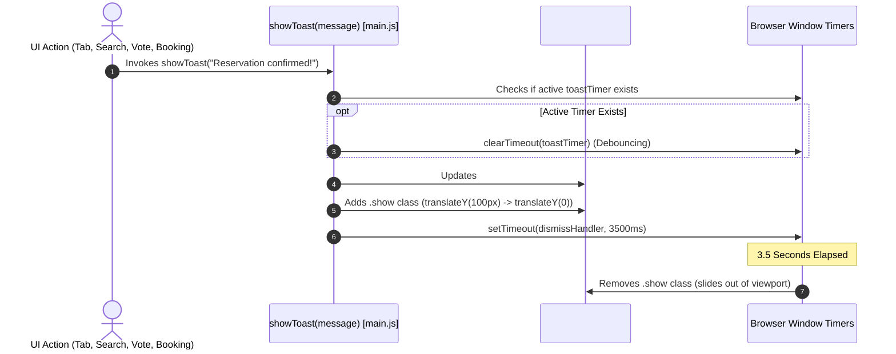

# Feature F10: Toast Notification Feedback Engine

---

## 1. Feature Overview & User-Facing Behavior
The **Toast Notification Feedback Engine** delivers lightweight, non-blocking visual confirmations for user interactions. Positioned fixed at the bottom-right of the viewport, the toast pill animates smoothly into view with a green checkmark icon when actions occur—such as booking a room, voting on reviews, switching travel verticals, or finding search matches.

---

## 2. Technical Code Trace
- **Dispatcher**: `showToast(message)` in [`02_Trillo/js/main.js:296-307`](file:///Users/avishjain/avishjain9-repos/52-trilo-travel-ui/02_Trillo/js/main.js#L296-L307).
- **Debounce Safety**: Ensures that subsequent rapid triggers reset the 3500ms timer via `clearTimeout(toastTimer)`, preventing race conditions and flickering.
- **Accessibility**: Includes `role="status"` and `aria-live="polite"` so screen readers announce changes without interrupting active speech.

---

## 3. Say It Out Loud

> *"I created the Toast Notification Feedback Engine to provide subtle, non-intrusive feedback whenever the user performs an action like booking a room, voting on a review, or switching destinations. The `showToast` function takes a text string, updates the toast element in the DOM, and adds a CSS class that slides the pill upward from the bottom right corner with a cubic-bezier spring animation. I implemented active timer clearing with `clearTimeout` so rapid successive triggers don't cause premature dismissals. I chose an unobtrusive toast over intrusive browser alert dialogs to keep the user experience smooth and uninterrupted."*
