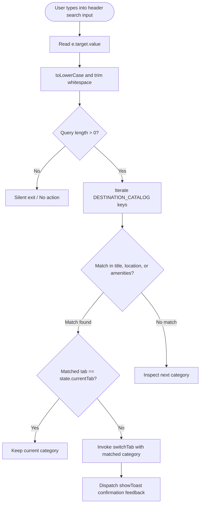
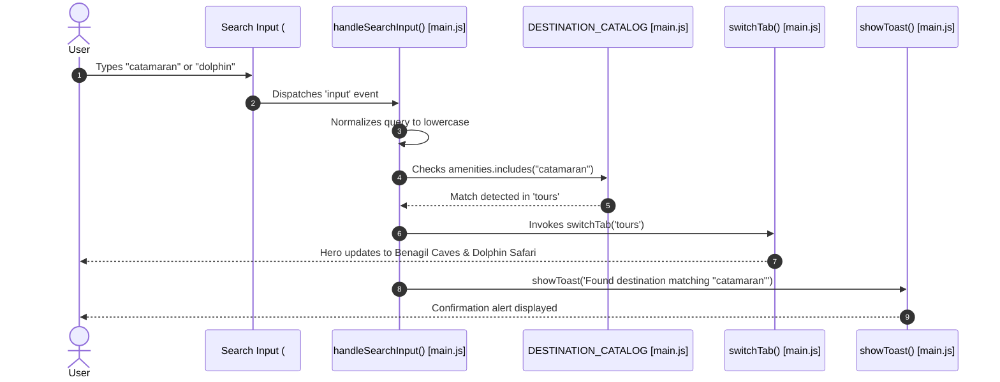

# Feature F2: Real-Time Live Destination Search

---

## 1. Feature Overview & User-Facing Behavior
The **Real-Time Live Destination Search** provides immediate destination filtering as the user types directly into the header search bar. Rather than requiring users to hit Enter or wait for a slow full-page search results refresh, the search engine scans the comprehensive catalog across service titles, geographic locations, and specific amenity tags (such as *"flight"*, *"beach"*, *"infinity pool"*, *"car"*, *"dolphin"*). When a match is detected, the UI instantly switches to the corresponding category and provides feedback via a toast notification.

---

## 2. Files and Functions Involved

| File Path | Function / Element | Line Number | Purpose |
| :--- | :--- | :---: | :--- |
| [`02_Trillo/js/main.js`](file:///Users/avishjain/avishjain9-repos/52-trilo-travel-ui/02_Trillo/js/main.js#L304-L323) | `handleSearchInput(e)` | L304–L323 | Search event handler executing live query matching. |
| [`02_Trillo/js/main.js`](file:///Users/avishjain/avishjain9-repos/52-trilo-travel-ui/02_Trillo/js/main.js#L380) | `DOM.searchInput` listener | L380 | `input` event listener attached to `#searchInput`. |
| [`02_Trillo/sass/layout/_header.scss`](file:///Users/avishjain/avishjain9-repos/52-trilo-travel-ui/02_Trillo/sass/layout/_header.scss#L40-L95) | `.search__input` | L40–L95 | Focus-expandable search bar styling with 100px border-radius. |

---

## 3. Sequence Flow Diagram

---

## 4. Failure Path & Security Considerations
- **Empty & Whitespace Inputs**: Trimmed query checks prevent unnecessary iterations on spaces or blank values.
- **No Results Found**: Silently keeps the user on their current view without throwing errors or breaking navigation.
- **XSS Safety**: User search input strings are never evaluated via `eval()` or injected via `innerHTML`. Toast messages use safe string concatenation into `textContent`.

---

## 5. Say It Out Loud

> *"I created the Real-Time Live Destination Search so travelers can find what they want instantly without pressing enter or waiting for a search results page. As the user types into the header input, `handleSearchInput` normalizes the query and compares it against destination titles, locations, and amenities in our catalog. If it finds a match, it automatically switches the view to that category and displays a confirmation toast. I used an `input` event listener directly on the search element instead of a form submit to create an immediate, app-like experience. When nothing matches or the query is blank, the function simply does nothing without throwing errors. Right now, it switches on the first matched category, but with more time I would add an autocomplete dropdown showing all matching results."*
