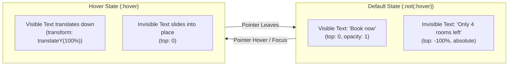
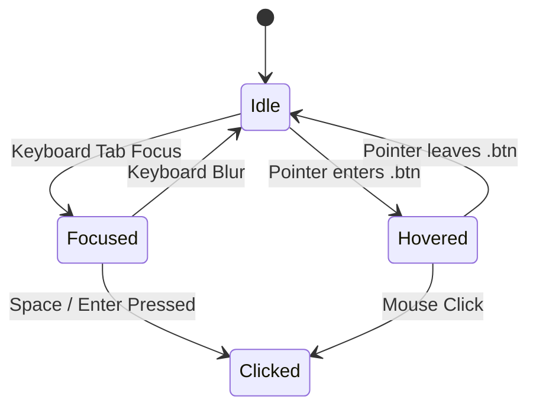

# Feature F3: Two-State Sliding CTA Action Button

---

## 1. Feature Overview & User-Facing Behavior
The **Two-State Sliding CTA Action Button** is an eye-catching micro-interaction anchored at the bottom of the property details view. In its idle state, it invites users with a clean pill-shaped gradient button reading **"Book now"**. When the user hovers over the button or moves keyboard focus to it, the text dynamically shifts: the initial label slides downward out of sight while an urgency-inducing label—**"Only 4 rooms left"**—slides in from the top.

---

## 2. Technical Implementation & CSS Geometry
- **Outer Shell (`.btn`)**:
  - `border-radius: 100px` for smooth pill shaping.
  - `overflow: hidden` to crop anything outside the button boundary.
  - Linear gradient background: `linear-gradient(to right, var(--color-primary-light), var(--color-primary-dark))`.
  - Reverses gradient direction on hover: `linear-gradient(to left, ...)`.
- **Visible Block (`.btn__visible`)**:
  - Has standard padding (`padding: 2rem 7.5rem`).
  - Translates `translateY(100%)` upon parent hover.
- **Invisible Block (`.btn__invisible`)**:
  - `position: absolute; left: 0; top: -100%`.
  - Shifts to `top: 0` upon parent hover.
- **Pulsating Focus Ring**:
  - Accessible outline animation via `@keyframes pulsate` in [`_typography.scss:72-84`](file:///Users/avishjain/avishjain9-repos/52-trilo-travel-ui/02_Trillo/sass/base/_typography.scss#L72-L84).

---

## 3. Say It Out Loud

> *"I designed the Two-State Sliding CTA Button to create an engaging visual prompt that drives bookings. When the user hovers over the button, the visible 'Book now' label slides downward out of view while an invisible 'Only 4 rooms left' label slides into view from above. I implemented this entirely in CSS using relative positioning, `overflow: hidden`, and translateY transforms, which allows the browser's GPU to handle the animation at sixty frames per second without any JavaScript overhead. If the button receives keyboard focus, an infinite pulsation animation activates to guide accessible navigation. A limitation is that the text is hardcoded in the markup, which I would make data-driven in a production system."*
