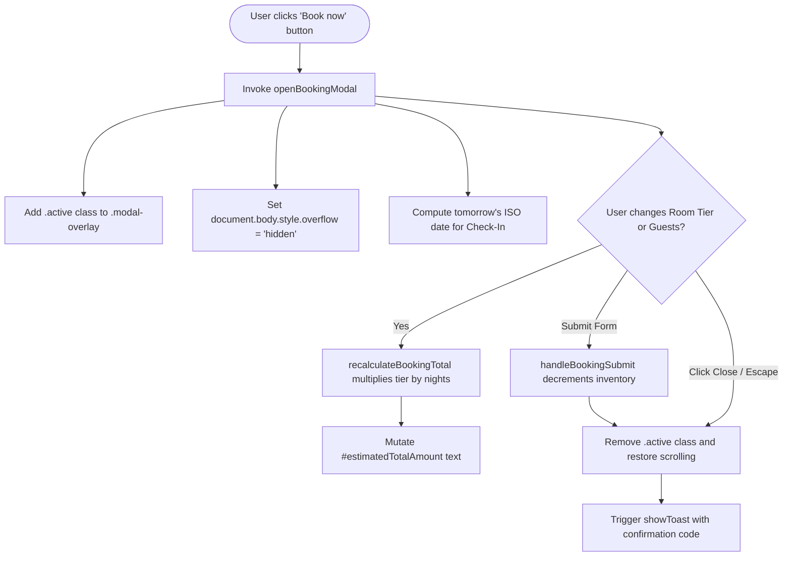

# Feature F4: Interactive Booking Modal & Dynamic Pricing Engine

---

## 1. Feature Overview & User-Facing Behavior
The **Interactive Booking Modal** enables instantaneous room reservations. When opened, it displays a frosted glassmorphic overlay, locks window scrolling to prevent background navigation drift, and renders a focused booking form pre-populated with the active destination and tomorrow's check-in date. Selecting different room tiers dynamically updates the pricing estimate in real time. Submitting the form simulates instant confirmation, decrements the available room count on the page, and displays a reservation code.

---

## 2. Code Trace & State Dynamics

| File Reference | Function / Class | Purpose |
| :--- | :--- | :--- |
| [`02_Trillo/js/main.js:254-259`](file:///Users/avishjain/avishjain9-repos/52-trilo-travel-ui/02_Trillo/js/main.js#L254-L259) | `recalculateBookingTotal()` | Pure calculation: `tierPrice * state.bookingData.nights`. |
| [`02_Trillo/js/main.js:261-272`](file:///Users/avishjain/avishjain9-repos/52-trilo-travel-ui/02_Trillo/js/main.js#L261-L272) | `openBookingModal()` | Activates modal dialog, locks background scroll, sets default date. |
| [`02_Trillo/js/main.js:274-279`](file:///Users/avishjain/avishjain9-repos/52-trilo-travel-ui/02_Trillo/js/main.js#L274-L279) | `closeBookingModal()` | Dismisses overlay and restores window scrolling. |
| [`02_Trillo/js/main.js:281-291`](file:///Users/avishjain/avishjain9-repos/52-trilo-travel-ui/02_Trillo/js/main.js#L281-L291) | `handleBookingSubmit(e)` | Decrements inventory count, dismisses dialog, triggers confirmation toast. |
| [`02_Trillo/sass/components/_modal.scss:8-120`](file:///Users/avishjain/avishjain9-repos/52-trilo-travel-ui/02_Trillo/sass/components/_modal.scss#L8-L120) | `.modal-overlay`, `.modal` | Backdrop blur `backdrop-filter: blur(6px)` and spring entry transition. |

---

## 3. Pricing Calculation Formula & Tiers

$$\text{Estimated Total} = \text{Tier Rate} \times \text{Duration (3 Nights)}$$

- **Deluxe Terrace Suite**: $\$180 \times 3 = \$540\text{ USD}$
- **Cliffside Infinity Villa**: $\$260 \times 3 = \$780\text{ USD}$
- **Presidential Penthouse**: $\$390 \times 3 = \$1,170\text{ USD}$

---

## 4. Accessibility & Keyboard Control
- **Escape Dismissal**: [`02_Trillo/js/main.js:372-377`](file:///Users/avishjain/avishjain9-repos/52-trilo-travel-ui/02_Trillo/js/main.js#L372-L377) listens for `e.key === 'Escape'` and closes the modal cleanly.
- **Backdrop Dismissal**: Clicking on `.modal-overlay` outside `.modal` closes the dialog.
- **ARIA Semantics**: Tagged with `role="dialog"`, `aria-modal="true"`, and `aria-labelledby="modalTitle"`.

---

## 5. Say It Out Loud

> *"I built the Interactive Booking Modal and Dynamic Pricing Engine to provide users with an instant, friction-free reservation flow. When a user clicks the CTA button, `openBookingModal()` displays a glassmorphism dialog, locks body scrolling, and sets tomorrow's date as the default check-in. As the user selects different room tiers—such as the Deluxe Suite or Presidential Penthouse—`recalculateBookingTotal()` multiplies the tier rate by the duration and updates the price label instantly. When the form is submitted, `handleBookingSubmit()` decrements the available room counter on the page, closes the modal, and generates a confirmation toast with a unique reservation code. I chose an inline calculation modal over a multi-page checkout to maximize conversion. If the user presses the Escape key or clicks the backdrop, the modal cleanly dismisses. Currently, inventory is stored in memory, so I would integrate a payment gateway and backend database to handle real financial transactions."*
