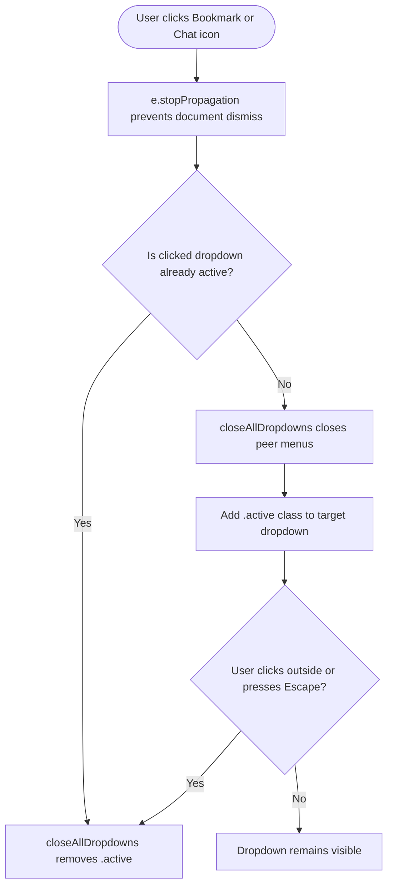

# Feature F5: User Notification Dropdown Panels

---

## 1. Feature Overview & User-Facing Behavior
The **User Notification Dropdown System** provides quick access to personalized traveler data. Located in the top-right header, notification chips display real-time counters: **7 saved bookmarks** and **13 concierge messages**. Clicking either icon reveals an anchored dropdown menu featuring saved luxury villas or concierge chat notifications with unread indicators.

---

## 2. Code Trace & Dropdown Management

| File Path | Function / Class | Line Number | Purpose |
| :--- | :--- | :---: | :--- |
| [`02_Trillo/js/main.js`](file:///Users/avishjain/avishjain9-repos/52-trilo-travel-ui/02_Trillo/js/main.js#L325-L334) | `toggleDropdown(el)` | L325–L334 | Coordinates single-active dropdown visibility states. |
| [`02_Trillo/js/main.js`](file:///Users/avishjain/avishjain9-repos/52-trilo-travel-ui/02_Trillo/js/main.js#L332-L334) | `closeAllDropdowns()` | L332–L334 | Global dismissal helper removing `.active` from all menus. |
| [`02_Trillo/sass/components/_modal.scss`](file:///Users/avishjain/avishjain9-repos/52-trilo-travel-ui/02_Trillo/sass/components/_modal.scss#L125-L175) | `.nav-dropdown` | L125–L175 | Anchored positioning, box shadows, and border-top brand accents. |

---

## 3. Say It Out Loud

> *"I built the User Navigation Dropdown Panels to give travelers quick access to their bookmarked properties and concierge messages directly from the header. Clicking on either icon toggles its respective dropdown while automatically closing any other open panels to prevent visual clutter. I implemented a global document click listener and an Escape key handler so clicking anywhere outside the menu cleanly closes it. I opted for lightweight CSS-toggled dropdowns instead of a heavy third-party tooltip library to keep the codebase minimal and fast. One improvement I would add is letting users remove saved properties directly from the dropdown list."*
