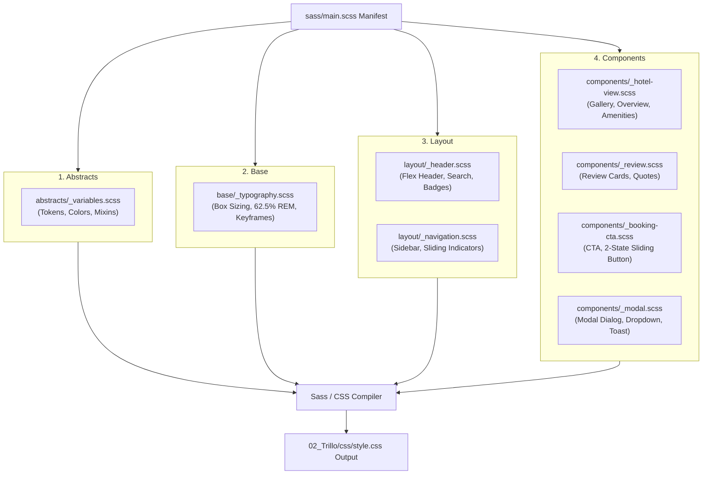

# Feature F7: Sass 7-1 Architecture & Design Tokens

---

## 1. Feature Overview & Design Tokens
The **Sass 7-1 Architecture** organizes the styling of Trillo into structured, single-responsibility partials that compile cleanly into a high-performance production stylesheet. Pairing Sass with native CSS Custom Properties (`:root`) decouples visual design tokens from CSS selectors, enabling effortless global adjustments to color palettes, elevation shadows, and animation curves.

### Token Registry (`_variables.scss`)

| CSS Custom Property | Default Value | Semantic Usage |
| :--- | :--- | :--- |
| `--color-primary` | `#eb2f64` | Primary brand accent (active tabs, icons, ratings, buttons). |
| `--color-primary-light` | `#ff3366` | Gradient highlight tone for hero backgrounds and buttons. |
| `--color-primary-dark` | `#ba265d` | Gradient shadow tone providing depth. |
| `--color-grey-dark-1` | `#333333` | Sidebar background and primary heading color. |
| `--color-grey-dark-2` | `#777777` | Body text copy and secondary iconography. |
| `--color-grey-light-1` | `#faf9f9` | Detail section background and sidebar active text. |
| `--color-grey-light-2` | `#f4f2f2` | Container background and dividing lines. |
| `--shadow-dark` | `0 2rem 6rem rgba(0,0,0,0.3)` | Main container elevation above the gradient backdrop. |
| `--shadow-cta` | `0 1rem 3rem rgba(235,47,100,0.35)` | Glowing shadow on the primary booking action button. |

---

## 2. Say It Out Loud

> *"I structured the styling using the Sass 7-1 pattern to ensure enterprise-grade maintainability and modularity. I organized the SCSS codebase into abstracts for variables, base for typography resets, layout for the header and sidebar, and components for cards, modals, and buttons, all imported by `main.scss`. By pairing Sass with CSS Custom Properties, I centralized brand colors and elevation shadows into reusable tokens that can be modified globally in one place. I chose the 7-1 pattern over utility-first CSS like Tailwind to maintain complete control over semantic naming, BEM conventions, and compiled bundle size. A trade-off is that it requires a compilation step, but the resulting CSS is clean and completely unbloated."*
