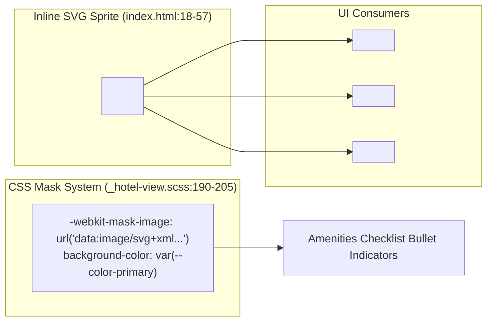

# Feature F9: Inline SVG Sprite & CSS Mask Icons

---

## 1. Feature Overview & Vector Mechanics
The **Inline SVG Sprite System** provides razor-sharp vector iconography across all display densities (standard, Retina, OLED) with zero external network requests. All twelve vector symbols are declared once inside `<defs>` at the top of the HTML document and instantiated anywhere via `<svg><use xlink:href="#id"></use></svg>`.

### Key Advantages Over Icon Fonts
1. **Crisp Sub-Pixel Rendering**: Eliminates the anti-aliasing fuzziness and font-smoothing artifacts common with web font icons.
2. **Dynamic Theming with CSS**: Icons inherit parent text colors automatically using `fill: currentColor` or apply brand tokens like `fill: var(--color-primary)`.
3. **CSS Mask Technology**: The amenities checklist utilizes CSS SVG masks (`-webkit-mask-image`), enabling bullet icons to inherit colors like pure CSS backgrounds.

---

## 2. Say It Out Loud

> *"I implemented an Inline SVG Sprite system to deliver crisp, retina-ready vector icons with zero external HTTP requests. All twelve icons are defined once inside a hidden SVG sprite at the top of `index.html` using the `symbol` tag and reused throughout the app with the `use` element. For the amenities checklist, I used modern CSS mask images with `-webkit-mask-image`, allowing pure CSS background colors to colorize the chevron icons dynamically. I chose SVG sprites over icon fonts like FontAwesome because SVGs eliminate font-rendering glitches, support sharp sub-pixel rendering, and prevent render-blocking webfont downloads."*
