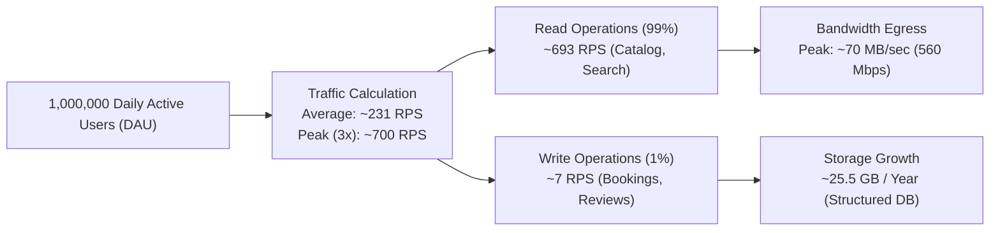

# 14.1 Requirements & Capacity Estimation

---

## 1. Concept in Plain Words
System requirements define **what** a system must accomplish (**Functional Requirements**) and **how well** it must perform under real-world constraints (**Non-Functional Requirements**). Capacity estimation is the mathematical process of sizing compute, memory, disk storage, and network bandwidth upfront so the architecture does not collapse when user traffic surges.

---

## 2. Requirements for Trillo at Scale

### Functional Requirements
1. **Multi-Service Catalog Browsing**: Users must be able to explore hotels, flights, car rentals, and tours with detailed specs, image galleries, and pricing.
2. **Instant Search & Filtering**: Users must be able to search destinations by keyword, amenities, and geographic tags in real time.
3. **Reservation & Booking Engine**: Users must be able to select check-in dates, choose room tiers, and complete instant reservations with unique confirmation codes.
4. **Community Feedback**: Users must be able to read verified customer reviews and submit helpfulness upvotes.

### Non-Functional Requirements
1. **Low Latency**: Read operations (catalog browsing, search) must return within $< 100\text{ms}$ at the 95th percentile globally.
2. **High Availability**: Target $99.99\%$ availability ($< 52.6$ minutes of unscheduled downtime per year).
3. **Data Consistency**: Strict serializability for room reservations to guarantee zero double-booking; eventual consistency for review upvote counters.
4. **Resilience**: The frontend landing portal must remain 100% accessible via CDN even if the backend booking microservice experiences a temporary outage.

---

## 3. Capacity Estimation Arithmetic

### Traffic Estimation
- **Daily Active Users (DAU)**: $1,000,000\text{ DAU}$
- **User Interactions**: Each user performs an average of $20$ page/tab views and search queries per day.
- **Total Requests / Day**:
  $$1,000,000 \times 20 = 20,000,000\text{ requests / day}$$
- **Average Requests Per Second (RPS)**:
  $$\frac{20,000,000\text{ requests}}{86,400\text{ seconds}} \approx 231.5\text{ RPS}$$
- **Peak Traffic Multiplier ($3\times$)**:
  $$\text{Peak RPS} = 231.5 \times 3 \approx 700\text{ RPS}$$
- **Read-to-Write Ratio**: $99 : 1$ (100 reads per 1 write).
  - **Peak Read RPS**: $700 \times 0.99 \approx 693\text{ RPS}$
  - **Peak Write RPS**: $700 \times 0.01 \approx 7\text{ RPS}$

---

### Bandwidth & Network Throughput
- **Average Payload Size**:
  - HTML, CSS, JS bundles (cached): $\sim 0\text{ KB}$ for repeat visitors.
  - Image assets per view (Unsplash CDN): $\sim 100\text{ KB}$ (3 photos).
- **Peak Egress Bandwidth**:
  $$700\text{ RPS} \times 100\text{ KB} = 70,000\text{ KB/s} = 70\text{ MB/s} = 560\text{ Mbps}$$

---

### Storage Growth (5-Year Horizon)
- **Daily Booking Transactions**: $1\%\text{ of DAU} = 10,000\text{ bookings/day}$.
- **Booking Record Size**: $\sim 2\text{ KB}$ (metadata, dates, traveler info, payment token).
- **Daily Data Ingestion**:
  $$10,000 \times 2\text{ KB} = 20,000\text{ KB} \approx 20\text{ MB / day}$$
- **Annual Storage Accumulation**:
  $$20\text{ MB} \times 365 = 7,300\text{ MB} \approx 7.3\text{ GB / year}$$
- **Review Upvotes & Logs**: $\sim 50\text{ MB / day} \approx 18.25\text{ GB / year}$.
- **5-Year Database Footprint**:
  $$(7.3\text{ GB} + 18.25\text{ GB}) \times 5 = 127.75\text{ GB}$$
  *(Fits easily within standard multi-region relational or document clusters without requiring massive distributed sharding).*

---

## 4. Failure Modes at Scale
- **At 10x Scale (7,000 RPS)**: Edge CDN absorbs 99% of read traffic effortlessly. Uncached search queries begin straining origin database CPU without read replicas.
- **At 100x Scale (70,000 RPS)**: Booking checkout locks on popular Algarve hotels experience database row lock contention. Requires Redis distributed locks and transactional reservation queues.
- **At 1,000x Scale (700,000 RPS)**: Monolithic databases hit connection pool limits. Requires sharding reservations by destination region (`region_id`).

---

## 5. Senior Roadmap & Improvements
1. Implement edge edge-side caching using Cloudflare Workers with stale-while-revalidate headers.
2. Establish a Kafka event streaming pipeline for asynchronous booking confirmations, email dispatching, and analytics ingestion.
3. Introduce Redis cluster caching for destination catalog queries to maintain sub-5ms read latencies.

---

## 6. 30-Second Spoken Answer
> *"To size Trillo for 1 million daily active users, I assumed a 99-to-1 read-heavy access pattern. With 20 interactions per user daily, our average load is roughly 230 requests per second, peaking at 700 RPS. By offloading static bundles and image delivery to an edge CDN, our origin servers only handle about 7 write operations per second for reservations. Over five years, structured reservation and review data accumulates to less than 130 gigabytes, meaning a standard primary-replica database configuration handles the load with high availability and minimal infrastructure cost."*
