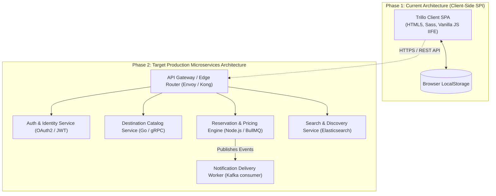

# 14.2 Architecture Styles: Monolith vs Modular vs Microservices

---

## 1. Concept in Plain Words
An architectural style defines the macro-structural pattern governing how components, data, and processes communicate:
- **Monolith**: All business capabilities, data access, and API routers reside in a single codebase and deployment unit.
- **Modular Monolith**: Code is logically decoupled into isolated domain modules with strict public interfaces, but packaged as a single deployable binary or container.
- **Microservices**: Independent, distributed services bounded by business domain, communicating over the network via HTTP/REST, gRPC, or messaging brokers.
- **Serverless / Edge**: Ephemeral, event-driven functions executed at network edge points of presence (e.g., Cloudflare Workers).

---

## 2. Current Implementation in Trillo
Trillo currently operates as a **Standalone Client-Side Single Page Interface (SPI)**. It has no backend monolith or microservice dependencies. Its architecture is divided cleanly inside the browser:
- **Presentation**: Modular Sass partials following the 7-1 pattern.
- **Controller & Domain Logic**: Modular closures in `main.js`.
- **Data Persistence**: In-memory data structures and browser `localStorage`.

---

## 3. Technology Comparison Matrix

| Architecture Style | Deployment Complexity | Fault Isolation | Operational Cost | Latency Overhead | Ideal Scale | Fit with Trillo |
| :--- | :---: | :---: | :---: | :---: | :---: | :--- |
| **Client SPI (Current)** | **Minimal (Static Host)**| **High (Isolated in Browser)**| **Near Zero** | **Zero Network Hop** | **1 - 100K Users** | **Optimal for current scope** |
| **Modular Monolith** | Low (Single Container) | Moderate | Low | Very Low (In-process) | 100K - 5M Users | Excellent next phase |
| **Microservices** | High (K8s, Service Mesh)| High (Independent failures) | High | Moderate (Network hops)| > 5M Users | Future enterprise scale |
| **Serverless Edge** | Moderate | High | Pay-per-execution | Low (Edge POPs) | Variable Traffic | Great for AI Concierge |

---

## 4. Why This Choice Was Made [CONFIRM WITH DEVELOPER]
The standalone client-side architecture was chosen because the application's scope is a focused, high-speed travel landing and booking exploration portal. Deploying a complex microservices cluster for this stage would introduce immense operational overhead, service discovery costs, and network latency without adding user value.

---

## 5. Senior Roadmap: When to Decompose into Services
As Trillo evolves into a commercial travel enterprise, it should transition through a **Modular Monolith** first, decomposing into microservices only when independent team scaling requires it:
1. **Catalog & Inventory Service**: Owns hotel, flight, and tour schedules.
2. **Booking & Transaction Service**: Owns reservations, payment authorization, and inventory locks.
3. **Search & Analytics Service**: Powered by Elasticsearch for multi-faceted destination discovery.

---

## 6. 30-Second Spoken Answer
> *"Trillo currently follows a client-side single page architecture with zero server dependencies, allowing it to be served globally from CDN edge nodes with zero compute costs. If scaling this into a multi-million-user commercial platform, I would transition to a modular monolith first to establish strict domain boundaries between inventory, reservations, and search, before breaking out critical transaction workflows like booking into independent microservices."*
