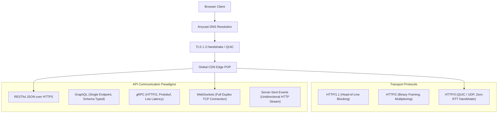

# 14.3 Networking & Communication Protocols

---

## 1. Concepts in Plain Words
Networking governs how bits travel securely and efficiently across the internet from client devices to edge servers and backends:
- **DNS (Domain Name System)**: Translates human-readable domain names (`trillo-travel.com`) into routable IP addresses using Anycast routing to direct users to the geographically nearest server.
- **HTTP/1.1 vs HTTP/2 vs HTTP/3**:
  - *HTTP/1.1*: Sequential text protocol prone to head-of-line blocking (one request per TCP connection at a time).
  - *HTTP/2*: Multiplexes multiple binary requests over a single TCP connection, eliminating head-of-line blocking at the application layer.
  - *HTTP/3 (QUIC)*: Replaces TCP with UDP-based QUIC, eliminating transport-layer head-of-line blocking during packet loss and enabling zero-RTT connection establishment.
- **REST vs GraphQL vs gRPC**:
  - *REST*: Stateless HTTP resource operations (GET, POST, PUT, DELETE) with standard caching.
  - *GraphQL*: Single endpoint allowing clients to request exact fields, eliminating over-fetching.
  - *gRPC*: High-performance binary RPC over HTTP/2 using Protocol Buffers, ideal for internal microservice communication.

---

## 2. Current Implementation in Trillo
Trillo leverages modern edge networking:
- **Asset Delivery**: Static HTML, CSS, and JS are delivered over **HTTP/2 or HTTP/3** with TLS 1.3 encryption when deployed to CDNs like Cloudflare, Vercel, or Netlify.
- **Inline SVG Sprite**: Eliminates 12 individual HTTP requests, bypassing connection establishment overhead completely.
- **Preconnected Fonts**: Uses `<link rel="preconnect">` in [`index.html:12-14`](file:///Users/avishjain/avishjain9-repos/52-trilo-travel-ui/02_Trillo/index.html#L12-L14) to establish early DNS and TLS handshakes with Google Fonts.

---

## 3. Communication Protocols Comparison

| Protocol | Transport | Latency | Multiplexing | Browser Support | Best Use in Trillo |
| :--- | :--- | :---: | :---: | :---: | :--- |
| **HTTP/3 (QUIC)** | UDP | Ultra-Low (0-1 RTT) | Yes (Per stream) | 85%+ Modern | **Static asset delivery & client API calls** |
| **HTTP/2** | TCP | Low (1-2 RTT) | Yes (Single TCP) | 98% Modern | Fallback for non-QUIC clients |
| **HTTP/1.1** | TCP | High | No (Parallel conns)| 100% Legacy | Ancient browser fallbacks only |
| **WebSockets** | TCP | Real-Time Full Duplex | Bidirectional stream | 99% Modern | Live room inventory alerts & chat |
| **gRPC** | HTTP/2 | Minimal (Protobuf) | Full Multiplexing | Requires gRPC-Web | Internal microservice-to-microservice |

---

## 4. Failure Modes & Bottlenecks
- **TLS Handshake Latency on Mobile**: High round-trip times (RTT) on mobile networks cause slow initial connections.
  *Fix*: Enable TLS 1.3 zero-RTT resumption and HTTP/3 QUIC on the edge CDN.
- **Head-of-Line Blocking during Packet Loss**: Under HTTP/2, a single lost TCP packet stalls all multiplexed streams.
  *Fix*: Transition edge delivery to HTTP/3.

---

## 5. 30-Second Spoken Answer
> *"For Trillo, networking is optimized around HTTP/3 and edge CDN caching. Delivering our static bundles and SVG sprite over QUIC eliminates transport-layer head-of-line blocking and cuts connection latency to near zero. For backend communications, I recommend standard RESTful HTTPS for booking operations because of its native edge cacheability, reserving WebSockets specifically for real-time room availability alerts."*
