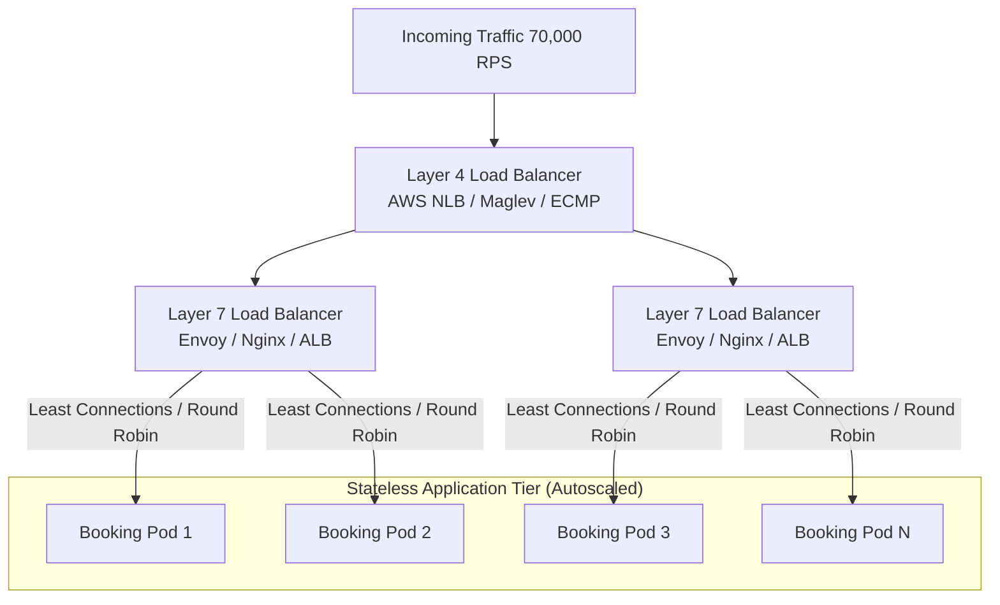

# 14.4 Load Balancing & Horizontal Scaling

---

## 1. Concepts in Plain Words
- **Horizontal Scaling (Scale Out)**: Adding more server nodes to share the load. Resilient, fault-tolerant, and theoretically limitless.
- **Vertical Scaling (Scale Up)**: Adding more CPU, RAM, or faster NVMe disks to a single server. Limited by physical hardware boundaries and presents a Single Point of Failure (SPOF).
- **Layer 4 vs Layer 7 Load Balancing**:
  - *Layer 4 (Transport)*: Routes traffic based on IP address and TCP/UDP ports without inspecting packet payloads. High throughput, low CPU overhead.
  - *Layer 7 (Application)*: Inspects HTTP headers, cookies, URLs, and request bodies. Enables intelligent routing (e.g., routing `/api/bookings` to the booking cluster and `/api/search` to Elasticsearch).
- **Stateless Services**: Server instances hold no local session memory. Any incoming request can be handled by any server instance, allowing rapid automated scaling.

---

## 2. Load Balancing Algorithms Comparison

| Algorithm | How It Works | Strengths | Weaknesses | Best Use in Trillo |
| :--- | :--- | :--- | :--- | :--- |
| **Round Robin** | Requests distributed sequentially | Trivial, zero overhead | Assumes equal request duration | Simple health checks |
| **Least Connections**| Routes to server with fewest active conns | Optimal for variable workloads | Slight state tracking overhead | **Booking transaction API** |
| **IP Hash / Consistent**| Hashes client IP to select server | Deterministic node affinity | Uneven distribution behind NATs| Sticky caching proxies |
| **Weighted Response**| Favors servers responding fastest | Automatically routes around lag | Complex monitoring metrics | Multi-region routing |

---

## 3. Eliminating Single Points of Failure (SPOF)
1. **Multi-AZ Redundancy**: Deploy application pods and databases across at least three distinct Availability Zones (AZs).
2. **DNS Failover**: Use Route53 or Cloudflare Health Checks with automatic DNS failover to hot standby regions.
3. **Stateless API Tier**: By externalizing user sessions to Redis and database stores, any crashed node is automatically replaced by Kubernetes without dropping active user bookings.

---

## 4. 30-Second Spoken Answer
> *"To scale Trillo's backend horizontally, I recommend a two-tier load balancing setup: an AWS Network Load Balancer operating at Layer 4 for high-throughput TCP routing, followed by Envoy or Nginx at Layer 7 for intelligent path-based routing. By keeping the application servers completely stateless and managing active connections with a Least Connections algorithm, our Kubernetes cluster can automatically scale from two to two hundred pods in response to CPU metrics or traffic spikes with zero downtime."*
