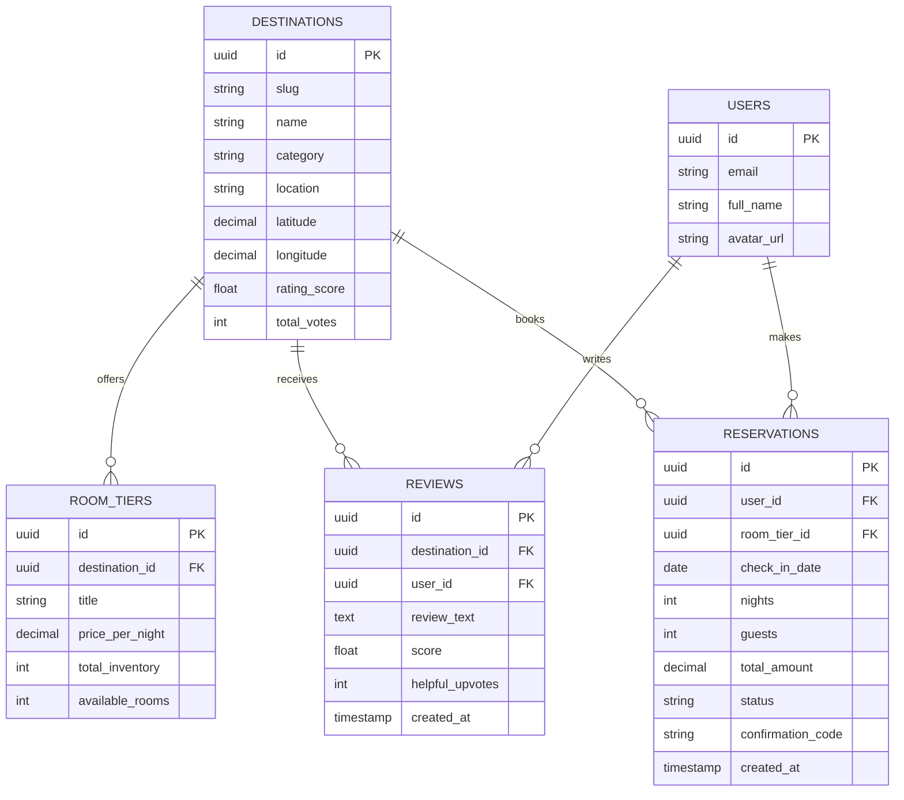

# 14.5 Database Systems & Storage Architecture



---

## 1. Concepts in Plain Words
- **SQL (Relational)**: Structured schemas with strict ACID transactions, foreign keys, and complex JOIN capabilities (e.g., PostgreSQL, MySQL).
- **NoSQL (Document/Key-Value)**: Flexible schemas, horizontal partitioning, and rapid denormalized read throughput (e.g., MongoDB, DynamoDB).
- **ACID vs BASE**:
  - *ACID*: Atomicity, Consistency, Isolation, Durability (Guarantees financial and inventory precision).
  - *BASE*: Basically Available, Soft state, Eventual consistency (Favors availability and speed over immediate consistency).
- **CAP Theorem**: A distributed data store can guarantee at most two out of three: **Consistency (C)**, **Availability (A)**, and **Partition Tolerance (P)**. Because network partitions (P) are unavoidable in distributed cloud systems, modern stores choose between CP (Postgres/Mongo) and AP (DynamoDB/Cassandra).

---

## 2. Database Choice for Trillo: PostgreSQL vs MongoDB

| Database | Data Model | Transaction Support (ACID) | Inventory Locking | Horizontal Sharding | Fit with Trillo |
| :--- | :--- | :---: | :---: | :---: | :--- |
| **PostgreSQL** | **Relational + JSONB** | **Strict (Serializable)** | **Native (`SELECT FOR UPDATE`)** | Citus / Read Replicas | **Recommended (Optimal for booking)** |
| **MongoDB** | Document (BSON) | Multi-document ACID | Optimistic versioning | Native auto-sharding | Good (flexible specs) |
| **DynamoDB** | Key-Value / Wide-Column | TransactWriteItems | Conditional Writes | Automatic partition | High operational cost |
| **MySQL** | Relational | Strict (InnoDB) | Native row-level locks | Vitess / Sharding | Good alternative |

---

## 3. Why PostgreSQL is the Superior Choice for Booking
Travel reservations involve real money and finite inventory. If two users simultaneously click "Book now" for the last room at Hotel Las Palmas, the database must guarantee that exactly one reservation succeeds and the other receives an inventory exhaustion error. PostgreSQL provides robust row-level locking:

```sql
-- Atomic reservation transaction with row-level locking:
BEGIN;

SELECT available_rooms 
FROM room_tiers 
WHERE id = 'tier-uuid' 
FOR UPDATE;

-- Application checks if available_rooms > 0
UPDATE room_tiers 
SET available_rooms = available_rooms - 1 
WHERE id = 'tier-uuid';

INSERT INTO reservations (id, room_tier_id, user_id, check_in_date, nights, total_amount, confirmation_code) 
VALUES (gen_random_uuid(), 'tier-uuid', 'user-uuid', '2026-11-01', 3, 540.00, 'TR-894201');

COMMIT;
```

---

## 4. Indexing Strategy
1. **Primary Index**: B-Tree on `id` (UUIDv7 for time-sorted clustering).
2. **Compound Index**: `CREATE INDEX idx_reservations_user_date ON reservations(user_id, check_in_date);` for fast traveler history lookups.
3. **Geospatial Index**: PostGIS R-Tree index on `(latitude, longitude)` for location radius searches.

---

## 5. 30-Second Spoken Answer
> *"For Trillo's data layer, I recommend PostgreSQL over MongoDB. Travel booking requires strict ACID guarantees and row-level locking to prevent double-booking during high-concurrency flash sales. PostgreSQL gives us strong relational integrity for financial reservations and room inventory, while its native JSONB support allows us to store dynamic, unstructured hotel amenities and metadata without sacrificing transactional consistency."*
