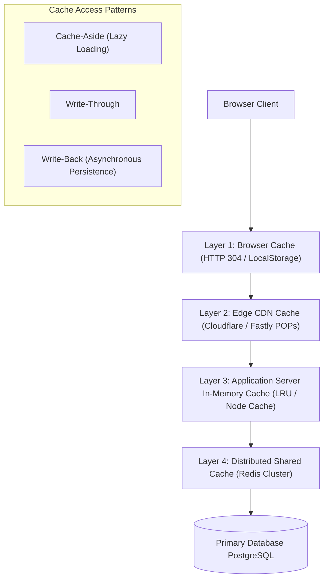

# 14.6 Caching Strategies & Performance Optimization

---

## 1. Concepts in Plain Words
Caching stores copies of frequently accessed data in fast, low-latency storage media (such as RAM) so future requests avoid expensive disk I/O, database queries, and CPU computations.
- **Cache-Aside (Lazy Loading)**: Application queries the cache first. On a *cache hit*, data returns immediately. On a *cache miss*, application queries the database, writes the result to the cache, and returns it.
- **Write-Through**: Application writes data to the cache and the primary database simultaneously.
- **Eviction Policies**: When memory fills up, the cache evicts data:
  - *LRU (Least Recently Used)*: Discards items not accessed for the longest time.
  - *LFU (Least Frequently Used)*: Discards items accessed least often.
  - *TTL (Time To Live)*: Data automatically expires after a set duration.

---

## 2. Multi-Tier Caching Architecture for Trillo

1. **Browser Layer**: Static assets (`style.css`, SVG icons) cached with `Cache-Control: public, max-age=31536000, immutable`.
2. **Edge CDN Layer**: Destination catalog responses cached globally for 1 hour (`s-maxage=3600, stale-while-revalidate=60`).
3. **Distributed Redis Layer**: Stores destination detail payloads and active room inventory:
   - Key: `destination:hotel-las-palmas`
   - TTL: 15 minutes with event-driven invalidation on property updates.

---

## 3. Mitigating Cache Failure Modes
- **Cache Stampede / Thundering Herd**: When a popular cache key expires, thousands of concurrent requests hit the database simultaneously.
  *Defense*: Use **Probabilistic Early Recomputation (XFetch)** or mutual exclusion locks (`SETNX` mutex) so only one worker queries the database while others wait.
- **Cache Penetration**: Malicious users query non-existent keys repeatedly to hammer the database.
  *Defense*: Store null values in Redis with short TTL (`TTL = 60s`) or use a **Bloom Filter** at the gateway to drop invalid queries instantly.

---

## 4. 30-Second Spoken Answer
> *"In Trillo, we employ a multi-layered caching strategy: immutable browser caching for static assets, edge CDN caching for catalog listings, and a Redis cluster for dynamic room pricing. Using a Cache-Aside pattern with TTL expiration and Redis mutex locks, we protect our primary database from cache stampedes and maintain sub-10ms response times for 99% of traveler queries."*
