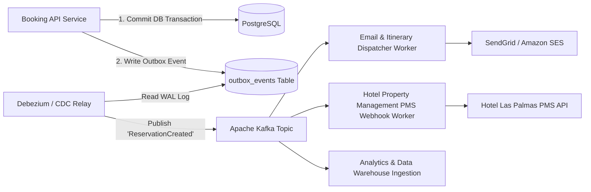

# 14.7 Messaging, Asynchronous Queues & Event Streaming



---

## 1. Concepts in Plain Words
Asynchronous messaging decouples request-response cycles. When a user submits an action (like confirming a hotel booking), the server completes the immediate transactional task (reserving the room), returns success to the client immediately, and delegates secondary work (sending emails, notifying hotel concierges, updating data warehouses) to background queues.
- **Message Queues (RabbitMQ, SQS, BullMQ)**: Work queues distributing distinct jobs to consumers with acknowledgement semantics.
- **Event Streaming (Apache Kafka, AWS Kinesis)**: Distributed append-only commit logs preserving immutable event streams partitioned across multiple consumer groups.
- **Transactional Outbox Pattern**: Solves dual-write problems by writing business data and domain events into the same relational database transaction, ensuring guaranteed event delivery without two-phase commit.

---

## 2. Queue & Messaging Technologies Comparison

| System | Architecture Style | Ordering Guarantee | Replay Capability | Throughput | Best Use in Trillo |
| :--- | :--- | :---: | :---: | :---: | :--- |
| **Apache Kafka** | Distributed Commit Log | Per-Partition Strict | Yes (Retention buffer) | Millions msg/sec | **Core domain event bus** |
| **RabbitMQ** | Smart Broker / Push | Per-Queue FIFO | No (Deleted on ACK) | ~50K msg/sec | Task dispatching |
| **Redis Streams** | In-Memory Stream | Strict Time-based | Yes | ~500K msg/sec | Lightweight queuing |
| **BullMQ (Node.js)**| Redis-backed Job Queue | Delayed / Priority | Partial | ~10K jobs/sec | Scheduled reservation reminders |

---

## 3. Delivery Semantics & Idempotency
- **At-Least-Once Delivery**: Messages are guaranteed to arrive, but network retries may duplicate events.
- **Idempotent Consumers**: Consumers must track processed event IDs in a deduplication table:
  ```sql
  INSERT INTO processed_events (event_id, processed_at) VALUES ('evt-1234', NOW())
  ON CONFLICT (event_id) DO NOTHING;
  ```
  If `ON CONFLICT` triggers, the consumer skips processing, preventing duplicate emails or double-charging.

---

## 4. 30-Second Spoken Answer
> *"To ensure high throughput and fault tolerance during hotel bookings, Trillo isolates secondary side-effects using the Transactional Outbox pattern and Apache Kafka. Once the booking record commits to PostgreSQL, a Change Data Capture process streams the event to Kafka, where independent worker pools handle confirmation emails, partner PMS webhooks, and analytics asynchronously without blocking the user's checkout response."*
