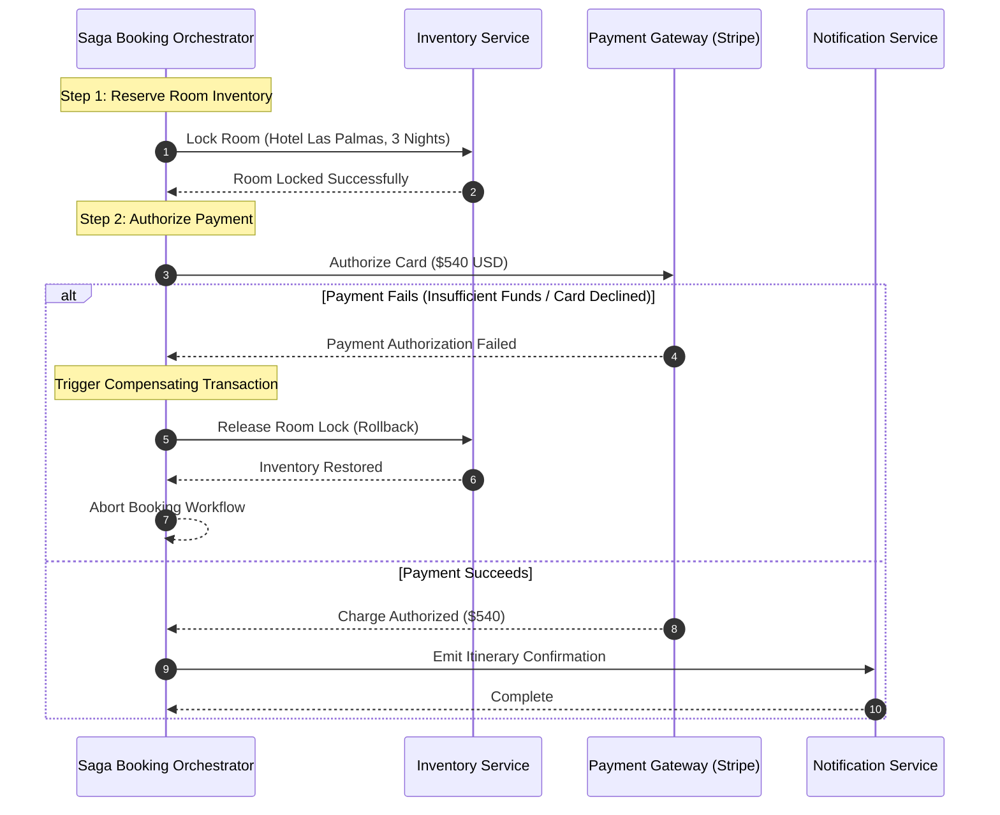

# 14.8 Consistency, Concurrency & Distributed Transactions



---

## 1. Concepts in Plain Words
- **Concurrency**: Multiple transactions executing simultaneously on shared resources (e.g., two travelers attempting to book the last available suite).
- **Race Condition**: A flaw where the system's output depends on unpredictable execution timing.
- **Pessimistic vs Optimistic Locking**:
  - *Pessimistic Locking*: Explicitly locks the database row (`SELECT FOR UPDATE`) before reading, blocking others until the transaction commits. Prevents overbooking; higher latency.
  - *Optimistic Locking*: Reads without locking, appending a version number (`version: 5`). When writing, checks `WHERE version = 5`. If another writer changed the version, the transaction fails and retries.
- **Saga Pattern**: Manages distributed transactions across multiple microservices without locking shared resources via a sequence of local transactions, paired with compensating transactions for rollbacks.

---

## 2. Distributed Locking with Redis (Redlock)
When multiple application pods need to synchronize operations without locking entire database tables, a distributed lock is established in Redis:

```javascript
// Distributed lock acquisition with TTL
const lockKey = 'lock:room-tier:deluxe-terrace-suite';
const lockToken = crypto.randomUUID();
const acquired = await redis.set(lockKey, lockToken, 'PX', 5000, 'NX');

if (!acquired) {
  throw new Error('Room is currently being reserved by another traveler. Please retry.');
}

try {
  // Execute booking transaction
} finally {
  // Safe release using Lua script verifying token ownership
  await redis.eval(RELEASE_LOCK_LUA, 1, lockKey, lockToken);
}
```

---

## 3. 30-Second Spoken Answer
> *"To manage concurrency and prevent race conditions during high-demand booking windows, Trillo uses pessimistic row-level database locking combined with the Saga pattern for distributed orchestration. When a traveler initiates checkout, we acquire an atomic inventory lock, execute payment authorization with third-party gateways, and finalize the reservation. If payment fails, our orchestrator immediately triggers compensating transactions to release the locked inventory back to the public pool."*
