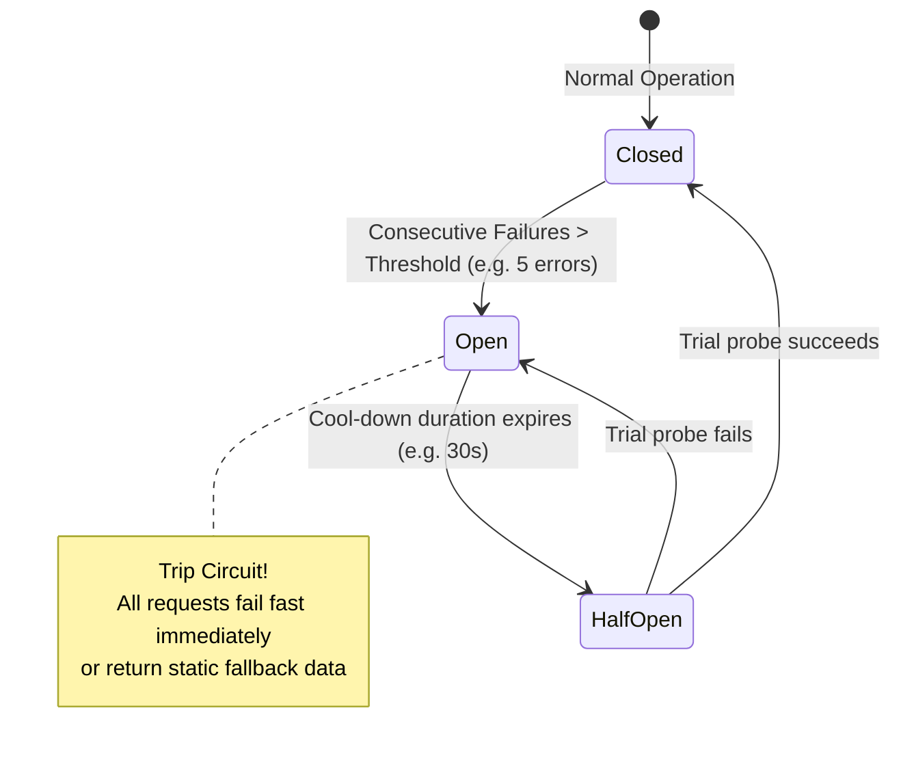

# 14.9 Reliability, Resilience & Circuit Breakers



---

## 1. Concepts in Plain Words
- **SLI (Service Level Indicator)**: The quantifiable metric measured (e.g., successful HTTP responses / total requests).
- **SLO (Service Level Objective)**: The internal target threshold (e.g., $99.9\%$ of requests return $< 100\text{ms}$).
- **SLA (Service Level Agreement)**: The contractual commitment made to paying customers, with financial penalties if breached (e.g., $99.9\%$ monthly uptime).
- **Circuit Breaker Pattern**: Prevents cascading failures. When a downstream dependency (like a third-party airline API or payment processor) starts failing, the circuit opens, failing fast or returning fallback responses immediately instead of exhausting server threads.
- **Bulkhead Pattern**: Partitions system resources into isolated pools (like watertight bulkheads in a ship) so a failure in one feature (e.g., image upload) cannot exhaust connection pools needed for core bookings.

---

## 2. Circuit Breaker Implementation Example

```javascript
// Circuit Breaker using Opossum in Node.js
import CircuitBreaker from 'opossum';

async function fetchExternalFlightInventory(flightId) {
  return await http.get(`https://api.partner-airline.com/flights/${flightId}`);
}

const breakerOptions = {
  timeout: 3000,              // 3 seconds timeout
  errorThresholdPercentage: 50, // Open if 50% of requests fail
  resetTimeout: 30000          // Wait 30s before trying again
};

const flightBreaker = new CircuitBreaker(fetchExternalFlightInventory, breakerOptions);

flightBreaker.fallback(() => {
  return { status: 'DEGRADED', message: 'Live seat maps temporarily unavailable. Booking available on partner site.' };
});
```

---

## 3. Chaos Engineering
Chaos testing (via tools like Chaos Mesh or Gremlin) proactively injects failures into staging clusters:
- Simulating network packet loss between booking and inventory pods.
- Killing random primary database nodes to test automated leader failover.
- Injecting high latency into third-party payment gateways to verify timeout and circuit breaker behavior.

---

## 4. 30-Second Spoken Answer
> *"To ensure high resilience, Trillo isolates downstream dependencies with circuit breakers, exponential backoff retries with jitter, and bulkheaded connection pools. If a third-party airline partner or payment processor experiences an outage, our circuit breaker trips within three seconds, preventing thread starvation and serving graceful fallback estimates while our primary hotel booking engine continues operating unimpeded."*
