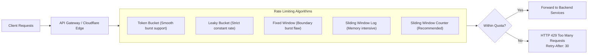

# 14.10 API Gateway Design & Rate Limiting Algorithms



---

## 1. Concepts in Plain Words
An **API Gateway** acts as the single reverse proxy entry point for all client requests, centralizing cross-cutting concerns such as TLS termination, rate limiting, authentication verification, and request routing.
- **Rate Limiting**: Protects backend APIs against abusive scrapers, credential stuffing, and DDoS floods by throttling requests per IP or API key.
- **Idempotency Key**: A unique client-generated header (`X-Idempotency-Key: uuid`) ensuring that if a network timeout occurs and the client retries a payment, the server does not execute duplicate transactions.

---

## 2. Rate Limiting Algorithms Comparison

| Algorithm | Mechanism | Burst Handling | Memory Overhead | Complexity | Best Use in Trillo |
| :--- | :--- | :---: | :---: | :---: | :--- |
| **Token Bucket** | Tokens added at fixed rate; spent per request | Smooth bursts allowed | Minimal (2 numbers) | Low | **User API endpoints** |
| **Leaky Bucket** | Requests enter queue and leak at constant rate | No bursts (strict smoothing) | Queue overhead | Moderate | Outbound partner webhooks |
| **Sliding Window Counter**| Approximates rolling window using past slice | Smooth (no boundary bursts) | Minimal (2 counters)| Low | **Gateway IP rate limits** |
| **Fixed Window** | Counter resets every minute/hour | Severe boundary bursts | Minimal (1 counter) | Very Low | Coarse daily quotas |

---

## 3. Idempotent Reservation Endpoint Pattern

```http
POST /api/v1/reservations HTTP/1.1
Host: api.trillo-travel.com
Content-Type: application/json
X-Idempotency-Key: 7b84c8d1-5829-4d69-a22b-5f3408a0b021

{
  "roomTierId": "tier-deluxe",
  "dates": "2026-11-01",
  "nights": 3
}
```

The gateway checks Redis for `idempotency:7b84c8d1...`. If the key exists, it returns the cached response with `HTTP 200 OK` without hitting the database or charging the card a second time.

---

## 4. 30-Second Spoken Answer
> *"We protect Trillo's booking gateway using an edge-enforced Sliding Window Counter rate limiter in Cloudflare Workers backed by Redis. Public search endpoints are throttled to 60 requests per minute per IP, while sensitive booking submissions are limited to 5 requests per minute with mandatory `X-Idempotency-Key` headers to guarantee that retried network requests can never duplicate room charges."*
