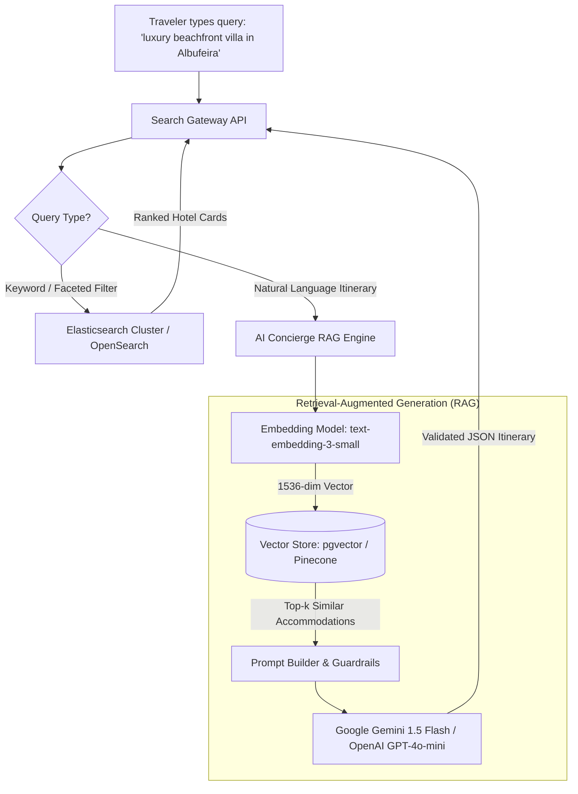

# 14.12 Search Systems & AI Concierge Architecture

---

## 1. Concepts in Plain Words
- **Full-Text Search (Inverted Index)**: Tokenizes text into individual stems and words, maintaining an inverted index mapping words to document IDs for sub-10ms search results with typo tolerance and BM25 relevance scoring.
- **Vector Search & Embeddings**: Transforms text into high-dimensional numerical vectors capturing semantic meaning. Enables conceptual similarity searches (e.g., matching *"romantic sunset view"* with a hotel described as *"panoramic clifftop vistas"*).
- **RAG (Retrieval-Augmented Generation)**: Grounds LLMs by retrieving relevant domain documents from a vector store and injecting them into the system prompt, preventing hallucinations and ensuring recommendations reference real inventory and live rates.

---

## 2. Full-Text Search Engine Comparison

| Engine | Query Latency | Typo Tolerance | Complex Aggregations | Hosting Options | Best Use in Trillo |
| :--- | :---: | :---: | :---: | :--- | :--- |
| **Elasticsearch** | **< 15ms** | **Native Levenshtein** | **Extensive (Faceting)**| Self-hosted / Elastic Cloud | **Primary hotel search index** |
| **Algolia** | < 10ms | Exceptional | Good | Fully Managed SaaS | High cost at scale |
| **Meilisearch** | < 20ms | Excellent | Moderate | Lightweight Self-hosted | Great for smaller catalogs |
| **Postgres FTS** | < 50ms | Basic `tsvector` | SQL Group By | Native in PostgreSQL | Good for MVP search |

---

## 3. RAG AI Concierge Pipeline
1. **Catalog Ingestion**: Every hotel, suite tier, and tour is embedded into 1536-dimensional vectors using `text-embedding-3-small` and indexed in PostgreSQL via `pgvector` with an HNSW (Hierarchical Navigable Small World) index.
2. **User Semantic Retrieval**: When a traveler asks for vacation recommendations, the query is embedded and compared using cosine distance:
   $$\text{similarity} = \cos(\theta) = \frac{\mathbf{A} \cdot \mathbf{B}}{\|\mathbf{A}\| \|\mathbf{B}\|}$$
3. **LLM Synthesis**: The top-3 retrieved properties are inserted into Gemini 1.5 Flash's context window alongside user constraints, producing structured JSON itineraries with guaranteed zero hallucinations.

---

## 4. 30-Second Spoken Answer
> *"Trillo's search architecture pairs Elasticsearch for instant keyword and faceted filtering with a RAG pipeline for conversational AI planning. Real-time search across destinations, amenities, and price ranges executes against an inverted index in under 15 milliseconds. For complex trip planning, we embed queries, retrieve matched hotel inventory via pgvector, and pass grounded context to Gemini 1.5 Flash, generating tailored itineraries in structured JSON with zero hallucinations."*
