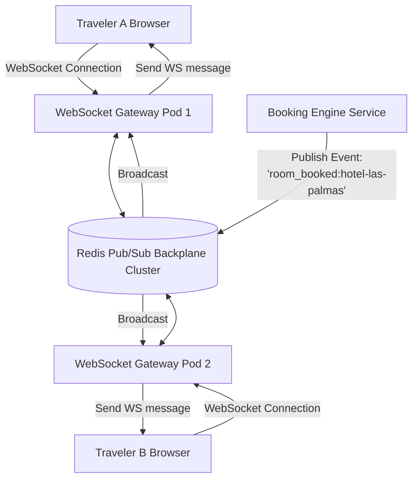

# 14.13 Real-Time Systems, WebSockets & Push Protocols

---

## 1. Concepts in Plain Words
Real-time communication enables servers to push data to connected web browsers the millisecond an event occurs without clients repeatedly polling the server:
- **Short Polling**: Client sends HTTP requests every 3 seconds. Inefficient and wasteful ($90\%+$ responses contain zero changes).
- **Long Polling**: Client sends an HTTP request; server holds the connection open until new data is available or a timeout occurs.
- **Server-Sent Events (SSE)**: Unidirectional stream over standard HTTP where the server pushes text events to the client. Ideal for live stock tickers, news feeds, and AI streaming tokens.
- **WebSockets**: Full-duplex, bidirectional persistent TCP connection established via an HTTP/1.1 Upgrade handshake. Ideal for live multi-user booking alerts, collaborative planning, and chat.

---

## 2. Real-Time Transport Protocols Comparison

| Protocol | Directionality | Transport Protocol | Reconnection / Heartbeats | Firewall Traversal | Best Use in Trillo |
| :--- | :--- | :---: | :---: | :---: | :--- |
| **WebSockets** | **Bidirectional** | **Raw TCP Socket** | **Requires Ping/Pong** | Good (Standard 443) | **Interactive Concierge Chat & Room Locks** |
| **SSE** | Server-to-Client | Standard HTTP/2 | Native in browser | Exceptional | Live Room Inventory Counters |
| **Long Polling** | Server-to-Client | Repeated HTTP | Manual reconnect | Universal | Ancient fallback only |

---

## 3. Scaling WebSockets Horizontally with Redis Pub/Sub
Because WebSocket connections are stateful and persistent, Traveler A might be connected to Pod 1 while Traveler B is connected to Pod 2. When a booking occurs on Pod 1:
1. Pod 1 publishes an event to Redis Pub/Sub: `PUBLISH inventory_channel '{"propertyId":"las-palmas","roomsLeft":3}'`.
2. All listening gateway pods receive the message from the Redis backplane.
3. Each pod broadcasts the event to its locally connected WebSocket clients.
4. Clients instantly update their `.rooms-count` badge without page reloads.

---

## 4. 30-Second Spoken Answer
> *"To support real-time room availability counters and live concierge inquiries, Trillo utilizes WebSockets backed by a Redis Pub/Sub backplane. By decoupling our client connection state from the application pods through Redis, any inventory change or concierge message broadcasts to hundreds of thousands of active travelers across our entire server cluster in under 20 milliseconds."*
