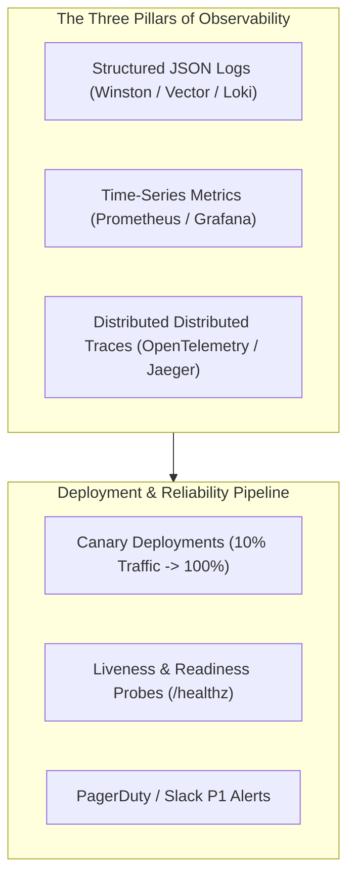

# 14.14 Observability, Telemetry & Operations

---

## 1. Concepts in Plain Words
- **The Three Pillars of Observability**:
  - **Metrics**: Numerical aggregations over time intervals (e.g., CPU utilization, p99 latency, request counts, error rates). Stored in Prometheus.
  - **Logs**: Discrete timestamped event records containing context. Must be structured JSON with correlation IDs.
  - **Distributed Traces**: Tracks the path of a single request as it traverses dozens of microservices, databases, and external APIs using distributed context propagation (`traceparent` header).
- **Correlation ID**: A unique UUID generated at the API Gateway and passed across every downstream service call, allowing engineers to trace an error through log aggregation systems in seconds.

---

## 2. Telemetry Tooling Stack for Trillo

| Observability Area | Production Tool | Implementation Details |
| :--- | :--- | :--- |
| **Metrics Collection** | **Prometheus** | Scrapes `/metrics` endpoints for HTTP request duration histograms and active room counts. |
| **Dashboards & Alerts**| **Grafana** | Visualizes p50, p95, and p99 latency percentiles, error budgets, and conversion rates. |
| **Distributed Tracing**| **OpenTelemetry + Jaeger** | Spans trace booking requests across API gateway, inventory, payment, and database layers. |
| **Log Aggregation** | **Grafana Loki / Vector** | High-throughput, cost-effective log ingestion indexing metadata labels rather than full text. |
| **Error Tracking** | **Sentry** | Automatically captures unhandled client-side JavaScript exceptions and source-mapped stack traces. |

---

## 3. Deployment Strategies: Blue-Green vs Canary
- **Blue-Green Deployment**: Runs two identical production environments (Blue active, Green idle). New releases deploy to Green; once verified, the router flips 100% of traffic to Green instantly.
- **Canary Deployment**: Gradually routes a small percentage of real user traffic (e.g., 5%) to the new version. Automated metrics analysis monitors error rates; if stable, traffic increments to 100%. If error rates spike, traffic rolls back automatically in seconds.

---

## 4. 30-Second Spoken Answer
> *"Trillo's observability strategy integrates the three pillars: Prometheus for real-time latency and error rate metrics, Grafana Loki for structured JSON log aggregation, and OpenTelemetry for end-to-end distributed tracing. By injecting correlation IDs at the edge and employing automated Canary deployments with Sentry error monitoring, we ensure that performance regressions or checkout errors are detected and rolled back before impacting users."*
