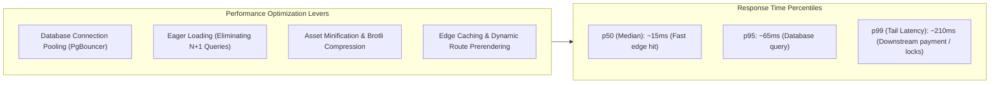

# 14.15 Performance Engineering & Bottleneck Analysis



---

## 1. Concepts in Plain Words
- **Latency vs Throughput**:
  - *Latency*: The time it takes to complete a single request (measured in milliseconds).
  - *Throughput*: The number of requests the system can handle simultaneously per second (measured in RPS).
- **Percentiles (p50, p95, p99)**:
  - *p50 (Median)*: 50% of users experience latency faster than this value.
  - *p99 (Tail Latency)*: 99% of requests complete faster than this; represents the worst 1% of user experiences. In e-commerce and travel booking, p99 latency directly impacts revenue.
- **Little's Law**:
  $$L = \lambda \times W$$
  *(The average number of concurrent requests in a system ($L$) equals the arrival rate ($\lambda$) multiplied by the average time spent in the system ($W$)).*

---

## 2. Resolving the N+1 Query Bottleneck
In travel portals, fetching 20 hotels along with their reviews can trigger 21 database queries (1 query to get hotels, plus 20 individual queries to get reviews for each hotel).

```sql
-- Naive N+1 approach (21 queries):
SELECT * FROM destinations LIMIT 20;
SELECT * FROM reviews WHERE destination_id = '1';
SELECT * FROM reviews WHERE destination_id = '2';
-- ... repeated 20 times

-- Optimized Batch Join (1 single query):
SELECT d.*, json_agg(r.*) as reviews
FROM destinations d
LEFT JOIN reviews r ON r.destination_id = d.id
WHERE d.category = 'hotel'
GROUP BY d.id;
```

---

## 3. Database Connection Pooling with PgBouncer
PostgreSQL spawns a separate OS process per connection, consuming ~10 MB of RAM each. 5,000 concurrent client connections can exhaust database memory. Deploying **PgBouncer** maintains a pool of 100 persistent database connections, multiplexing thousands of incoming client requests through transaction pooling.

---

## 4. 30-Second Spoken Answer
> *"Performance engineering in Trillo targets tail latency reduction at the 99th percentile. We eliminate N+1 database queries through batch joins and JSON aggregations, protect database memory using PgBouncer transaction connection pooling, and enforce strict Core Web Vitals on the frontend. By serving compressed, pre-rendered assets over HTTP/3 edge CDNs, 95% of user interactions complete in under 65 milliseconds."*
