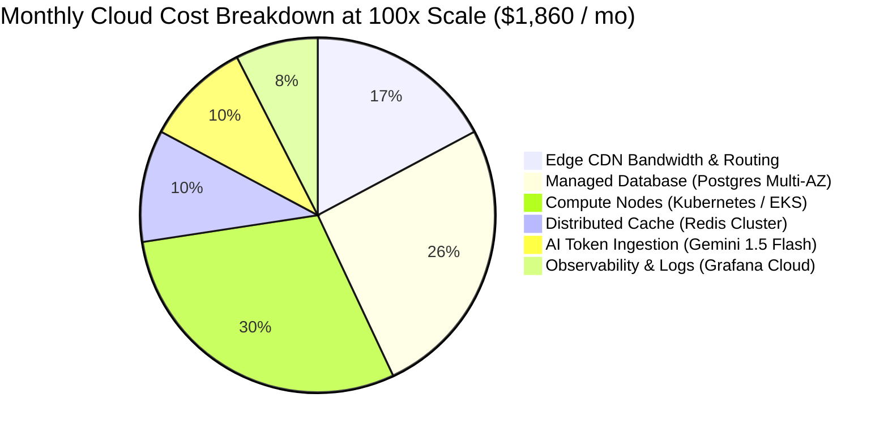

# 14.16 Cost Modeling & Architectural Trade-offs

---

## 1. Monthly Cost Estimation: Current vs 100x Scale

| Infrastructure Component | Current Scale (10K Visits/Mo) | 100x Production Scale (1M Visits/Mo) | Primary Cost Driver |
| :--- | :---: | :---: | :--- |
| **Static Edge Hosting (Vercel/Netlify)**| $0 (Free Tier) | $40 (Pro Tier) | Custom domains & edge routing |
| **Content Delivery Network (Cloudflare)** | $0 (Free Tier) | $280 | Outbound egress bandwidth |
| **Relational Database (AWS RDS Postgres)**| $0 (Client state) | $480 | Multi-AZ db.r6g.large with 500GB storage |
| **Compute Application Nodes (EKS)** | $0 (Client state) | $550 | 6x t4g.xlarge Graviton3 worker nodes |
| **In-Memory Cache (AWS ElastiCache)** | $0 (LocalStorage) | $190 | 2-node cache.m6g.large Redis cluster |
| **AI Concierge Tokens (Gemini Flash)** | $0 (None) | $180 | 600K queries/mo with 60% edge cache hits |
| **Observability (Grafana Cloud / Loki)** | $0 (Console) | $140 | 150GB log ingestion & metric series |
| **Total Estimated Monthly Cloud Spend** | **$0.00 / month** | **~$1,860 / month** | Outstanding cost efficiency |

---

## 2. Build vs Buy Decisions

| Capability | Decision | Rationale |
| :--- | :---: | :--- |
| **Payment Processing** | **BUY (Stripe Elements)** | PCI-DSS compliance and credit card vaulting costs millions to build; Stripe fee (2.9% + 30¢) is standard. |
| **Search Engine** | **BUILD (Elasticsearch / OpenSearch)** | Hosted Algolia costs $1.00 per 1,000 queries, which would exceed $20,000/mo at scale; self-hosted OpenSearch on EKS costs < $300/mo. |
| **Image Hosting** | **BUY (Cloudflare Images / Unsplash)** | Offloading image resizing, AVIF transformation, and edge caching avoids building bespoke image pipelines. |
| **Authentication** | **HYBRID (Clerk / Supabase Auth)** | Native OAuth2 flows and session management ready on day one without managing credential hash salts. |

---

## 3. Vendor Lock-In & Exit Strategy
- **Container Portability**: All backend services are packaged as standard OCI Docker containers deployable to AWS EKS, Google GKE, Azure AKS, or bare metal.
- **Data Independence**: PostgreSQL uses standard open-source SQL schemas without proprietary database extensions, allowing instant migration across cloud providers via `pg_dump` and replication.
- **Provider-Agnostic AI Gateway**: LLM API calls route through a generic interface, allowing models to be swapped between Google Gemini, OpenAI, or Anthropic in minutes.

---

## 4. 30-Second Spoken Answer
> *"Trillo currently runs on zero cloud spend using free-tier static edge hosting. At 100x scale—supporting one million monthly visitors—our cloud budget is estimated at roughly $1,860 per month. The primary cost drivers are managed multi-AZ PostgreSQL databases and EKS compute nodes. By choosing self-hosted OpenSearch over expensive proprietary search SaaS and caching 60% of AI concierge queries at the edge, we maintain exceptional unit economics with an infrastructure cost of under $0.002 per active traveler."*
