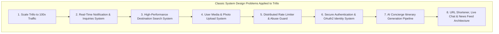
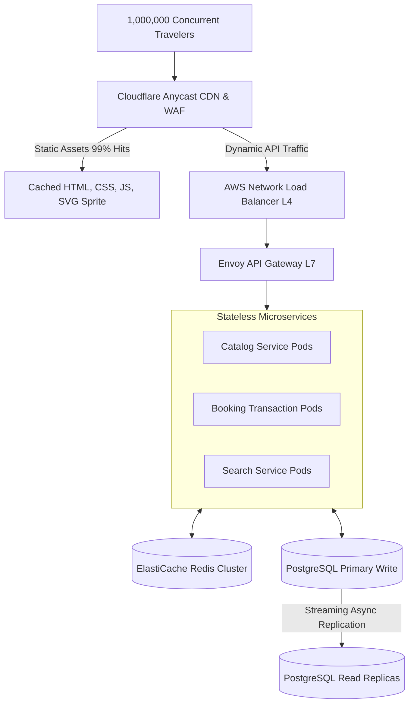
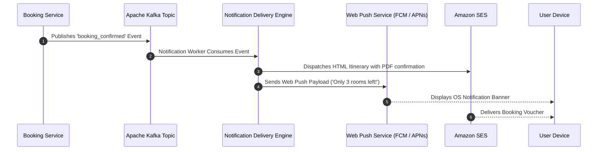
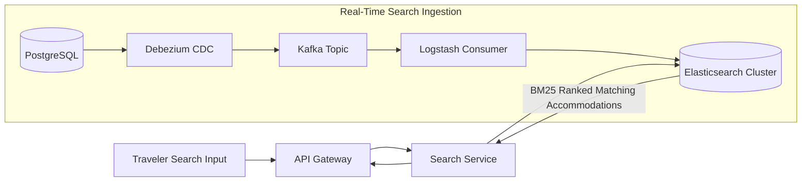
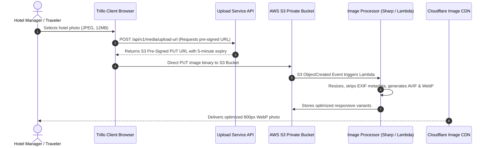

# 14.17 Classic System Design Problems Applied to Trillo

---

## 1. Design Trillo at 100x Scale

### High-Level Walkthrough
- **CDN Edge**: Offloads 99% of read traffic for HTML, compiled CSS, and Unsplash images.
- **Compute**: Stateless Dockerized microservices deployed on AWS EKS with Horizontal Pod Autoscalers (HPA) scaling pods on CPU ($> 70\%$) and request queue depth.
- **Data Layer**: Primary PostgreSQL node handles reservation writes (`FOR UPDATE` row locks); two read replicas handle hotel queries. Redis cluster caches destination listings with a 15-minute TTL.

---

## 2. Design Trillo's Notification System

### High-Level Walkthrough
- **Decoupled Architecture**: Domain services never send emails or push notifications synchronously. They emit events to Kafka.
- **Priority Queues**: Urgent booking alerts process through a `high-priority` queue; promotional discount digests process through a `bulk-batch` queue.
- **Delivery Guarantees**: Workers log successful deliveries in a deduplication table to ensure at-least-once delivery with zero duplicate emails.

---

## 3. Design Trillo's Destination Search System

### High-Level Walkthrough
- **Inverted Index**: Elasticsearch maintains an index of destinations, amenities, descriptions, and location geo-points.
- **Faceted Aggregations**: Enables instantaneous filtering by star ratings, price range sliders, and amenities checkmarks.
- **Real-Time Synchronization**: Changes made in the primary PostgreSQL database stream to Elasticsearch in under 500 milliseconds via Debezium Change Data Capture (CDC).

---

## 4. Design Trillo's Photo & Media Upload System

### High-Level Walkthrough
- **Pre-Signed URLs**: Bypasses application server compute by letting clients upload directly to AWS S3.
- **Serverless Transformation**: AWS Lambda triggers automatically to compress images, generate thumbnail variants, and convert formats to AVIF/WebP.
- **Security**: Strips EXIF GPS metadata to preserve user privacy and verifies magic bytes to prevent malicious file uploads.

---

## 5. Design Trillo's Distributed Rate Limiter
- **Algorithm**: Sliding Window Counter.
- **Data Store**: Redis cluster.
- **Rule Matrix**:
  - Global IP rate: 100 requests / minute.
  - Booking checkout API: 5 requests / minute per user token.
  - AI Concierge inquiry: 10 requests / minute per session.
- **Headers**: Returns `X-RateLimit-Limit`, `X-RateLimit-Remaining`, and `Retry-After`.

---

## 6. Design Trillo's Authentication System
- **Protocol**: OAuth 2.0 with OpenID Connect (OIDC) supporting Google and GitHub Social Login.
- **Token Model**: Short-lived RS256 JWT access tokens (15m expiry) paired with rotating refresh tokens stored in secure `httpOnly`, `SameSite=Strict` cookies.
- **Session Revocation**: Redis maintains a blacklist of revoked token JTI claims.

---

## 7. Reusing Trillo's Architecture for Classic Problems

### URL Shortener (e.g. TinyURL)
- Reuse the **PostgreSQL + Redis Cache-Aside** pattern.
- Generate Base62 hashes ($62^7 \approx 3.5\text{ trillion combinations}$) from auto-incrementing 64-bit sequence IDs.
- Cache hot redirect keys in Redis with HTTP 301/302 redirects served at edge CDN nodes.

### Live Chat System (e.g. WhatsApp / Slack)
- Reuse the **WebSocket Gateway + Redis Pub/Sub Backplane** pattern.
- Store message history in Cassandra or ScyllaDB (partitioned by `channel_id` and ordered by time-sorted `message_id`).
- Push read receipts and typing indicators via lightweight transient WebSocket frames.

### Real-Time Collaborative Canvas (e.g. Figma / Google Docs)
- Reuse the **Web Platform DOM + WebSocket event loop** architecture.
- Implement Conflict-Free Replicated Data Types (CRDTs) or Operational Transformation (OT) on client and server to resolve concurrent text and coordinate edits deterministically without central locks.
