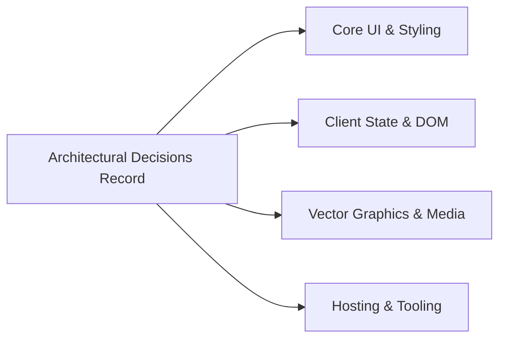

# 14.18 Master Architectural Decision Log (ADR)

The following table records every major technical and architectural decision made in the design and implementation of the Trillo Travel UI codebase:

---

## Complete Decisions Registry

| Decision Area | Chosen Option | Alternatives Considered | Deciding Factors | Trade-off Accepted | Revisit When |
| :--- | :--- | :--- | :--- | :--- | :--- |
| **Styling Architecture** | **Sass 7-1 Pattern (SCSS)** | TailwindCSS, Plain CSS, CSS Modules, Styled-Components | Clean semantic HTML, modular separation of concerns, BEM class clarity. | Requires compilation step during development. | Migrating to React or Vue component library. |
| **Design Tokens** | **CSS Custom Properties (`:root`)** | Hardcoded SCSS variables, JS theme objects | Runtime browser cascading, inspection in DevTools, seamless dark mode. | Minor legacy browser polyfill requirement (IE11). | Targeting legacy embedded browsers without CSS variable support. |
| **Layout Model** | **CSS Flexbox** | CSS Grid, Floats with Clearfix, HTML Tables | 1-dimensional alignment power, fluid content-driven sizing, clean breakpoint reflowing. | Complex 2D grid tracks require nested flex containers. | Introducing complex multi-dimensional masonry dashboard grids. |
| **Logic & Scripting** | **Vanilla JavaScript (IIFE)** | React, Vue 3, Svelte, Angular | Zero runtime bundle overhead (< 6 KB), sub-millisecond execution, pure web standards. | Manual DOM mutations instead of declarative reactive bindings. | Expanding to full multi-page portal with complex form flows. |
| **Iconography System** | **Inline SVG Sprite (`<symbol>`)** | FontAwesome, External SVG ``, PNG CSS Sprites | Zero HTTP requests, no FOUT font delays, crisp Retina rendering, `currentColor` theming. | Adds ~2 KB to initial HTML payload. | Icon library expands to $> 100$ icons (switch to external cached SVG). |
| **Base Font Sizing** | **62.5% Root REM Scaling** | Static Pixels (`px`), Viewport Units (`vw`), Pure EMs | Intuitive math ($1\text{rem} = 10\text{px}$), single-point responsive scaling at breakpoints. | Third-party embedded widgets expecting 16px rem must be reset. | Embedding external third-party widgets with hardcoded rems. |
| **Data Catalog Storage** | **In-Memory JavaScript Object** | External JSON via `fetch()`, SQLite in WASM, IndexedDB | Instant zero-latency access, zero asynchronous loading spinners on first paint. | Data changes require code redeployment. | Connecting to a headless production database API. |
| **Review Persistence** | **Browser `localStorage`** | Cookies, IndexedDB, SessionStorage | Synchronous key-value API, zero network bandwidth waste, permanent persistence. | 5 MB storage ceiling, synchronous main-thread execution. | Storing complex relational traveler booking histories. |
| **Search Engine** | **Client-Side String Filter** | Server REST query, Web Workers, Lunr.js | Sub-millisecond response time for small catalog, zero network overhead. | Scales only to small destination catalogs ($< 1,000$ items). | Catalog expands to tens of thousands of global properties. |
| **Modal Focus Management**| **Native DOM Keydown (`Escape`)** | Third-party dialog libraries (A11y Dialog) | Zero bundle weight, simple maintenance, transparent keyboard control. | Focus trapping must be managed manually in code. | Building complex multi-step checkout dialog wizards. |
| **Notification Feedback** | **Animated Toast Element** | Browser `alert()`, Modal popups, Toastify JS | Non-blocking user flow, sleek modern aesthetics, GPU-accelerated spring curves. | Must handle active timer debouncing manually in JavaScript. | Requiring interactive action buttons inside notification pills. |
| **Static Documentation** | **VitePress with Mermaid Plugin** | Docusaurus, GitBook, MkDocs | Built by Vue.js team, instant local search, dark mode toggle, native Mermaid support. | Requires Node.js build tooling. | Documenting non-JavaScript projects in dedicated Python/Go teams. |
| **Asset Delivery** | **Unsplash Global CDN** | Self-hosted static images, AWS S3 origin | Free high-definition travel photography, automatic WebP format negotiation. | Dependent on third-party CDN availability. | White-label enterprise production deployment with private S3 bucket. |
